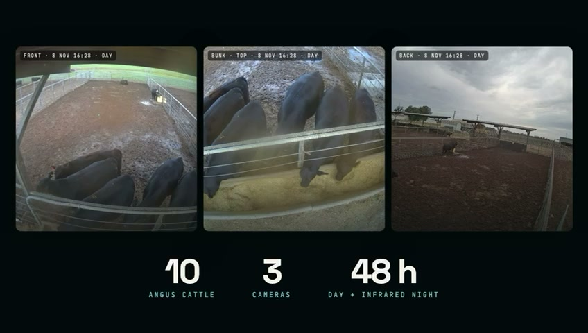
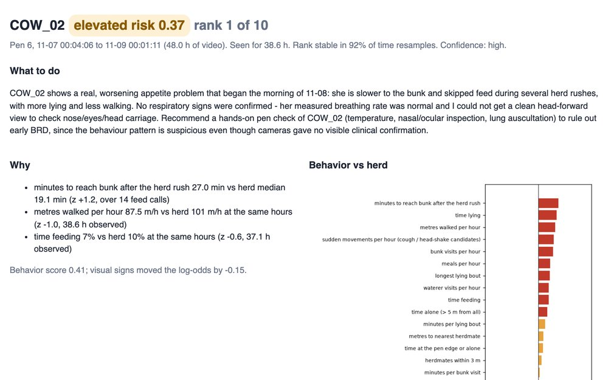
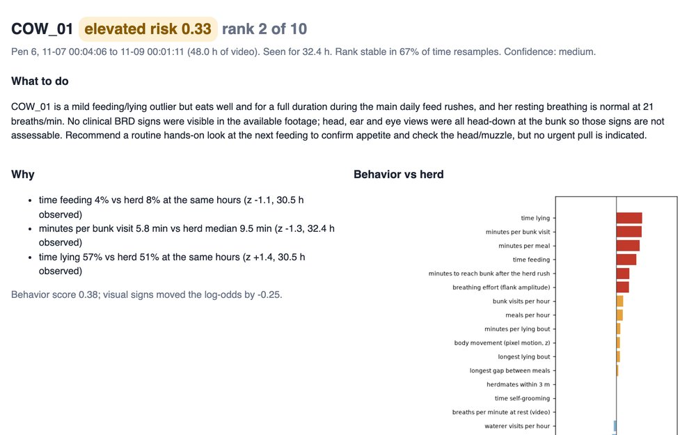
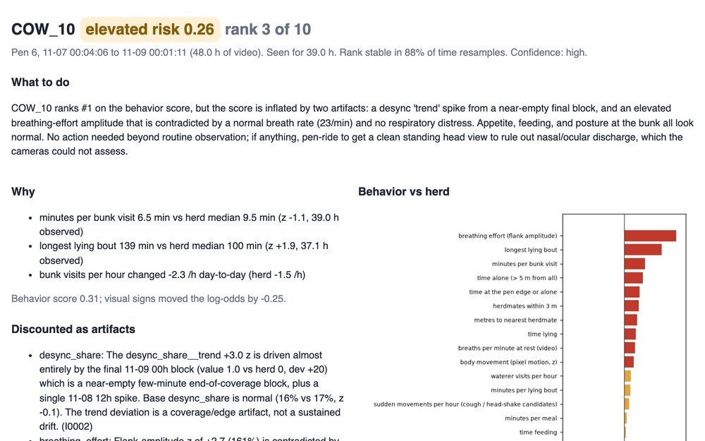
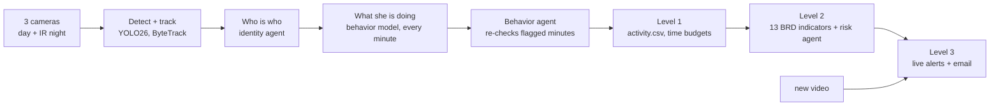

# Agentic Vision for Angus Behavior and BRD Risk

**Team 404 · Naufal, Afeef, Nooh**<br>
Merck–TAMU AISFS Hackathon 2026 · Pen 6 · 10 Angus cattle · 3 cameras · 48 h

We turn 48 hours of raw video from three cameras into:

1. **Level 1 · what every cow did, every minute**, with one ID per cow across cameras and days.
2. **Level 2 · a BRD risk ranking** that a veterinarian can check, with reasons and video evidence.
3. **Level 3 · a live early-warning loop** that alerts a pen rider with a video clip.

Computer vision measures. Tool-using agents check that record. Code checks the agents. Every number says whether it was observed, verified, estimated or not visible.

[](https://youtu.be/a2jZN3BnDJE)

**[▶ Submission video](https://youtu.be/a2jZN3BnDJE)** (5 min 39 s) &nbsp;·&nbsp; **[📄 Technical brief](docs/TECHNICAL_BRIEF.pdf)** (2 pages) &nbsp;·&nbsp; **[🖼 All results, with pictures](submission/SHOWCASE.md)**

**Contents:** [Results](#results) · [Where to look](#where-to-look) · [Deliverables](#deliverables-checklist) · [How it works](#how-it-works) · [Limits](#what-the-results-can-and-cannot-support) · [Future work](#future-work) · [Run it](#1-quick-start) · [Models](#6-models-versions-and-external-resources) · [AI tools](#7-ai-tools-and-how-we-used-claude) · [Repository map](#8-repository-map)

---

## Results

**COW_02, COW_01 and COW_10 are early suspects, not sick cows.** Compared with the herd at the same hours, they are slower to reach the bunk after feeding, eat less and lie down more. The risk agent confirmed no visible clinical sign. Next step: take their temperatures and examine them.

> **Who are they?** `COW_xx` are names our system gave the cows. **[Meet the three cows](submission/level2/EVIDENCE.md#meet-the-three-cows)** has their pictures, what sets each apart (COW_10 has a brownish back; COW_02 has pink and green ear tags; COW_01 is the glossiest black, with a yellow tag) and how to find them in the pen.

| Rank | Cow | Risk | In the top 3 in | Confidence | Why, compared with the herd at the same hours |
|:-:|---|--:|--:|:-:|---|
| 1 | **COW_02** | 0.37 | 92 % of resamples | high | 27 vs 19 min to reach the bunk after feed rushes · walks 87.5 vs 101 m/h · feeds 7 vs 10 % of the time |
| 2 | **COW_01** | 0.33 | 67 % | medium | feeds 4 vs 8 % of the time · bunk visits 5.8 vs 9.5 min · lies 57 vs 51 % of the time |
| 3 | **COW_10** | 0.26 | 88 % | high | bunk visits 6.5 vs 9.5 min · longest lying bout 139 vs 100 min |
| 4–10 | the rest | 0.10–0.19 | ≤ 24 % | low | herd-typical |

- **Risk is an index for ranking cows, not a probability.** A herd-typical cow scores about 0.10.
- ***In the top 3 in*** is the share of 200 resamples (in 30-min blocks) in which a cow stays in the top 3. It shows how stable her rank is.

**Each flagged cow has a one-page risk card** with what to do, the reasons, her behavior against the herd, clips, the sign checks and the sources. Click a card to open it in full:

<p>
<a href="submission/level2/cards/COW_02_card.jpg"></a>
<a href="submission/level2/cards/COW_01_card.jpg"></a>
<a href="submission/level2/cards/COW_10_card.jpg"></a>
</p>

**Level 1 and Level 3 in one line each:**
- **Level 1:** 28,800 cow-minutes labelled (10 cows × 48 h), each with its basis, in 4,858 behavior bouts. No camera saw the cow in 30.4 % of those minutes. These are reported as not visible, never guessed.
- **Level 3:**
  - **Clip from 7 Nov, 16:00:** the sign check raised 4 flags, and every one was rejected by a measurement or a second look. No false alarm went out.
  - **Day 2 replay:** COW_10 drew a behavior alert. She lay down 76 % of the time, against 22 % for the herd.

---

## Where to look

Steps 1–4 open right here on GitHub, with no download. GitHub shows `.html` files as source code, so those pages come in step 5.

| | Open | What you get |
|:-:|---|---|
| 1 | **[Submission video](https://youtu.be/a2jZN3BnDJE)** | The whole system in 5 min 39 s |
| 2 | **[Technical brief](docs/TECHNICAL_BRIEF.pdf)** | Methods and results on 2 pages |
| 3 | **[SHOWCASE.md](submission/SHOWCASE.md)** | Every result of Levels 1–3 on one page, with pictures (also as a [PDF](submission/SHOWCASE.pdf)) |
| 4 | **[EVIDENCE.md](submission/level2/EVIDENCE.md)** | The BRD ranking explained cow by cow: every video clip with its day, time and camera (click a picture to play it). **[IMAGE_EVIDENCE.md](submission/level2/IMAGE_EVIDENCE.md)** shows the 86 still images behind each verdict. |
| 5 | **`submission/index.html`** | The interactive pages. Download the repository (**Code → Download ZIP**) and open the file in a browser, or run `python serve_showcase.py` and open http://localhost:8000 |
| 6 | **[Level 3 on your own clip](#3-level-3-on-a-clip-you-choose-the-judges-clip)** | `python live_watch.py --clip <any camera file>` |

> **Event data:** the footage, frames and results stay within the event, so keep this repository private. The only video clips in the repository are the submission video and the Level 2 decision clips (`submission/level2/cards/clips/`). The commands below regenerate the rest.

---

## Deliverables checklist

Every deliverable the brief asks for, and where it is. The results are in [`submission/`](submission/README.md).

### Level 1 · behavior and identity

| Required | File |
|---|---|
| `activity.csv`: one row per behavior bout, every cow, both days | [`submission/stitched/final/activity.csv`](submission/stitched/final/activity.csv) |
| The same, per minute, with confidence, basis and the agent's rationale | [`submission/stitched/final/activity_minute.csv`](submission/stitched/final/activity_minute.csv) |
| Per-cow time budgets | [`submission/stitched/final/time_budgets.csv`](submission/stitched/final/time_budgets.csv) |
| ID-check frames every 30 min on each camera: 97 sheets, each a JPG plus a CSV. In each chunk's folder, `legend.csv` maps its IDs to `COW_01`–`COW_10` | [`submission/stitched/id_checks/`](submission/stitched/id_checks/) |
| Agent reasoning trace, **success**: stage 1 said drinking (0.69); the agent verified walking (0.96) | [`success_COW_02_d1_m0862.md`](submission/stitched/final/traces/success_COW_02_d1_m0862.md) |
| Agent reasoning trace, **failure**: a weak "standing" that the agent could not settle, kept as unverified | [`failure_COW_01_d1_m0813.md`](submission/stitched/final/traces/failure_COW_01_d1_m0813.md) |
| Agent reasoning trace, **night**: infrared footage; the agent rejected "ruminating" and set the minute to not visible | [`night_COW_05_d1_m1085.md`](submission/stitched/final/traces/night_COW_05_d1_m1085.md) |
| Which cow each trace is after stitching | [`traces/README.md`](submission/stitched/final/traces/README.md) |

### Level 2 · BRD risk

| Required | File |
|---|---|
| `brd_risk.csv`: cow ID, risk 0–1, rank, top reasons | [`submission/level2/brd_risk.csv`](submission/level2/brd_risk.csv) |
| A one-page risk card for each top-3 cow, with 2–3 clips | [COW_02 card](submission/level2/cards/COW_02_card.jpg) · [COW_01 card](submission/level2/cards/COW_01_card.jpg) · [COW_10 card](submission/level2/cards/COW_10_card.jpg) (full-page images; with playable clips: `cards/COW_*.html`, after download) |
| The decision clips, cow by cow, with day, time and camera | [`EVIDENCE.md`](submission/level2/EVIDENCE.md) (the clips are in [`cards/clips/`](submission/level2/cards/clips/)) |
| The images behind each decision: all 86 the agent looked at, each linked to the sign verdict it supports | [`IMAGE_EVIDENCE.md`](submission/level2/IMAGE_EVIDENCE.md) (one row per image: [`image_index.csv`](submission/level2/evidence/image_index.csv)) |
| Visualization tool | [Ranking page](submission/showcase/l2_ranking.png) (ranking, stability, cards) · [48 h viewer](submission/showcase/l1_ethogram_48h.png) (ethogram, plus [the joins between chunks](submission/showcase/l1_joins.png) and [time budgets](submission/showcase/l1_time_budgets.png)). These are screenshots; the interactive pages are `level2/index.html` and `stitched/viewer.html`, after download |
| The risk agent's reasoning and every piece of evidence it cited | [`agent/traces/`](submission/level2/agent/traces/) · [`evidence/`](submission/level2/evidence/) |

### Level 3 · live early warning

| Shown | File |
|---|---|
| Live alerts on one 5-min clip, end to end | [Evidence report](submission/showcase/l3_report_top.png) · [every crop checked](submission/showcase/l3_crops.png) · [every cow in the window](submission/showcase/l3_cows.png) (screenshots; interactive: `level3/clip_1600/report.html`, after download) |
| Three Day 2 hours replayed as if live | [COW_10's alert card](submission/showcase/l3_alert_cow10.png) · [live dashboard](submission/showcase/l3_dashboard.png) (screenshots; interactive: `level3/day2_replay/report.html`, after download) |
| Alert cards, dashboard and simulated emails: what each folder holds | [`level3/README.md`](submission/level3/README.md) |

### Code and disclosure

| Required | Where |
|---|---|
| Code that reproduces everything from raw video | Sections [1–5](#1-quick-start) below |
| Models, versions, and outside data and models | [Section 6](#6-models-versions-and-external-resources) |
| AI tools used | [Section 7](#7-ai-tools-and-how-we-used-claude) |
| Submission video | [YouTube](https://youtu.be/a2jZN3BnDJE) · a copy in the repository: [`docs/media/team404_submission_video.mp4`](docs/media/team404_submission_video.mp4) (54 MB; use *View raw* or *Download* to play) |

---

## How it works



**Measurement first, judgement second.**
- **Code measures** positions, zones, speed and who is near whom.
- **The agents** are vision-language models that plan, call tools and look at frames. They decide only what the measurements cannot settle.
- **Code checks every claim** before it counts.
- **Scale:** the 48 h were processed in 33 chunks on our laptops and on TAMU HPRC, then stitched into one ID per cow.

Method notes: [pipeline](docs/PIPELINE.md) · [Level 2](docs/LEVEL2_METHOD.md) · [Level 3](docs/LEVEL3_LIVE.md) · [column definitions](docs/DATA_CONTRACT.md)

## What the results can and cannot support

- **Observed vs estimated:** every minute in `activity.csv` says how it is known. About 30 % of cow-minutes are not visible to any camera, mostly because cows block each other in the resting area and in the far corners at night. Those minutes are reported as not visible, never guessed.
- **Identity across chunks is the weakest link.** A wrong join blurs the differences between cows more than it invents new ones. Uncertain joins are listed in `id_map.csv`.
- **The risk score is a ranked suspicion index, not a diagnosis.** It is compared with the herd and is not a calibrated probability. Ten cows over 48 h, with no clinical outcomes, cannot validate a BRD model.
- **Visible signs need close daylight views.** At night the alerts rely on behavior and say so. A camera cannot take a temperature, so a pen rider confirms.

## Future work

- **The pen manager names the cows, and the system tracks them by those names.** Today the system calls the cows `COW_01` to `COW_10`, names it chose itself, because the pen came with no list of tags. A pen rider then has to work out which animal `COW_02` is. ([EVIDENCE.md](submission/level2/EVIDENCE.md#meet-the-three-cows) does this by hand for the top three, from pictures and habits.) Next, the system will show the manager one picture per cow from its enrolment sheet. The manager types the name or ear-tag number they already use ("tag 214", "Daisy"), once. From then on, every chart, risk card and live alert uses that name, and the identity agent keeps it on the same animal across cameras and days. If the agent is unsure about a cow, it asks the manager again rather than guess. An alert would then read *"Tag 214 is slow to the bunk"* and could go straight to the pen.
- **Read ear tags on camera** when a close daylight view allows it, to confirm the names the manager gave.
- **Validate against clinical outcomes** (temperatures, pulls, treatments) across more pens and more weeks, so the risk index can be calibrated into a real probability.

---

# Running it

Sections 1–5 run the system. For the judges' clip, set up with section 1, then go to [section 3](#3-level-3-on-a-clip-you-choose-the-judges-clip).

## 1. Quick start

You need:
- the footage, laid out the way the organizers shared it (`Day 1/Cam 01/Event*.Avi`, …);
- a TAMU AI Chat API key for the agents.

### Option A: Docker (recommended)

```bash
git clone <this repository> pen6 && cd pen6
git lfs install && git lfs pull                 # model weights (models/*.pt, ~170 MB)
cp .env.example .env                            # then put your key in it: TAMU_API_KEY=...
docker build -t pen6 .                          # CPU image, ~4 GB
```

On Linux with an NVIDIA GPU (much faster tracking) and the NVIDIA Container Toolkit:

```bash
docker build -t pen6 --build-arg BASE=pytorch/pytorch:2.5.1-cuda12.4-cudnn9-runtime .
# then add --gpus all to every docker run below
```

Every command in sections 2–5 runs inside the container. Mount the footage read-only at `/videos`, and keep the results on your machine:

```bash
docker run --rm -it --env-file .env \
  -v "/path/to/footage:/videos:ro" -v "$PWD/outputs:/app/outputs" \
  pen6 <command>
```

### Option B: Python on your machine

You need Python 3.10–3.12, Git LFS and `ffmpeg` with HEVC decoding (macOS: `brew install ffmpeg`; Ubuntu: `apt install ffmpeg`).

```bash
git clone <this repository> pen6 && cd pen6
git lfs install && git lfs pull
python3.12 -m venv .venv && source .venv/bin/activate
pip install -r requirements.txt -r brd_agent/requirements.txt      # exact tested versions: requirements-lock.txt
cp .env.example .env                                                 # TAMU_API_KEY=...
```

The models run on the first of these that is available: an NVIDIA GPU (CUDA), the Apple GPU (MPS), then the CPU. To force the CPU, set `PEN6_DEVICE=cpu`.

### See every result in your browser

The Docker image's default command serves the results showcase on this computer only:

```bash
docker run --rm -p 127.0.0.1:8000:8000 -v "$PWD/outputs:/app/outputs" pen6
```

Without Docker, run `python serve_showcase.py`; it needs only Python, no packages. Then open:
- **http://localhost:8000/**: the showcase for Levels 1–3. It links to every page:
  - the 48 h viewer;
  - the BRD ranking and the risk cards;
  - the Level 3 evidence reports, alert cards and emails;
  - the technical brief.
- **http://localhost:8000/live/**: your own Level 3 run, after `live_watch.py --clip …` (section 3).

It serves only `submission/`, `docs/`, this README and `outputs/live/`. It never serves the code folders or `.env`.

---

## 2. Check before you run

This takes 1 minute and processes nothing:

```bash
python run_pipeline.py --videos "/videos/Day 2" --name check --dry-run
```

It prints the camera each clip was assigned to, then the plan, then checks the first clip's resolution.
- **How cameras are recognised:** from the `Cam 0N` folder, or else from the 3 digits after the timestamp in the file name: `006` = cam1 (front), `017` = cam2 (bunk, top view), `003` = cam3 (back).
- **A clip that cannot be placed stops the run.** It is never guessed.

---

## 3. Level 3 on a clip you choose (the judges' clip)

Pass **one camera's file** of a 5-minute window. The same window from the other two cameras is found next to it (`Cam 01/02/03`).

```bash
python live_watch.py --clip "/videos/Day 2/Cam 01/Event20261108142130006.Avi"
```

For that window, it:
1. tracks the cows and maps them to the 48 h IDs;
2. compares each cow with the herd in the same window;
3. uses a vision-language model to check close crops for drooping ears, a low head and nasal discharge. Every flag gets a second look and a measurement check;
4. updates each cow's risk, starting from the 48 h Level 2 result, and sends alerts with a 12 s clip.

| Output (in `outputs/live/`) | What it is |
|---|---|
| `index.html` | Live dashboard: tier and risk per cow, trend, alert feed |
| `alerts/<cow>_<time>.html`, with its clip, frame and crops | The alert a pen rider gets: what to do, the evidence, why |
| `outbox/*.eml` | Simulated alert emails and the daily BRD report (never sent) |
| `report.html`, `risk_history.csv`, `state.json`, `windows.jsonl`, `live.log` | Every decision with its evidence |

To view them, start the showcase (see "See every result in your browser" in section 1) and open **http://localhost:8000/live/**.

**Ranch mode** watches the folder the cameras write to, and processes each new window as soon as it is complete:

```bash
python live_watch.py --watch /videos --poll 30
```

Useful flags:
- `--verify`: also runs the stage 2 behavior agent on the window.
- `--no-signs`: skips the VLM sign check.
- `--reset`: starts again from the 48 h baseline.

Settings: `configs/live.yaml` · Method: [`docs/LEVEL3_LIVE.md`](docs/LEVEL3_LIVE.md)

---

## 4. Levels 1 and 2 on any footage

One command takes a folder of clips, of any length, to the Level 1 and Level 2 deliverables:

```bash
python run_pipeline.py --videos "/videos/Day 2" --name d2_afternoon \
    --start "2026-11-08 14:00" --end "2026-11-08 16:00"     # optional time window
```

| Step | What happens | Output (in `outputs/pipeline/<name>/`) |
|---|---|---|
| `prepare` | Sorts the clips into cameras (links, not copies) | `input/cam1..cam3/` |
| `track` | Fine-tuned YOLO26 detector and ByteTrack on each camera, 1 frame/s | `stage1/tracking/` |
| `level1` | Identity by cross-camera agreement, world state, identity agent, behavior model | `stage1/level1/` (+ `agent/id_checks/`, the 30-min ID sheets) |
| `assets` | Breathing, sudden movements, feed events, evidence clips | `stage1/level1/assets/` |
| `import` / `agent` / `export` | The stage 2 behavior agent re-checks flagged minutes on the video | `final/activity.csv`, `activity_minute.csv`, `time_budgets.csv`, `actions.csv`, `traces/` |
| `level2` | 13 BRD indicators compared with the herd, risk agent, risk cards | `level2/brd_risk.csv`, `index.html`, `cards/` |

- **Resuming:** a run picks up where it stopped. With the same `--name`, finished steps are skipped. `--from STEP` reruns that step and every step after it.
- **Logs:** each step's log is in `logs/`. `python why_failed.py` tells you which step stopped and why ([`docs/TROUBLESHOOTING.md`](docs/TROUBLESHOOTING.md)).
- **Viewer:** `python scripts/run_viewer.py --run outputs/pipeline/<name>` makes an interactive `viewer.html`.
- **The `basis` column:** every row of `activity.csv` says how it is known:
  - `verified`: an agent looked at the frames;
  - `observed`, `unverified` or `estimated`;
  - `not_visible`: no camera saw the cow.

**Running time:** 5 minutes of footage from all 3 cameras took about 12 min on a MacBook (Apple GPU). An NVIDIA GPU is several times faster. For the full 48 h, see section 5.

| Tracking | Identity + behavior | Assets | Behavior agent |
|:-:|:-:|:-:|:-:|
| 4 min | 5 min | 1 min | 2 min |

### Without an API key

Everything still runs on rules and the local models; only the agents are switched off:

```bash
python run_pipeline.py --videos /videos/... --name test --vlm mock --no-id-agent --level2-skip-agent
python live_watch.py --clip /videos/.../Event....Avi --no-signs     # live_watch drops the identity agent itself when no key is set
```

---

## 5. Reproducing the 48 h results in `submission/`

The 48 h of 4K footage from 3 cameras is split into chunks, which run in parallel and are then stitched together.

```bash
# 1. plan: split the footage into shares (all on one machine here)
python run_share.py --plan-only --layout all-laptops --videos /videos
# 2. run each share's chunks (resumable; repeat for each --who)
python run_share.py --who naufal_training --videos /videos --yes
python run_share.py --who afeef_training  --videos /videos --yes
python run_share.py --who nooh_training   --videos /videos --yes
# 3. join the chunks into one 48 h result and run Level 2 on it
python stitch_shares.py --videos /videos            # -> outputs/stitched/ (final/, level2/, id_map.csv)
python scripts/stitched_viewer.py                   # -> outputs/stitched/viewer.html
```

**How the stitch works:**
- Each chunk also tracks the 2 minutes before its own window.
- The stitcher joins cow IDs where neighbouring chunks saw the same boxes in the same frames.
- Uncertain joins are listed in `id_map.csv`. You can override them with `--id-map overrides.yaml`.

**Where it runs:**
- **On a cluster:** we ran Day 2 as a Slurm GPU array job on TAMU HPRC. See [`docs/HPRC_PIPELINE.md`](docs/HPRC_PIPELINE.md).
- **On laptops:** see [`docs/LAPTOP_SETUP.md`](docs/LAPTOP_SETUP.md).
- **Level 3 baseline:** Level 3 starts from `submission/level2` (the `baseline` setting in `configs/live.yaml`).

---

## 6. Models, versions and external resources

| What | Model / version | Where |
|---|---|---|
| Cow detector | YOLO26-m (Ultralytics 8.4.212), fine-tuned at 1280 px on 216 hand-labelled frames from this pen | `models/angus_det_hprc_m1280.pt` (Git LFS) |
| Tracker | ByteTrack (Ultralytics), per camera | |
| Cow appearance (identity tie-break, memory cards) | Meta DINOv2 ViT-S/14 via `torch.hub` (`facebookresearch/dinov2`) | Downloaded on first use; baked into the Docker image |
| Behavior classifier | DINOv2-S (`timm` `vit_small_patch14_dinov2.lvd142m`), last 4 blocks fine-tuned on our ~330 labelled clips + 9,269 CBVD-5 crops | `models/behavior/beh_finetuned.pt` (Git LFS); report in `models/behavior/ft_report.md` |
| Identity agent, stage 2 behavior agent | GPT-5.6 Luna (`protected.gpt-5.6-luna`) via the TAMU AI Chat API | `configs/agent.yaml`, `configs/pipeline.yaml` |
| Level 2 risk agent | Claude Opus 4.8 (`protected.Claude Opus 4.8`) via TAMU | `configs/risk.yaml` |
| Level 3 sign check | Gemini 3.5 Flash and Claude Opus 4.8 via TAMU | `configs/live.yaml` |
| Fallbacks | The same model on the OpenAI API (`OPENAI_API_KEY`), then local Qwen2.5-VL 7B through Ollama | `configs/agent.yaml` |

**External data and code:**
- CBVD-5 cattle behavior dataset (Kaggle, CC0)
- COCO-pretrained YOLO26 weights (Ultralytics)
- DINOv2 (Meta)
- OpenCV, ffmpeg, and Label Studio (run locally, for our labelling)
- BRD literature for the indicator weights (sources in `configs/risk.yaml` and on every risk card)

**Tested environment:**
- Python 3.12.15 with ffmpeg 9.0 on macOS (Apple GPU).
- Linux on TAMU HPRC (NVIDIA GPUs).
- The Docker image uses Debian's ffmpeg.
- Exact package versions: `requirements-lock.txt`.

---

## 7. AI tools and how we used Claude

**Inside the system** (every call is logged in the traces):

| Where | Model | What it does | What keeps it honest |
|---|---|---|---|
| Identity agent | GPT-5.6 Luna (TAMU) | Investigates duplicate IDs, ID jumps and camera conflicts; audits every 30 min | Code accepts a relabel only with ≥ 2 kinds of evidence, a top-2 appearance match and no duplicate ID |
| Stage 2 behavior agent | GPT-5.6 Luna (TAMU) | Re-checks flagged cow-minutes on the video with tools | A rule verifier checks it; rumination needs measured chewing; it abstains rather than guess |
| Level 2 risk agent | **Claude Opus 4.8** (TAMU) | Audits each cow's indicators and looks for DART signs on 4K crops | Code, not the model, sets the score; a sign needs a cited image of that cow, at a minimum size |
| Level 3 sign check | Gemini 3.5 Flash and **Claude Opus 4.8** (TAMU) | Checks ears, head carriage and nasal discharge on close crops | Each flag gets a second look and a measurement check (tracker speed, posture) |
| Benchmarked, not used | Claude Sonnet 5, local Qwen2.5-VL 7B | Compared on the same 8 identity cases (speed, and whether the first answer passed the self-check) | |

**Building it:** we wrote the code with **Claude Code** (Anthropic's coding agent, running Claude Opus models) as a pair programmer. 61 of our 65 commits (merges not counted) are co-authored by Claude. It helped with:
- the pipeline, agents, stitching and viewers;
- debugging the 48 h runs;
- the technical brief's layout and wording;
- this README and the Dockerfile.

The team chose the methods, labelled the training data and ran the footage. We checked every number in the brief and in `submission/` against the outputs, and we remain responsible for every claim.

---

## 8. Repository map

```
run_pipeline.py        videos -> Level 1 + Level 2 (one command, resumable)
live_watch.py          Level 3 live early warning
run_share.py           48 h in chunks;  stitch_shares.py  joins them
main.py                stage 1 tracking (detector + ByteTrack)
scripts/               run_level1.py, run_level2.py, viewers, calibration, anchors, identity tools
src/                   detection, tracking, identity, world state, behavior, agents, risk, live
brd_agent/             stage 2 behavior agent (verifies flagged cow-minutes on the video)
pipeline/              camera sorting, step orchestration, deliverables
configs/               cameras, pen layout, models, agents, risk weights and sources, live alert rules
models/                fine-tuned detector and behavior model (Git LFS)
submission/            our 48 h results (Levels 1–3), traces, ID-check sheets, evidence images
docs/                  technical brief, method notes per level, setup and troubleshooting
tests/                 pytest -q
```
