# Pen 6 · Agentic Vision for Angus Behavior and BRD Prediction

**Merck–TAMU Animal Science Hackathon 2026.** A system that watches the pen around the clock, knows each cow, and
says which ones may be getting sick before a person can see it.

> **This page renders on GitHub.** The pictures are screenshots of our result pages. For the full interactive pages
> (hover, every piece of evidence): **Code → Download ZIP**, unzip, and open **`submission/index.html`** in a browser.
> Video clips are kept out of the repository; the commands in the [README](../README.md) regenerate them. These files
> contain event video frames: keep this repo private.

| 48 h | 10 | 28,800 | 3 | 33 | COW_02 |
|:-:|:-:|:-:|:-:|:-:|:-:|
| day + IR night, 3 cameras | Angus cows, one id each across cameras and days | cow-minutes labelled, each with its basis | tool-using agents with code self-checks | chunks on laptops + HPRC, stitched | top BRD suspect (0.37; a herd-typical cow is about 0.10) |

**Contents:** [How it works](#how-it-works) · [Level 1](#level-1--every-cow-every-minute) ·
[Level 2](#level-2--brd-risk-ranking) · [Level 3](#level-3--live-early-warning) · [Limits](#what-it-can-and-cannot-claim) ·
[Every file](#every-file)

---

## How it works

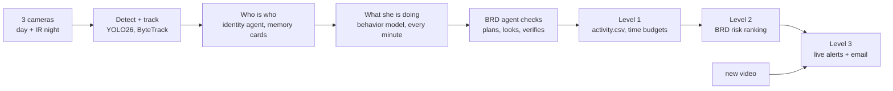

Measurement first, judgement second. Code measures positions, zones, speed and who is near whom. The agents (VLMs that
plan, call tools and look at frames) only decide what the measurements cannot settle, and code checks every claim
before it counts. Technical brief (2 pages): [`docs/TECHNICAL_BRIEF.pdf`](../docs/TECHNICAL_BRIEF.pdf).

---

## Level 1 · every cow, every minute

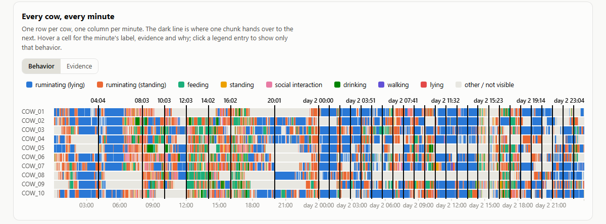

*The whole 48 h, one row per cow and one column per minute. Dark lines are where one processing chunk hands over to
the next.*

| Basis of the label (48 h, 10 cows) | minutes | share |
|---|--:|--:|
| observed: stage-1 label passed rule checks | 16,963 | 58.9 % |
| verified: the agent looked at the frames | 509 | 1.8 % |
| unverified: seen, agent could not confirm | 2,142 | 7.4 % |
| estimated: calm bout carried or gap filled | 441 | 1.5 % |
| not visible: no camera saw the cow | 8,745 | 30.4 % |

`activity.csv` holds 4,858 bouts, each with its basis. The behavior agent confirmed 1,815 minutes, corrected 335, and
abstained on 5,003 rather than guess. All 181,622 of its actions are logged with a reason.

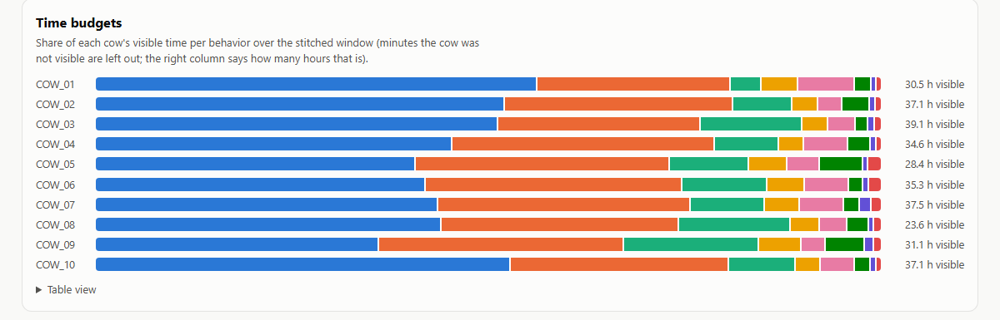

| Held-out check | result |
|---|---|
| Detector P / R, day | 0.84 / 0.88 (COCO YOLO26-x: 0.98 / 0.71) |
| Detector P / R, IR night | 0.93 / 0.88 (COCO: 0.95 / 0.73) |
| Behavior, 64 tasks by clip | accuracy 0.69, macro-F1 0.37 |

**Three saved agent traces** (they render on GitHub):
[success](stitched/final/traces/success_COW_02_d1_m0862.md) ·
[failure](stitched/final/traces/failure_COW_01_d1_m0813.md) ·
[night](stitched/final/traces/night_COW_05_d1_m1085.md) ·
[why these three](stitched/final/traces/README.md)

<b>How cow ids were joined across the 33 chunks</b> (click)

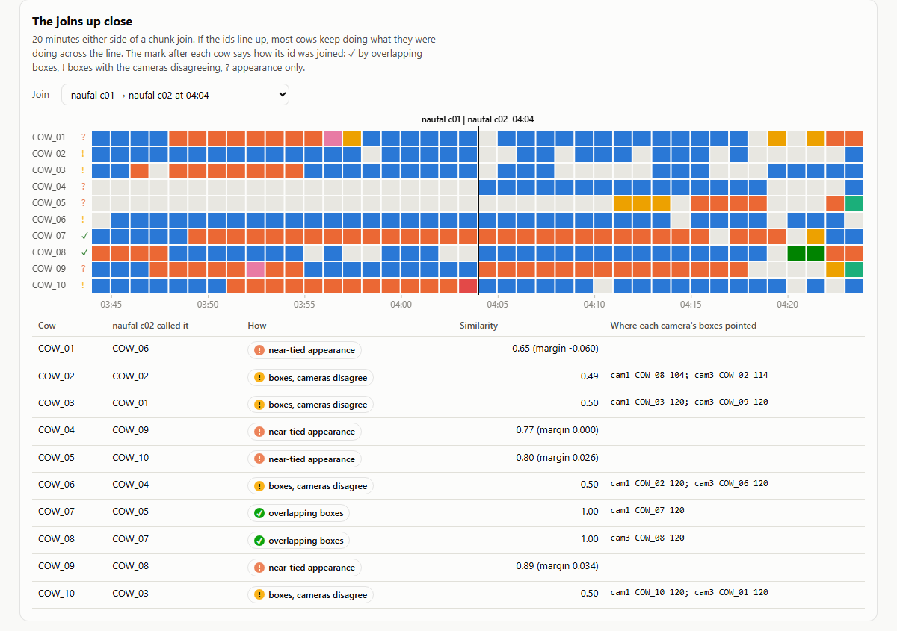

Each chunk numbers its cows itself. The stitcher matches them where both chunks saw the same boxes in the same
frames. Where the two chunks linked the cameras differently, the match is flagged `overlap_split`; near-tied
appearance matches are flagged too. Every join and its evidence: [`stitched/id_map.csv`](stitched/id_map.csv).

Files: [`stitched/final/activity.csv`](stitched/final/activity.csv) ·
[`activity_minute.csv`](stitched/final/activity_minute.csv) · [`time_budgets.csv`](stitched/final/time_budgets.csv) ·
`stitched/viewer.html` (full interactive view, open after download)

---

## Level 2 · BRD risk ranking

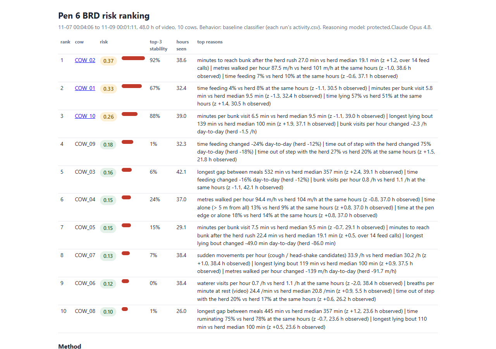

| # | Cow | risk | in the top 3 in | Why, against the herd at the same hours |
|:-:|---|--:|--:|---|
| 1 | **COW_02** | 0.37 | 92 % of resamples | 27 vs 19 min to reach the bunk after 14 feed rushes; walks less; feeds 7 vs 10 % |
| 2 | **COW_01** | 0.33 | 67 % | feeds 4 vs 8 %; bunk visits 5.8 vs 9.5 min; lies 57 vs 51 % |
| 3 | **COW_10** | 0.26 | 88 % | short bunk visits; 139 vs 100 min longest lying bout; visits falling faster than the herd's |
| 4–10 | the rest | 0.10–0.19 | ≤ 24 % | |

13 indicators from the BRD literature, each a robust z against **the same pen at the same hours**, so weather and
feeding times cancel out. The risk agent confirmed **no visible clinical sign**; the top three show the early
sickness-behavior pattern (appetite and activity down, lying up). They are **early suspects, not sick**: check
temperature and examine them before any treatment. risk is a ranking index, not a probability.

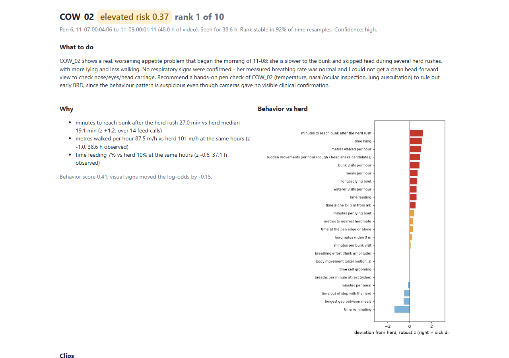

Files: [`level2/brd_risk.csv`](level2/brd_risk.csv) · [`indicators.csv`](level2/indicators.csv) ·
[`contributions.csv`](level2/contributions.csv) · risk cards with clips: `level2/cards/COW_02.html`, `COW_01.html`,
`COW_10.html` (open after download) · method: [`docs/LEVEL2_METHOD.md`](../docs/LEVEL2_METHOD.md)

---

## Level 3 · live early warning

`live_watch.py` turns the pipeline into a pen monitor: it watches new video, updates each cow's risk, and sends an alert
with video evidence that a pen rider can act on. `python live_watch.py --clip <any camera file>` runs a judge's clip.

**1. The morning list: alert tiers from the 48 h risk.**

| Tier | Rule | Cows | What the pen rider gets |
|---|---|---|---|
| Pull and examine | a confirmed visible sign | none | pull, take a temperature, treat by protocol |
| Check on the next pen ride | top 3, in the top 3 in ≥ 60 % of resamples, medium/high confidence | COW_02, COW_01, COW_10 | alert card + clips + email |
| Watch list | rank ≤ 5 or top 3 in ≥ 20 % | COW_09, COW_03, COW_04 | dashboard |
| Normal | everyone else | 4 cows | nothing |

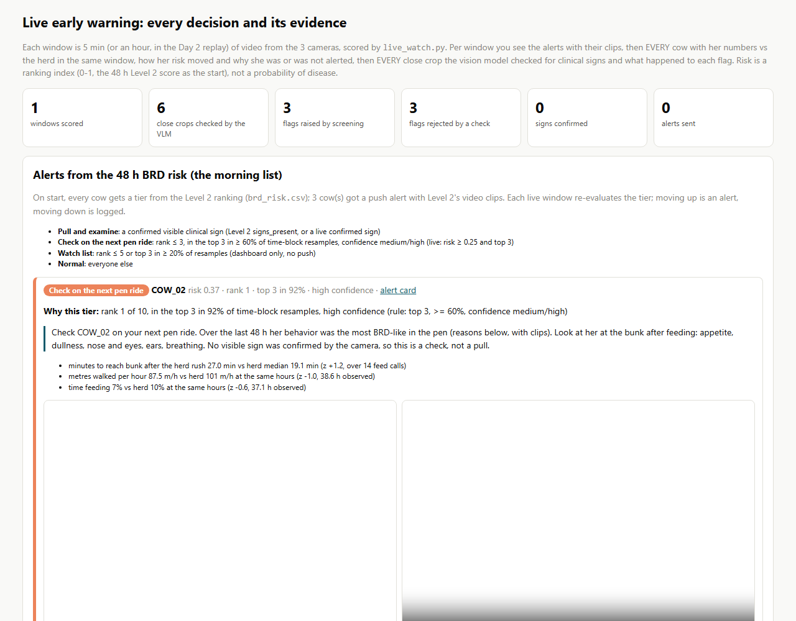

**2. Every new 5-min clip** is scored: cows mapped to the 48 h ids, behavior compared with the herd **in the same
window**, close crops checked for **drooping ears, head carried low and nasal discharge**. Every flag gets a second
check before it counts.

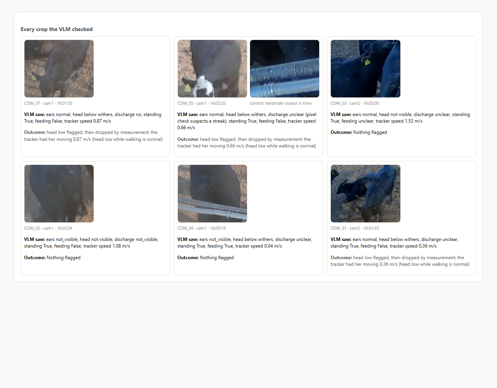

*On the 11-07 16:00 clip (3 cameras, 7 cows) the VLM raised 4 flags. The tracker rejected 3 "head low" flags because
the cows were walking (0.36–0.87 m/s), and a second look next to a herdmate rejected the "nasal discharge"
("the muzzle is blurry"). No false alarm went out.*

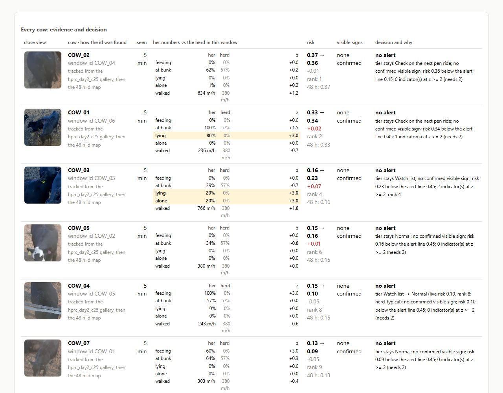

**3. Fresh video of the cows on the check list, every window.**

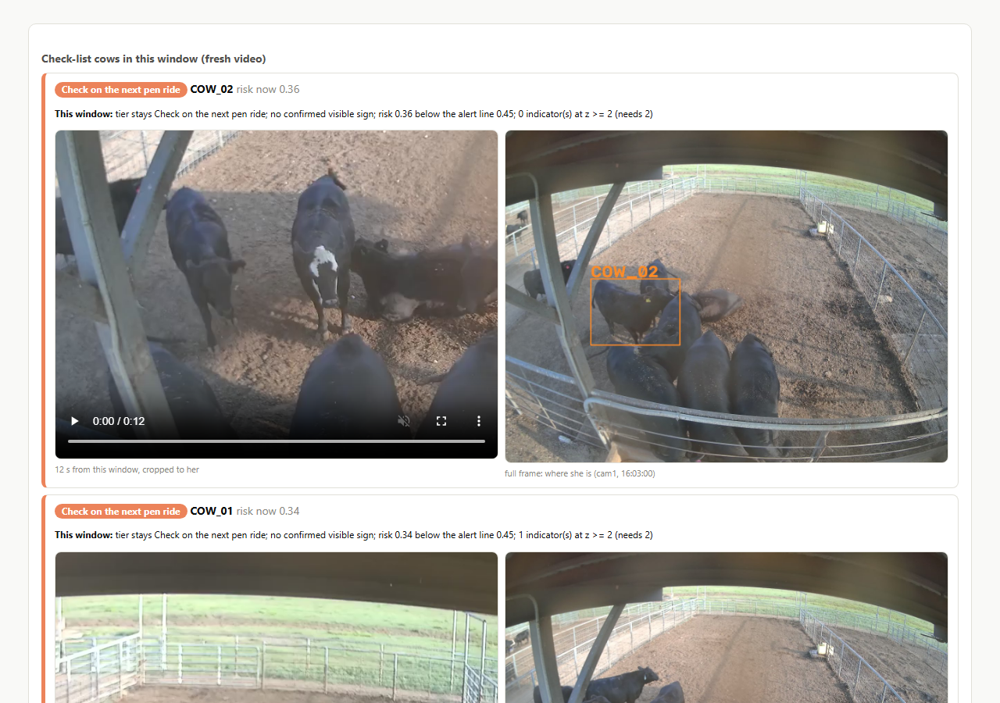

*Screenshot from the run; the clips themselves are regenerated by `live_watch.py` (video is kept out of the repository).*

**4. Alerts a pen rider can act on.** On the Day 2 replay, COW_10 drew a behavior alert: she lay 76 % of the hour
vs 22 % for the herd and was alone 80 % vs 36 %.

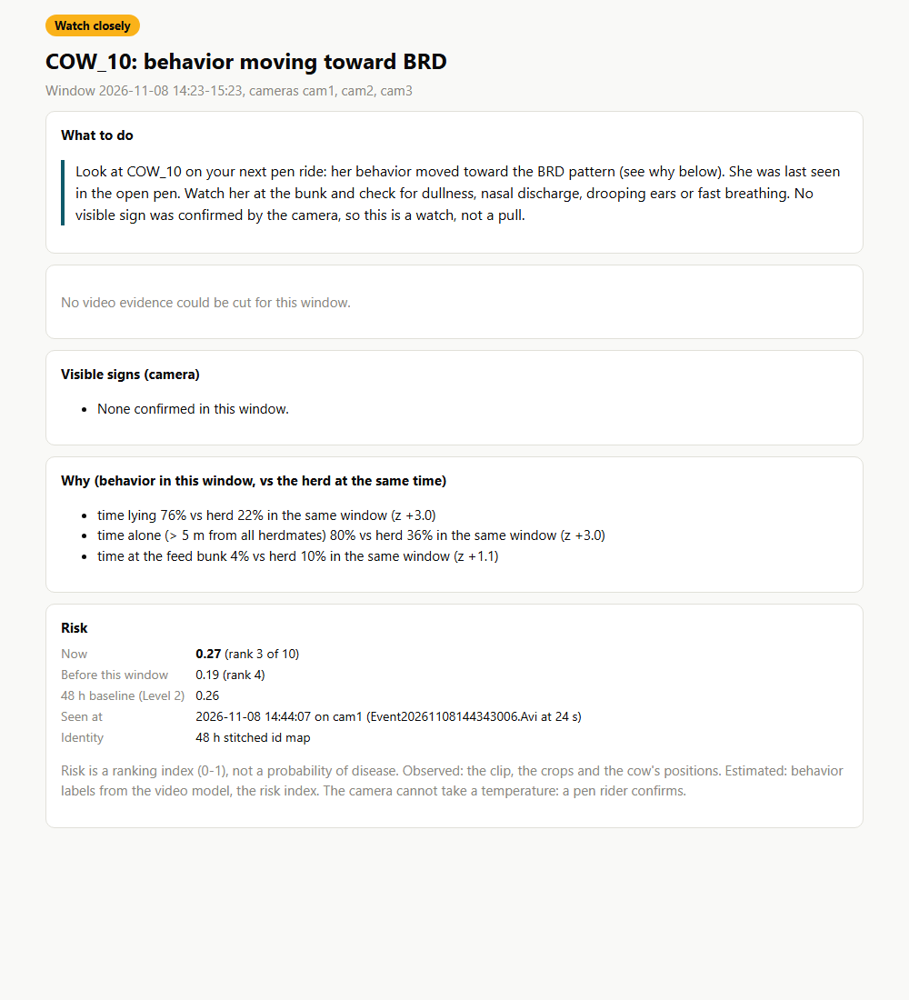
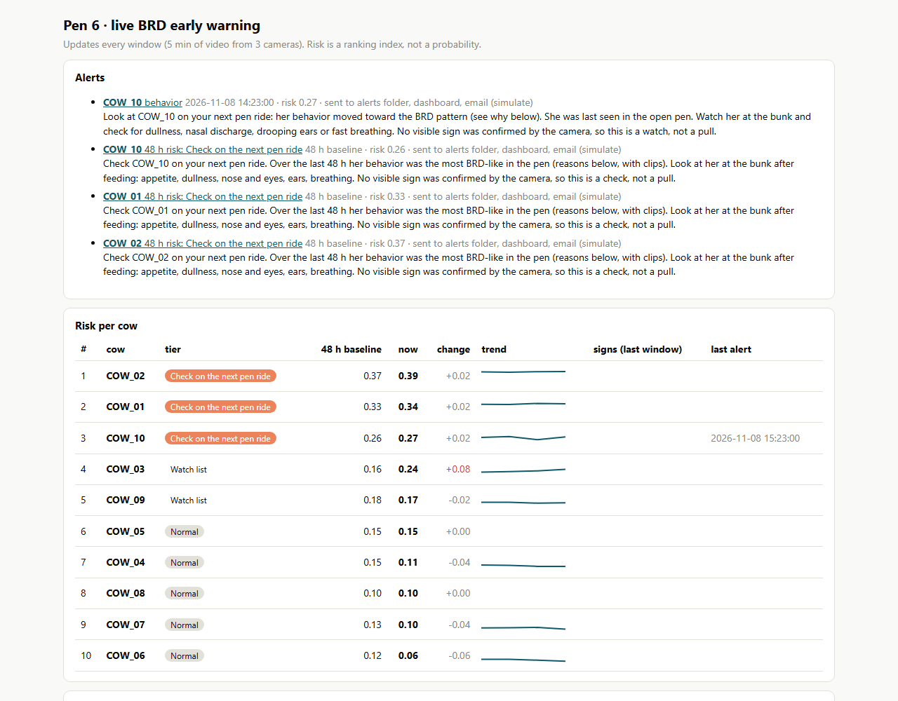

**5. Email (simulated).** Every alert and a daily BRD report are written as real email files with the evidence
attached, addressed to placeholder ranch addresses. Nothing is sent.

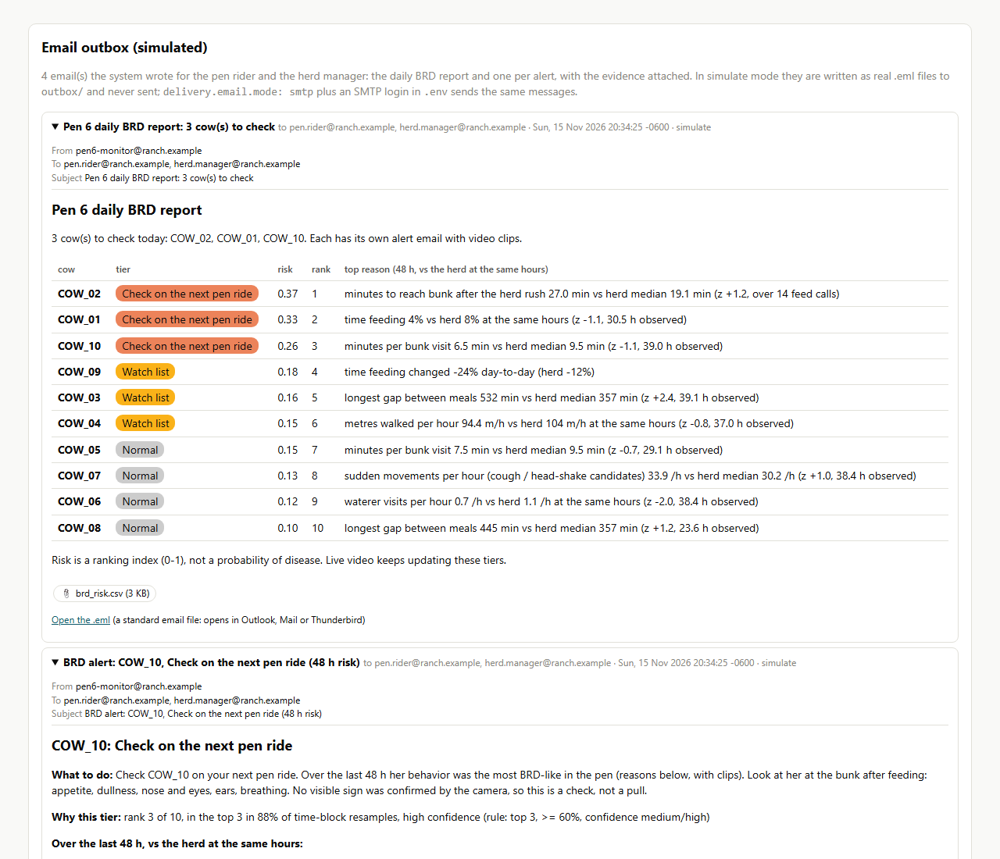

Files: [`level3/README.md`](level3/README.md) · design, speed and limits: [`docs/LEVEL3_LIVE.md`](../docs/LEVEL3_LIVE.md) ·
evidence reports `level3/clip_1600/report.html` and `level3/day2_replay/report.html` (open after download) ·
emails `level3/*/outbox/*.eml`

---

## What it can and cannot claim

* **Observed** means a detection we can point to (camera, second, box). **Estimated** is carried or filled, and
  labelled so. Risk uses observed time only.
* **30 % of cow-minutes are not visible**, mostly occlusion in the resting area and far corners at night.
* **Identity across chunks is the weakest link.** A wrong join blurs differences between cows more than it invents them.
* **Ten cows and 48 h cannot validate a BRD model.** With no diagnoses, the score is a ranked suspicion index, not a
  probability.
* **Visible signs need close daylight views.** At night the alerts rely on behavior and say so. The camera cannot take a
  temperature: a pen rider confirms.

---

## Every file

| What | File | On GitHub |
|---|---|---|
| Technical brief (2 pages) | [`docs/TECHNICAL_BRIEF.pdf`](../docs/TECHNICAL_BRIEF.pdf) | ✓ |
| Results overview | [`submission/README.md`](README.md) | ✓ |
| Level 1 bouts, minutes, time budgets | [`stitched/final/`](stitched/final/) | CSV ✓ |
| Level 1 agent traces | [`stitched/final/traces/`](stitched/final/traces/) | ✓ |
| Cow-id map across chunks | [`stitched/id_map.csv`](stitched/id_map.csv) | ✓ |
| 48 h interactive viewer | `stitched/viewer.html` | after download |
| Level 2 ranking | [`level2/brd_risk.csv`](level2/brd_risk.csv) | ✓ |
| Level 2 page and risk cards with clips | `level2/index.html`, `level2/cards/` | after download |
| Level 3 example runs | [`level3/`](level3/) | ✓ (folder) |
| Level 3 evidence reports, alerts, dashboard | `level3/*/report.html`, `alerts/`, `index.html` | after download |
| How to reproduce everything | [`README.md`](../README.md), [`docs/PIPELINE.md`](../docs/PIPELINE.md) | ✓ |
