# Level 2 · BRD risk: results and video evidence

The 48 h ranking (**7 Nov 00:04 to 9 Nov 00:01**, 3 cameras, 10 Angus cows) and the clips behind it. Day 1 is
**7 Nov**, Day 2 is **8 Nov**. Cameras: **cam1** front (looks down the pen), **cam2** over the feed bunk, **cam3** back
corner. Times are the cameras' clock.

> **Click a picture to open the clip** (GitHub plays .mp4 files in the browser). Each picture is a frame from the clip.
> The same clips play inside the risk cards: `cards/COW_02.html`, `COW_01.html`, `COW_10.html` (open them after
> downloading the repo, or with `python serve_showcase.py`).

## Meet the three cows

`COW_02`, `COW_01` and `COW_10` are **names our system gave the cows**, not the pen's ear-tag numbers. The pen came
with no list of tags, so the system enrolled each animal by how she looks and gave her a `COW_xx` name that stays the
same across all three cameras and both days. All ten are black Angus, so below is what sets each of the three apart
on camera, and how to find her in the pen. The tag numbers were never readable on camera, so **read the tag at the pen
to confirm** before you take a temperature. (To fix this, see [future work](../../README.md#future-work): the pen
manager names the cows once, and the system tracks them by those names.)

In the annotated videos (the [feed-rush clip](cards/clips/COW_02_3_feed_rush_8nov_1628.mp4) and the submission video)
each cow has her own box colour in every camera: **COW_02 red**, **COW_01 blue**, **COW_10 grey**.

### COW_02 · rank 1 · "the late one"

<a href="evidence/img/I0012.jpg">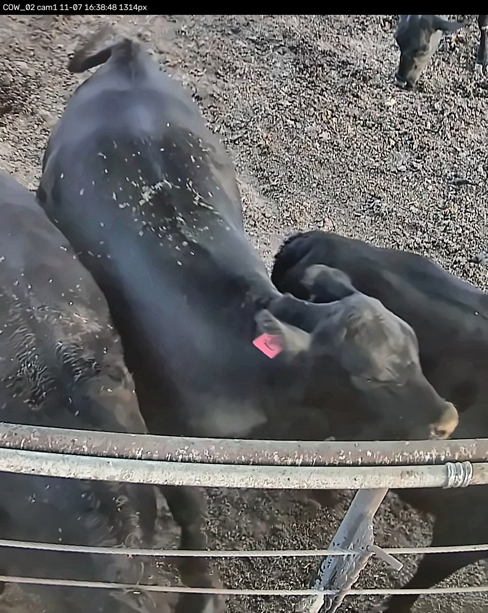</a> <a href="evidence/img/I0018.jpg">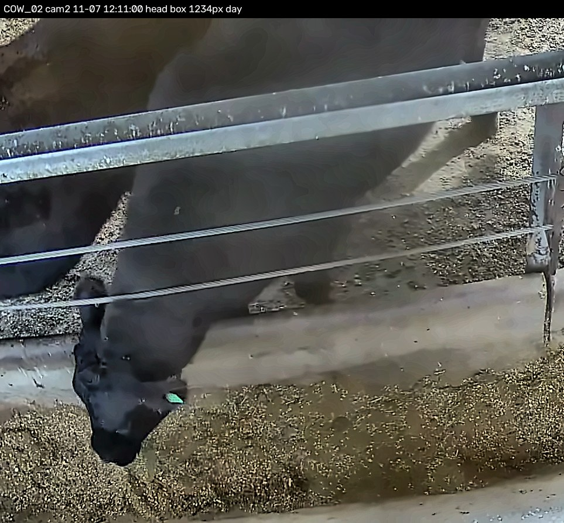</a> <a href="cards/clips/COW_02_2.jpg">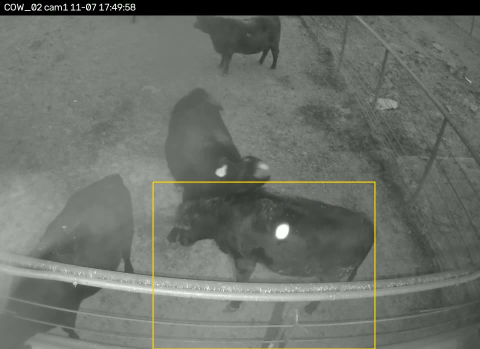</a>

Left: 7 Nov 16:38, front camera, pink tag. Middle: 7 Nov 12:11, bunk camera, green tag. Right: 7 Nov 17:49, front camera at dusk (infrared), her closest view (yellow box).

- **Looks:** all-black, medium build, no white markings. **Two ear tags seen on camera: a pink/red one and a green
  one.**
- **Habits:** she is **the last to come to the bunk** when feed arrives (27 min after the herd starts, against 19), and
  walks the least of the three. In the 8 Nov 16:28 feed rush she lies alone in the alley, 11.6 m from the nearest cow,
  while 6 of the 10 eat.
- **To find her:** at feeding time, look for the black cow with a pink and a green tag who stays lying down, or who
  arrives last.

### COW_01 · rank 2 · "the light eater"

<a href="cards/clips/COW_01_1.jpg">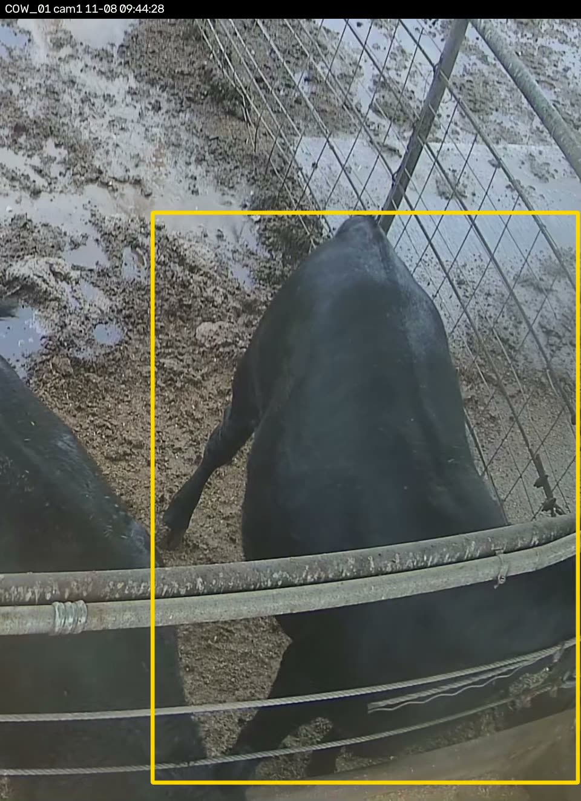</a> <a href="evidence/img/I0031.jpg">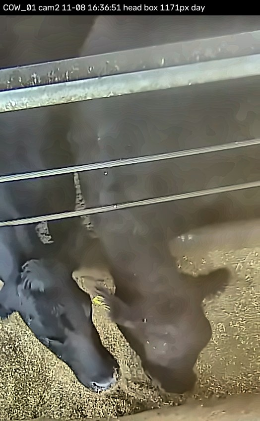</a> <a href="evidence/img/I0022.jpg">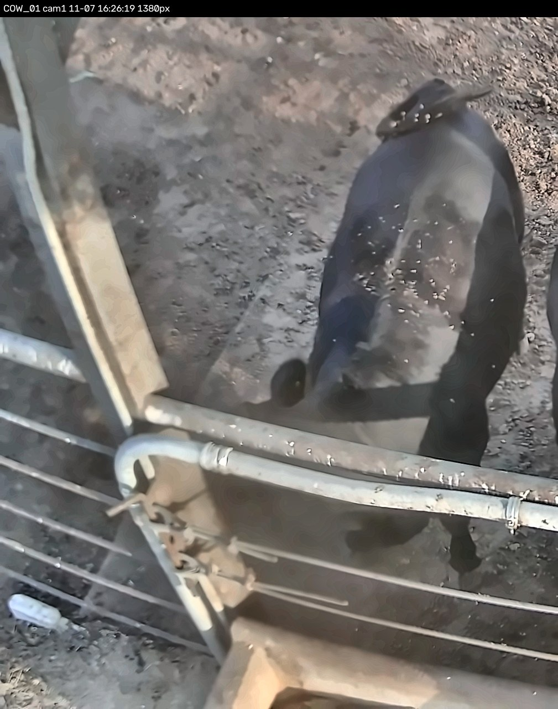</a>

Left: 8 Nov 09:44, front camera, at the bunk (yellow box). Middle: 8 Nov 16:36, bunk camera, the cow on the right, yellow tag. Right: 7 Nov 16:26, front camera, from behind.

- **Looks:** **solid, glossy jet-black coat with no brown tinge** (this is what tells her apart from COW_10), medium
  build, no white markings. **A yellow ear tag was seen** at the bunk.
- **Habits:** she stays with the herd (about 1.5 cows within 3 m, like the rest) and comes to the big feed rushes, but
  her bunk visits are short (5.8 min, against 9.5) and she **lies down more than the herd** (57 %, against 51 %).
- **To find her:** the deep-black cow with a yellow tag who leaves the bunk early and lies down soon after.

### COW_10 · rank 3 · "the brownish one"

<a href="cards/clips/COW_10_1.jpg">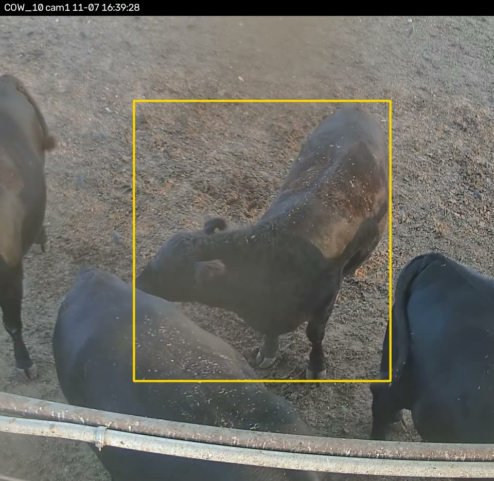</a> <a href="cards/clips/COW_10_2.jpg">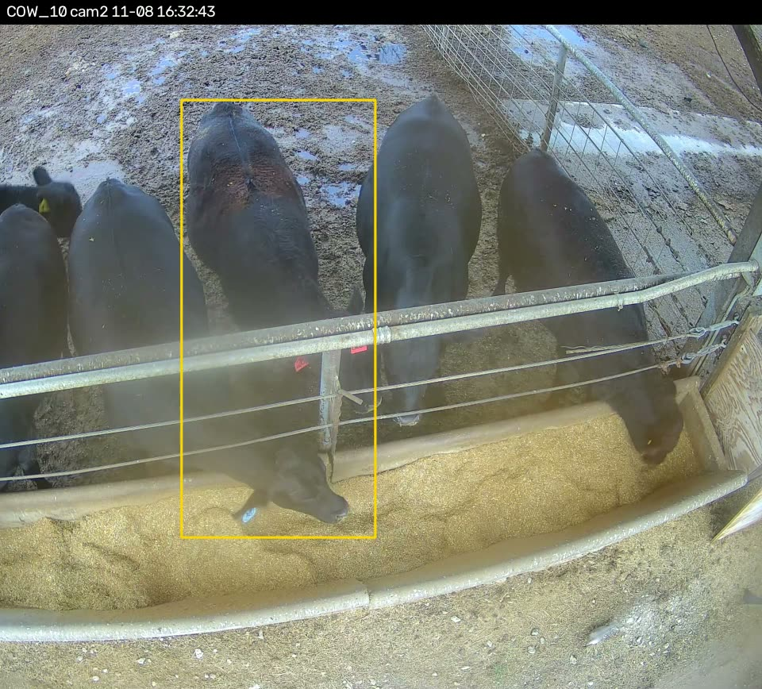</a> <a href="evidence/img/I0005.jpg">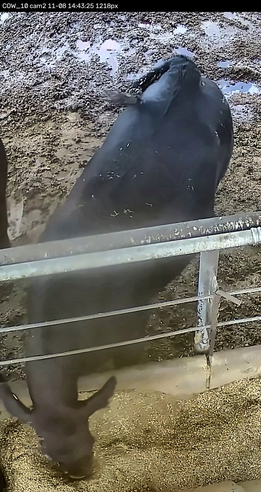</a>

Left: 7 Nov 16:39, front camera (yellow box). Middle: 8 Nov 16:32, bunk camera (yellow box), red and blue tags. Right: 8 Nov 14:43, bunk camera.

- **Looks:** **the easiest of the three to spot. Her coat has a rusty-brown, sun-faded tinge over the back and
  shoulders**, where the others are jet black. Medium build. **A red tag and a blue tag were seen** at the bunk.
- **Habits:** she **spends about three times as long near the waterer** as a typical cow (10 min per hour, against 3),
  has the longest lying bout in the pen (139 min, against 100), and makes short bunk visits (6.5 min, against 9.5).
- **To find her:** the brownish-backed cow, often near the water trough or lying down for a long stretch.

---

## The ranking

| Rank | Cow | risk | in the top 3 in | confidence | seen | Why, against the herd at the same hours |
|:-:|---|--:|--:|---|--:|---|
| 1 | **COW_02** | 0.37 | 92 % of resamples | high | 38.6 h | 27 vs 19 min to reach the bunk after 14 feed rushes; walks 87.5 vs 101 m/h; feeds 7 vs 10 % |
| 2 | **COW_01** | 0.33 | 67 % | medium | 32.4 h | feeds 4 vs 8 %; bunk visits 5.8 vs 9.5 min; lies 57 vs 51 % |
| 3 | **COW_10** | 0.26 | 88 % | high | 39.0 h | bunk visits 6.5 vs 9.5 min; longest lying bout 139 vs 100 min; bunk visits falling faster than the herd's |
| 4–10 | the rest | 0.10–0.19 | ≤ 24 % | low | | herd-typical |

**How to read it.** 13 indicators from the BRD literature (bunk time and visits, how slowly a cow joins the herd's feed
rush, distance walked, lying time and bouts, distance from herdmates, time alone, rumination, drinking, grooming,
breath rate, sudden movements), each a robust z-score against **the same pen at the same hours**, so weather and
feeding times cancel out. *risk* is a ranking index (a herd-typical cow is about 0.10), not a probability. *In the top
3 in* is the share of 200 resamples of 30-min blocks in which the cow stays in the top 3: how stable her rank is.

**Verdict.** No cow is far from the herd, and the risk agent confirmed **no visible clinical sign** (nasal or eye
discharge, drooping ears, head carried low, laboured breathing). The top three show the early sickness-behavior
pattern: **appetite and activity down, lying up**. They are **early suspects, not sick**. Take their temperature and
examine them before any treatment.

---

## COW_02 · rank 1 · risk 0.37 · high confidence

**Why:** she is the slowest to come to eat. After 14 feed calls she took **27.0 min** to reach the bunk, against a herd
median of 19.1 min (z +1.2). She walks less (87.5 vs 101 m/h, z −1.0) and feeds less (7 vs 10 % of the time, z −0.6).
The risk agent's reading: an appetite problem that **began on the morning of 8 Nov**, with skipped feed rushes, more
lying and less walking. Her measured breathing rate was normal, and no clean head-forward view was available to check
nose, eyes and head carriage. Recommended: a hands-on pen check (temperature, nose and eyes, lung auscultation).

| Proof | Day and time | Camera | What it shows |
|---|---|---|---|
| [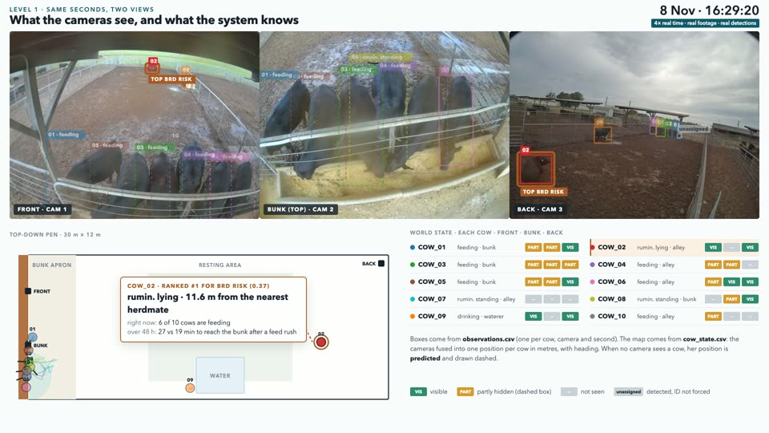](cards/clips/COW_02_3_feed_rush_8nov_1628.mp4) | **Day 2 · 8 Nov 16:28–16:30** (30 s at 4× speed) | all 3 + the pen map | **The afternoon feed rush.** 6 of 10 cows are feeding at the bunk while COW_02 lies alone in the alley, **11.6 m from the nearest herdmate**: the "slow to come to eat" sign as it happens. Boxes, IDs and behavior labels are the system's real detections. |
| [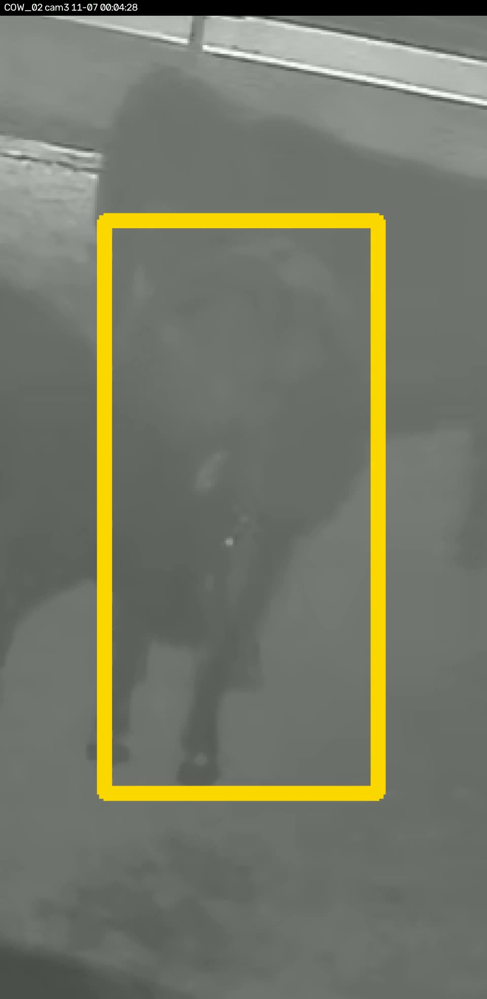](cards/clips/COW_02_1.mp4) | **Day 1 · 7 Nov 00:04:24–00:04:36** (12 s) | cam3 back | **Feed-call latency (out of step):** the clip the risk agent cited for her late arrival at the bunk. Night (infrared). |
|  | **Day 1 · 7 Nov 17:49:54–17:50:06** (12 s) | cam1 front | **Closest view** of her in the 48 h, used to look for visible signs (none confirmed). |

---

## COW_01 · rank 2 · risk 0.33 · medium confidence

**Why:** she feeds the least of the top three: **4 vs 8 %** of her time (z −1.1), with short bunk visits (**5.8 vs
9.5 min**, z −1.3) and more lying (**57 vs 51 %**, z +1.4). The risk agent's reading: a mild feeding and lying outlier,
but she eats well and for a full duration during the main daily feed rushes, and her resting breathing is normal (21
breaths/min). Head, ear and eye views were all head-down at the bunk, so those signs could not be assessed.
Recommended: a routine hands-on look at the next feeding; no urgent pull.

| Proof | Day and time | Camera | What it shows |
|---|---|---|---|
|  | **Day 2 · 8 Nov 09:44:24–09:44:36** (12 s) | cam1 front | **Feeding share (at the bunk):** the clip cited for her low feeding time. |
| [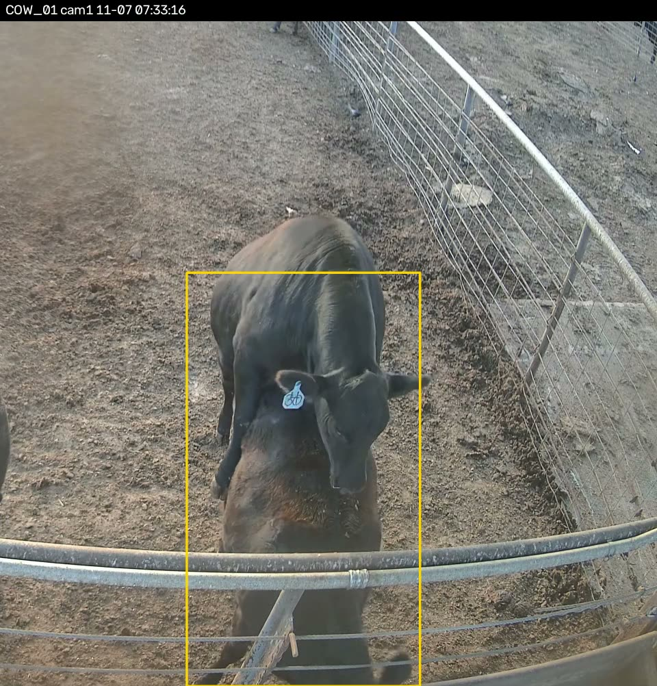](cards/clips/COW_01_2.mp4) | **Day 1 · 7 Nov 07:33:12–07:33:24** (12 s) | cam1 front | **Closest view** of her, used to look for visible signs (none confirmed). |

---

## COW_10 · rank 3 · risk 0.26 · high confidence

**Why:** short bunk visits (**6.5 vs 9.5 min**, z −1.1), the longest lying bout in the pen (**139 vs 100 min**, z +1.9),
and bunk visits falling faster from Day 1 to Day 2 than the herd's (−2.3 vs −1.5 per hour). **The risk agent's own
check discounted part of her score as artifacts:** a "time out of step with the herd" trend spike that comes from a
near-empty final time block, and a high breathing-effort reading contradicted by a normal breath rate (23/min) with no
respiratory distress. Her appetite, feeding and posture at the bunk look normal. Recommended: routine observation, and a
clean standing head view on the next pen ride to rule out nasal or eye discharge, which the cameras could not assess.

| Proof | Day and time | Camera | What it shows |
|---|---|---|---|
|  | **Day 1 · 7 Nov 16:39:24–16:39:36** (12 s) | cam1 front | **Bunk visit length (at the bunk):** the clip cited for her short visits. |
|  | **Day 2 · 8 Nov 16:32:39–16:32:51** (12 s) | cam2 bunk | **Closest view** of her, used to look for visible signs (none confirmed). |

---

## Where everything is

| File | What it is |
|---|---|
| [`brd_risk.csv`](brd_risk.csv) | cow, risk 0–1, rank, top reasons, confidence, signs (the table above) |
| [`indicators.csv`](indicators.csv), [`contributions.csv`](contributions.csv) | every indicator per cow, and how each moved the score (value, herd reference, z, weight) |
| [`cards/clips/`](cards/clips/) | the 7 clips above, with a frame from each |
| [`IMAGE_EVIDENCE.md`](IMAGE_EVIDENCE.md) | **every image the agent looked at (86), next to the sign verdict it supports**, with the agent's reasoning at each step |
| [`evidence/`](evidence/) | `facts.jsonl` (every fact the agent cited), `img/` (every frame crop it looked at) and `image_index.csv` (one row per image: cow, camera, time, what cites it) |
| [`agent/traces/`](agent/traces/) | the risk agent's tool calls, findings and self-check, per cow |
| [`risk_meta.json`](risk_meta.json) | time span, runs used, model, and the source camera and time of each clip |
| [`cards/COW_02_card.jpg`](cards/COW_02_card.jpg), [`COW_01_card.jpg`](cards/COW_01_card.jpg), [`COW_10_card.jpg`](cards/COW_10_card.jpg) | the one-page risk cards as full-page images (readable on GitHub) |
| `index.html`, `cards/COW_*.html` | the interactive ranking and risk cards, with playable clips (open after download) |

Method: [`docs/LEVEL2_METHOD.md`](../../docs/LEVEL2_METHOD.md). The clips' cameras and times come from
`risk_meta.json`; the feed-rush clip is from the same stitched run (8 Nov 16:28–16:30).
