# Level 2 · the images behind each decision

While reviewing the 10 cows, the risk agent (Claude Opus 4.8) looked at **86 images**. Each image has an ID (`I0001`–`I0086`), and every verdict cites the IDs it rests on. **46 of the 86 images are cited in a decision.** The agent looked at the other 40 without citing them; the steps under each cow show what it made of them. **Click a thumbnail to open the full image.**

Day 1 is **7 Nov**, Day 2 is **8 Nov**. Times are the cameras' clock. Cameras: **cam1** front, **cam2** over the feed bunk, **cam3** back corner. *box* is the cow's height in the 4000 × 3000 source frame.

**What an image can settle.** Code checks every verdict, in `src/risk/agent.py`, before it counts:
- **absent:** needs a crop of that cow at least 250 px tall. A head sign also needs the head facing the camera or side-on. Discharge needs a box of at least 450 px, in daylight.
- **not assessable:** the honest answer when no image clears that bar.
- **present:** would raise the risk. No image showed a sign in any cow.

The ranking, the clips and the reasons are in [`EVIDENCE.md`](EVIDENCE.md). This page holds the still images.

**Contents:** [COW_02](#cow_02--rank-1) · [COW_01](#cow_01--rank-2) · [COW_10](#cow_10--rank-3) · [COW_09](#cow_09--rank-4) · [COW_03](#cow_03--rank-5) · [COW_04](#cow_04--rank-6) · [COW_05](#cow_05--rank-7) · [COW_07](#cow_07--rank-8) · [COW_06](#cow_06--rank-9) · [COW_08](#cow_08--rank-10) · [Every image](evidence/image_index.csv)

## Summary

| Rank | Cow | Risk | Images looked at | Cited in a decision | absent | not assessable | present |
|:-:|---|--:|--:|--:|--:|--:|--:|
| 1 | [**COW_02**](#cow_02--rank-1) | 0.37 | 10 | 4 | 1 | 6 | 0 |
| 2 | [**COW_01**](#cow_01--rank-2) | 0.33 | 13 | 6 | 2 | 5 | 0 |
| 3 | [**COW_10**](#cow_10--rank-3) | 0.26 | 10 | 5 | 2 | 5 | 0 |
| 4 | [**COW_09**](#cow_09--rank-4) | 0.18 | 8 | 5 | 4 | 3 | 0 |
| 5 | [**COW_03**](#cow_03--rank-5) | 0.16 | 8 | 4 | 3 | 4 | 0 |
| 6 | [**COW_04**](#cow_04--rank-6) | 0.15 | 9 | 6 | 2 | 5 | 0 |
| 7 | [**COW_05**](#cow_05--rank-7) | 0.15 | 7 | 2 | 3 | 4 | 0 |
| 8 | [**COW_07**](#cow_07--rank-8) | 0.13 | 7 | 7 | 2 | 5 | 0 |
| 9 | [**COW_06**](#cow_06--rank-9) | 0.12 | 7 | 2 | 1 | 6 | 0 |
| 10 | [**COW_08**](#cow_08--rank-10) | 0.10 | 7 | 5 | 1 | 6 | 0 |
| | **all** | | **86** | **46** | 21 | 49 | 0 |

| Kind of image | Count | What it is |
|---|--:|---|
| gallery crop | 62 | the closest daylight crops of the cow saved over the 48 h (tool `gallery`) |
| head crop | 13 | a close, enhanced crop of the head at a moment the agent chose (tool `get_crop`) |
| trend chart | 5 | an indicator over the 48 h against the herd, with the sustained-change onset (tool `trend`) |
| breathing window | 3 | the still, close window her breath rate was measured on (tool `breathing`) |
| 8-frame sequence | 2 | frames over a few seconds around a sudden movement, for coughing posture (tool `get_sequence`) |
| herdmate comparison | 1 | the cow next to up to 3 herdmates at the same moment (tool `compare_herdmates`) |

---

## COW_02 · rank 1

Risk **0.37** · high confidence · 10 images looked at, 4 cited

> **The agent's summary.** COW_02 shows a real, worsening appetite problem that began the morning of 11-08: she is slower to the bunk and skipped feed during several herd rushes, with more lying and less walking. No respiratory signs were confirmed - her measured breathing rate was normal and I could not get a clean head-forward view to check nose/eyes/head carriage. Recommend a hands-on pen check of COW_02 (temperature, nasal/ocular inspection, lung auscultation) to rule out early BRD, since the behaviour pattern is suspicious even though cameras gave no visible clinical confirmation.

**Sign verdicts and the images they rest on**

| Sign | Verdict | Images | The agent's note |
|---|---|---|---|
| ears drooping | absent | <a href="evidence/img/I0018.jpg">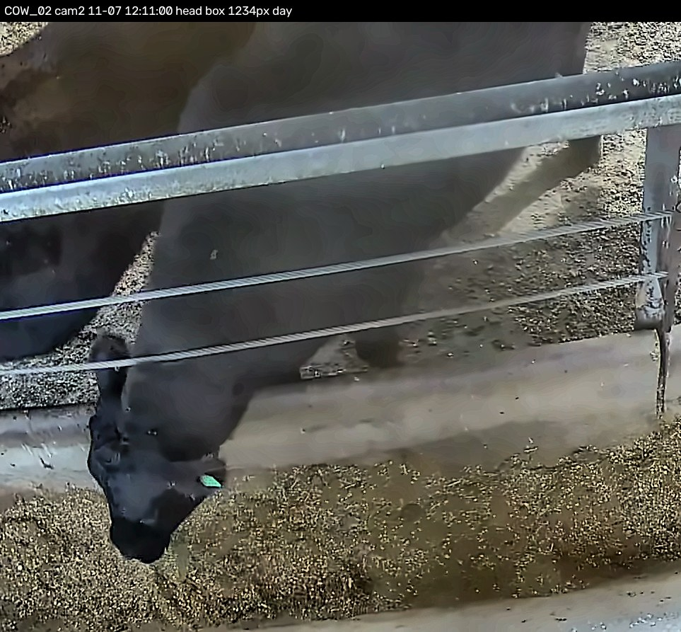</a> <b>I0018</b> cam2 · 7 Nov 12:11 · head, toward · box 1234 px also cites `V0003` | In the clear toward-facing head crop (I0018, 1234px, green tag confirms ID) ears carried upright/normal, no droop. |
| coughing posture | not assessable | <a href="evidence/img/I0020.jpg">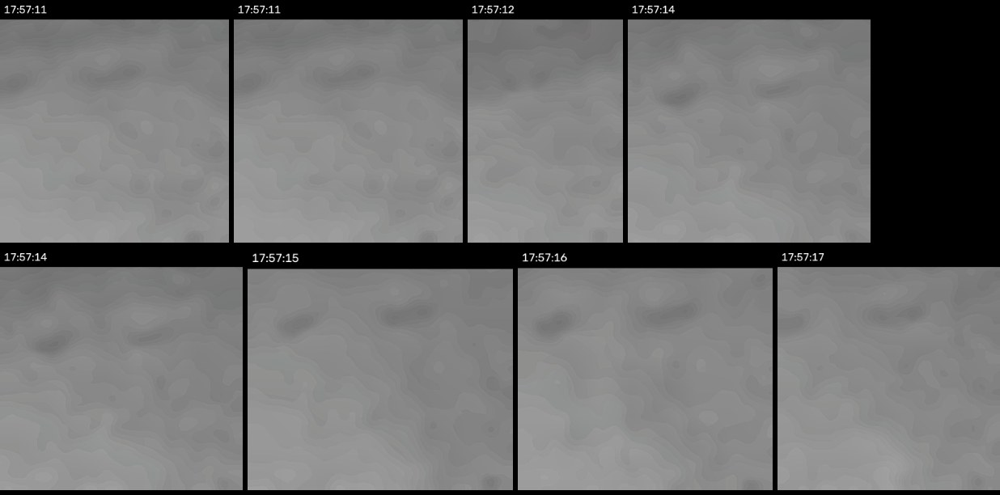</a> <b>I0020</b> cam3 · 8 Nov 17:57 · body · box 197 px · IR night also cites `F-COW_02-jerk_rate` | Jerk rate 33.6/h only marginally above herd 30.2; highest-z event sequence (cam3, 197px, IR-soft grey) too small/soft to confirm coughing posture. |
| hollow left flank / gaunt | not assessable | I0018 <a href="evidence/img/I0019.jpg">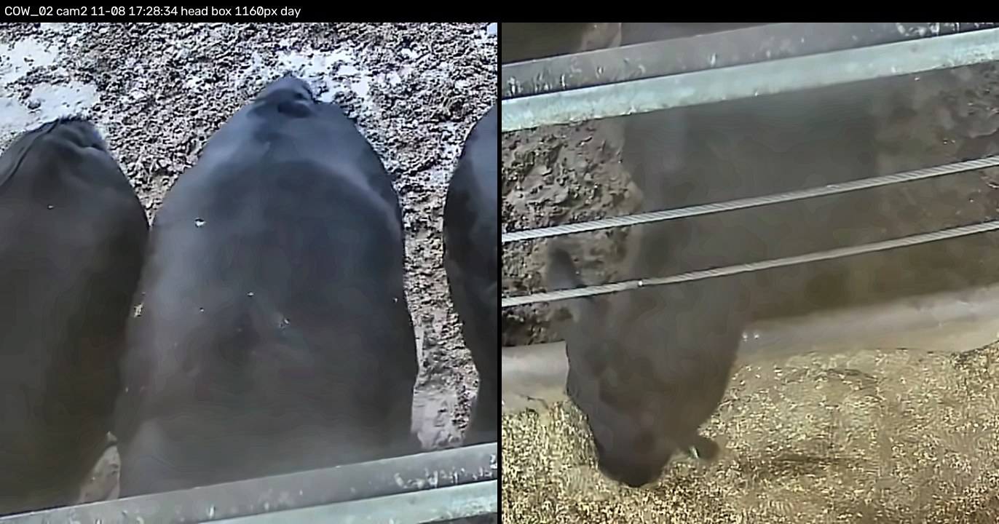</a> <b>I0019</b> cam2 · 8 Nov 17:28 · head · box 1160 px | No clear left-flank view; body crops are rump/top-down at bunk. |
| head carried low / depressed | not assessable | I0018 I0019 | All head crops show COW_02 head-down eating at the bunk; never observed standing-not-eating with a toward/side-on facing, so abnormal head carriage cannot be assessed. |
| laboured / open-mouth breathing, extended neck | not assessable | I0018 I0019 | Resting respiratory rate is normal (F-COW_02-breathing_bpm 20.8/min = herd median; F-COW_02-breathing_effort 107% normal), but I captured no still image clearly showing flank/neck/mouth posture, so visible labored breathing cannot be formally assessed from an image. |
| nasal discharge | not assessable | I0018 I0019 | Muzzle at head-down eating angle; no clean daylight &gt;=450px frontal nose view. |
| ocular discharge / tearing | not assessable | I0018 I0019 | Eyes not clearly resolved in available crops; no qualifying head-forward daylight view. |

**Behavior check: are the deviations real?** The appetite deviations are REAL, not artifacts. feed_call_latency (F-COW_02-feed_call_latency) shows a CUSUM-confirmed sustained worsening from 11-08 06h (I0011), and feed_response confirms repeated genuine off-feed episodes on day 2 - notably the 11-08 16:16 herd rush where the herd stayed ~21 min but COW_02 never approached. Reduced feeding_share (F-COW_02-feeding_share), lower bunk_visit_rate (F-COW_02-bunk_visit_rate) and elevated lying_share (F-COW_02-lying_share) are consistent with this appetite drop. Reduced locomotion (F-COW_02-distance_m_per_h) fits a lethargic animal. Rumination is actually above herd (protective). Jerk/isolation deviations are small and unconfirmed.

<a href="evidence/img/I0011.jpg">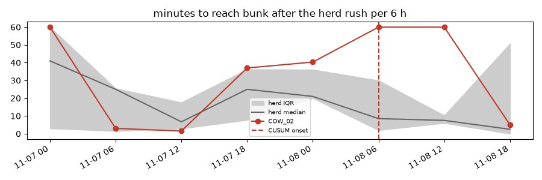</a> <b>I0011</b> trend chart: `feed_call_latency`

<b>Every step of the review, with the images each one returned (10 steps, 8 tool calls)</b>

| Step | Tool | The agent's reasoning before the call | Images returned |
|:-:|---|---|---|
| 1 | `trend` indicator=feed_call_latency, block_h=6 | Top deviations: feed_call_latency (+1.2), lying_share (+1.1), distance walked (+1.0), bunk_visit_rate (+0.9), jerk_rate (+0.9). Let me check the feed_call_latency trend first - is the slow approach to bunk sustained? | I0011 ✓ |
| 2 | `feed_response`  | Feed latency worsened from 11-08 06h onward - cow was not approaching bunk for 60 min on day 2. This aligns with reduced feeding. Let me check feed_response for appetite detail. |  |
| 3 | `gallery` n=6 | On day 2 (11-08) afternoon, COW_02 repeatedly failed to approach feed during the big 16:16 herd rush (herd stayed 21 min, cow 0 min). This is a real appetite drop on day 2, though it recovers somewhat at 22:55. Feed latency deviation is real, not an artifact. Now let me check the cow visually - need head crops for clinical signs. Let me look at the gallery first. | <a href="evidence/img/I0012.jpg">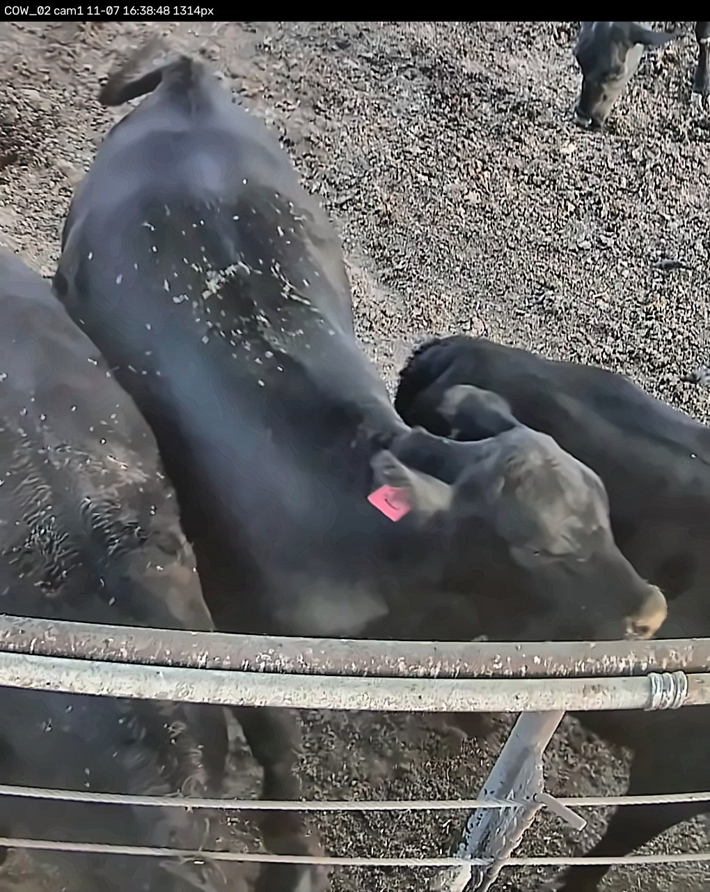</a>I0012 <a href="evidence/img/I0013.jpg">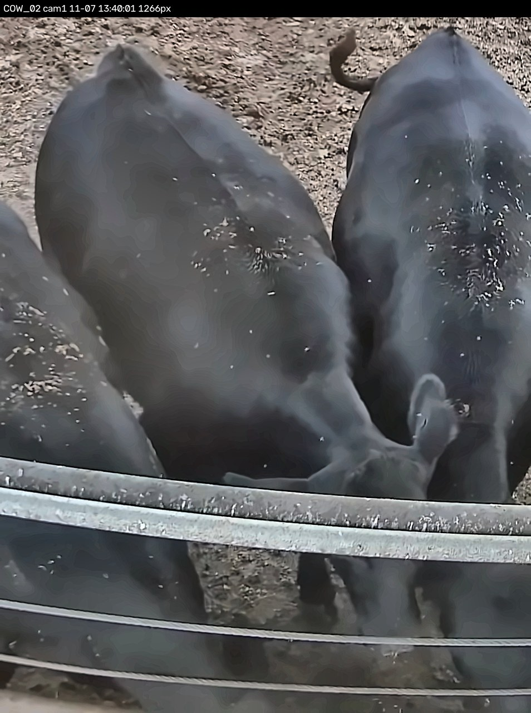</a>I0013 <a href="evidence/img/I0014.jpg">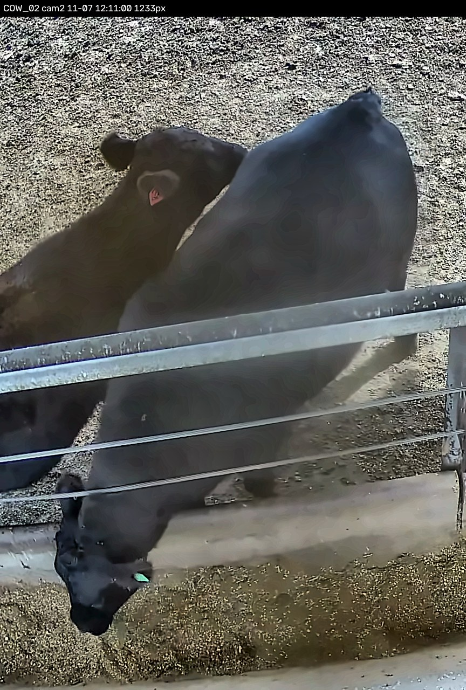</a>I0014 <a href="evidence/img/I0015.jpg">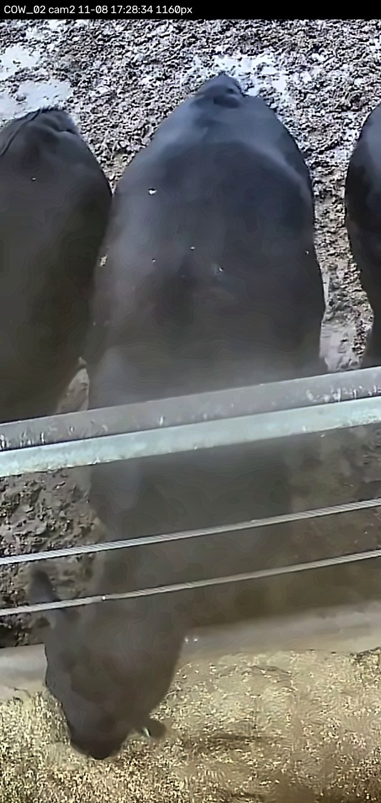</a>I0015 <a href="evidence/img/I0016.jpg">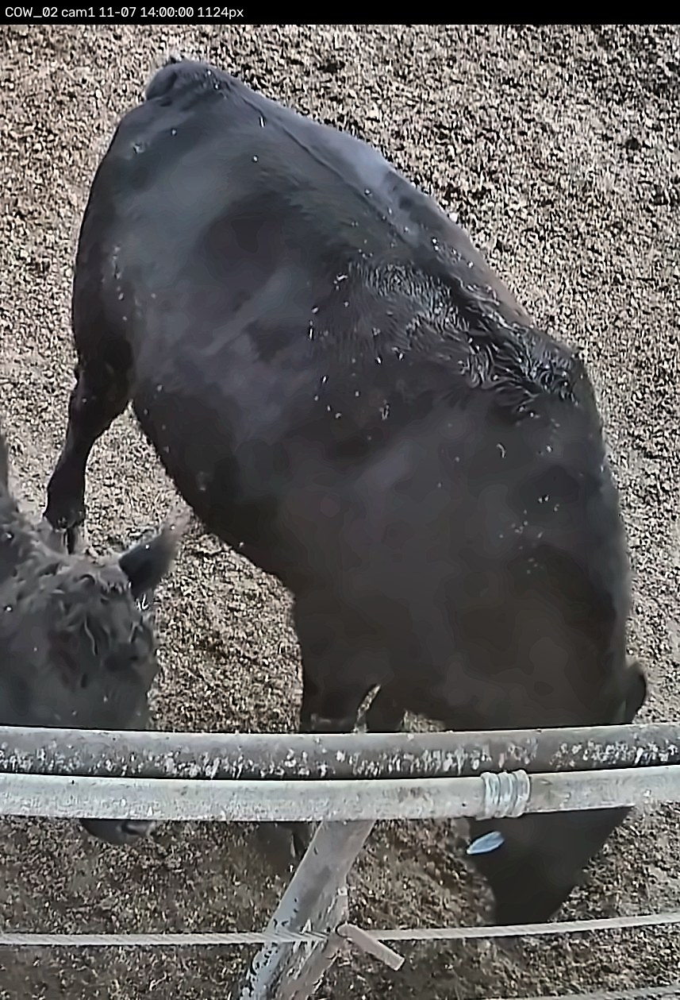</a>I0016 <a href="evidence/img/I0017.jpg">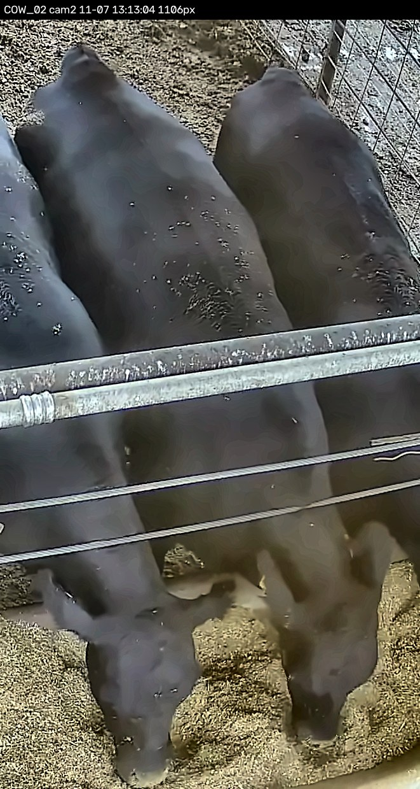</a>I0017 |
| 4 | `get_crop` time=11-07 12:11:00, camera=cam2, region=head, enhance=True | Gallery crops mostly show rumps/backs or heads down at the bunk (eating). I0014 (cam2, 1233px) shows a cow with head down, mouth open at bunk - likely eating. I0017 shows head at bunk. None are a clean head-forward crop. I need a proper head crop facing toward/side-on. Let me get a head crop from I0014 moment where a face is visible. | I0018 ✓ |
| 5 | `record_fact` sign=ears_droop, status=absent, confidence=0.6 | Head crop I0018: COW_02 facing toward/down at the bunk, green ear tag visible. Head is down because eating. Ears look upright/alert, no obvious droop. Nose/muzzle partly visible but at this angle (head-down, eating) I can't confidently assess nasal discharge. Eyes not clearly visible. Ears appear normal - no droop. Let me record what I can and try a better head crop from day 2 (I0015, 17:28 cam2) where cow may be standing. Actually let me check breathing briefly then look at day 2. First record ear observation. |  |
| 6 | `get_crop` time=11-08 17:28:34, camera=cam2, region=head, enhance=True | Now let me check a day-2 head crop (I0015, 11-08 17:28 cam2, 1160px) which may show the cow when off-feed, to assess head carriage, eyes, nose standing. | I0019 ✓ |
| 7 | `jerks`  | I0019 facing unknown - left panel shows backs/topline, right panel a head down at bunk. Facing unknown means it doesn't satisfy head-sign requirements for nose/eyes. Head carriage: the cow is at the bunk eating (right panel head down into feed). Not assessable for abnormal head_low since eating. Let me check the jerk_rate (cough candidates, +0.9 z) which could indicate BRD cough. I have 3 calls left. |  |
| 8 | `get_sequence` time=11-08 17:57:14, span_s=6, n=8, camera=cam3, region=body | Jerk rate (33.6 vs 30.2) is only marginally elevated, not strongly specific. Let me check one high-z event with a sequence to see if it's a cough. Pick 11-08 17:57:14 cam3, the highest. | I0020 ✓ |

✓ = cited in a decision.

---

## COW_01 · rank 2

Risk **0.33** · medium confidence · 13 images looked at, 6 cited

> **The agent's summary.** COW_01 is a mild feeding/lying outlier but eats well and for a full duration during the main daily feed rushes, and her resting breathing is normal at 21 breaths/min. No clinical BRD signs were visible in the available footage; head, ear and eye views were all head-down at the bunk so those signs are not assessable. Recommend a routine hands-on look at the next feeding to confirm appetite and check the head/muzzle, but no urgent pull is indicated.

**Sign verdicts and the images they rest on**

| Sign | Verdict | Images | The agent's note |
|---|---|---|---|
| laboured / open-mouth breathing, extended neck | absent | <a href="evidence/img/I0032.jpg">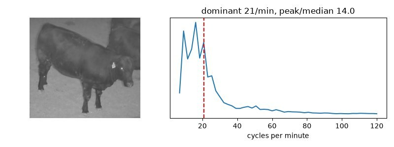</a> <b>I0032</b> cam3 · 7 Nov 04:36 · box 636 px · IR night · 20.8 breaths/min | Resting breathing 21/min across 3 valid windows, at herd median, no open-mouth or flank effort evident. |
| nasal discharge | absent | <a href="evidence/img/I0031.jpg">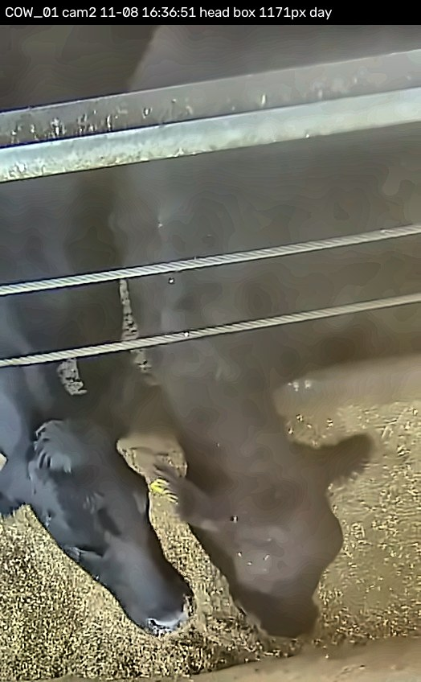</a> <b>I0031</b> cam2 · 8 Nov 16:36 · head, toward · box 1171 px <a href="evidence/img/I0033.jpg">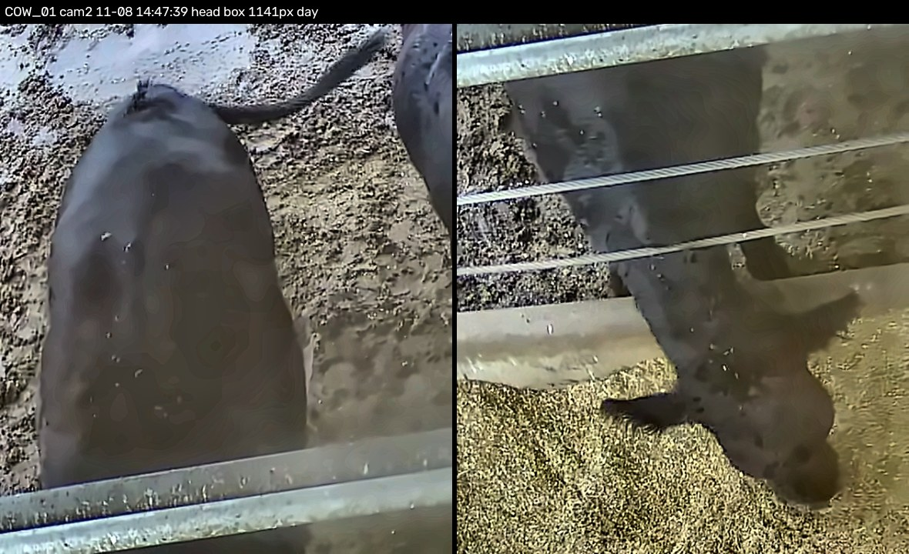</a> <b>I0033</b> cam2 · 8 Nov 14:47 · head · box 1141 px <a href="evidence/img/I0030.jpg">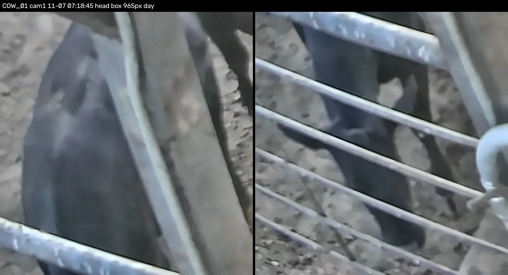</a> <b>I0030</b> cam1 · 7 Nov 07:18 · head, side-on · box 965 px also cites `V0004` | Muzzle reasonably resolved in daylight toward-facing crop I0031 (&gt;450px); no discharge seen. Low confidence, single frame. |
| coughing posture | not assessable | no image qualified also cites `F-COW_01-jerk_rate` | Jerk rate 29.5/h below herd median (30.2); no coughing posture confirmed on video. |
| ears drooping | not assessable | I0031 I0033 | Ears not cleanly resolvable in the available crops; no clean toward/side-on standing head view. |
| hollow left flank / gaunt | not assessable | <a href="evidence/img/I0024.jpg">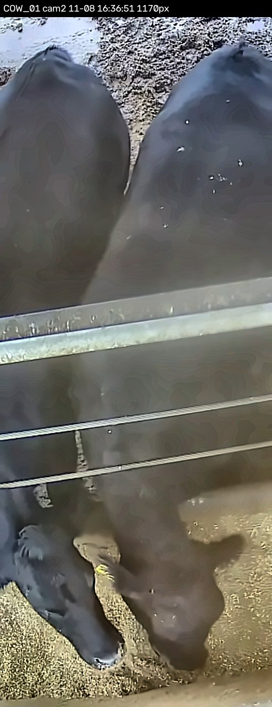</a> <b>I0024</b> cam2 · 8 Nov 16:36 · body · box 1170 px I0033 | Flank/body condition not assessed from a clear side-on standing view. |
| head carried low / depressed | not assessable | I0031 I0033 | Only head views are head-down eating at the bunk (normal feeding posture); no standing head-up daylight view obtained. |
| ocular discharge / tearing | not assessable | I0031 I0033 | Eyes not clearly visible in available crops. |

**Behavior check: are the deviations real?** The feeding deficit (F-COW_01-feeding_share, F-COW_01-meal_min, F-COW_01-bunk_visit_min) is real but mild and partly noisy: feed_response shows she responds normally and stays a full 16-27 min at the bunk on the major herd rushes (11-08 06:32, 09:39, 16:16), with slow/skipped visits mostly at minor troughs. The trend (I0021) shows a single-block spike on 11-07 12h, otherwise she tracks the herd band. Increased lying (F-COW_01-lying_share) is modest. The social 'drift' facts (cows_within_3m__trend, nn_distance_m__trend) are day-to-day change metrics on short coverage and are small; her absolute isolation/edge shares are actually BELOW herd (negative z). Breathing is normal (21/min). Overall a borderline behavioral outlier, not a convincing sick picture.

<a href="evidence/img/I0021.jpg">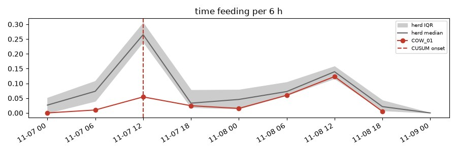</a> <b>I0021</b> trend chart: `feeding_share`

<b>Every step of the review, with the images each one returned (9 steps, 8 tool calls)</b>

| Step | Tool | The agent's reasoning before the call | Images returned |
|:-:|---|---|---|
| 1 | `trend` indicator=feeding_share, block_h=6 | Main deviations: reduced feeding (feeding_share, shorter meals/bunk visits), more lying, and a social trend (fewer cows within 3m, drifting). Breathing effort is slightly up but bpm normal. Let me check feeding trend first to see if it's sustained and when it started. | I0021 ✓ |
| 2 | `feed_response`  | The big feeding gap is in the 11-07 12h block (herd rushed to feed, cow lagged). Otherwise mostly tracks the herd band. The feeding deficit is driven by the midday feed rush. Let me check feed_response to see if the cow is slow to the bunk or short at it. |  |
| 3 | `gallery` n=8 | Feed response is actually quite normal on many rushes — on big rushes (11-08 09:39 stayed 27 min, 11-08 16:16 stayed 23 min, 11-08 06:32 stayed 16 min) she responds well, matching the herd. The feed deficit is largely from skipping some rushes but she eats well on major ones. Appetite is not severely impaired. Now let me look at the cow visually — gallery for daylight head crops to assess clinical signs. | <a href="evidence/img/I0022.jpg">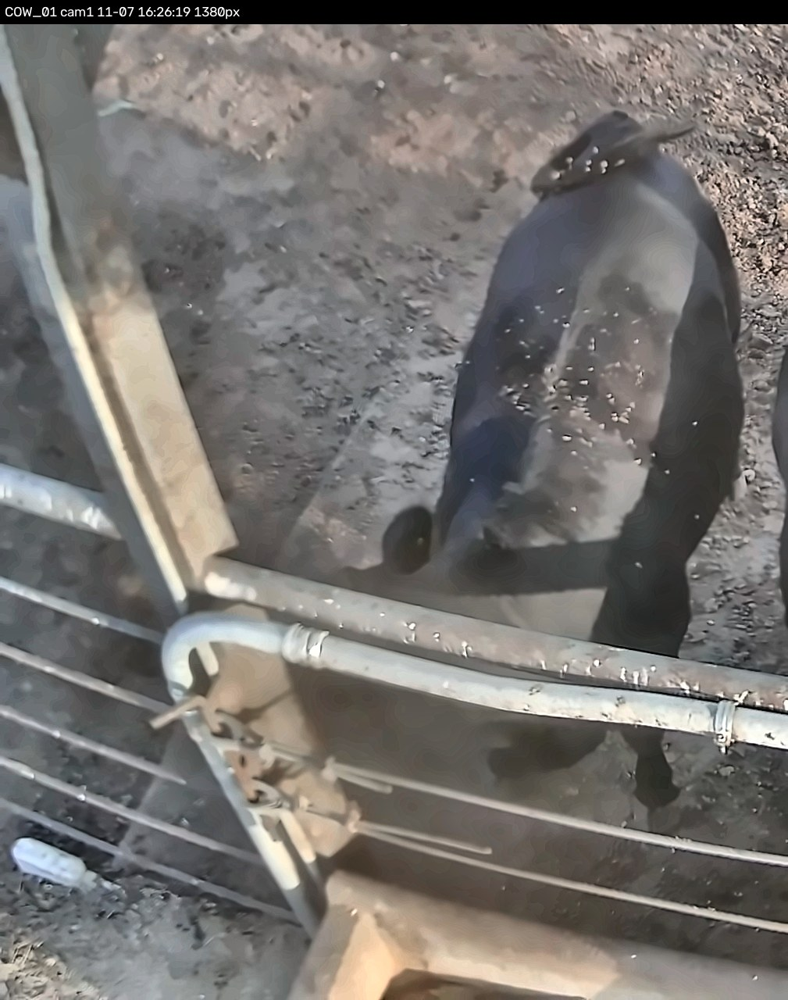</a>I0022 <a href="evidence/img/I0023.jpg">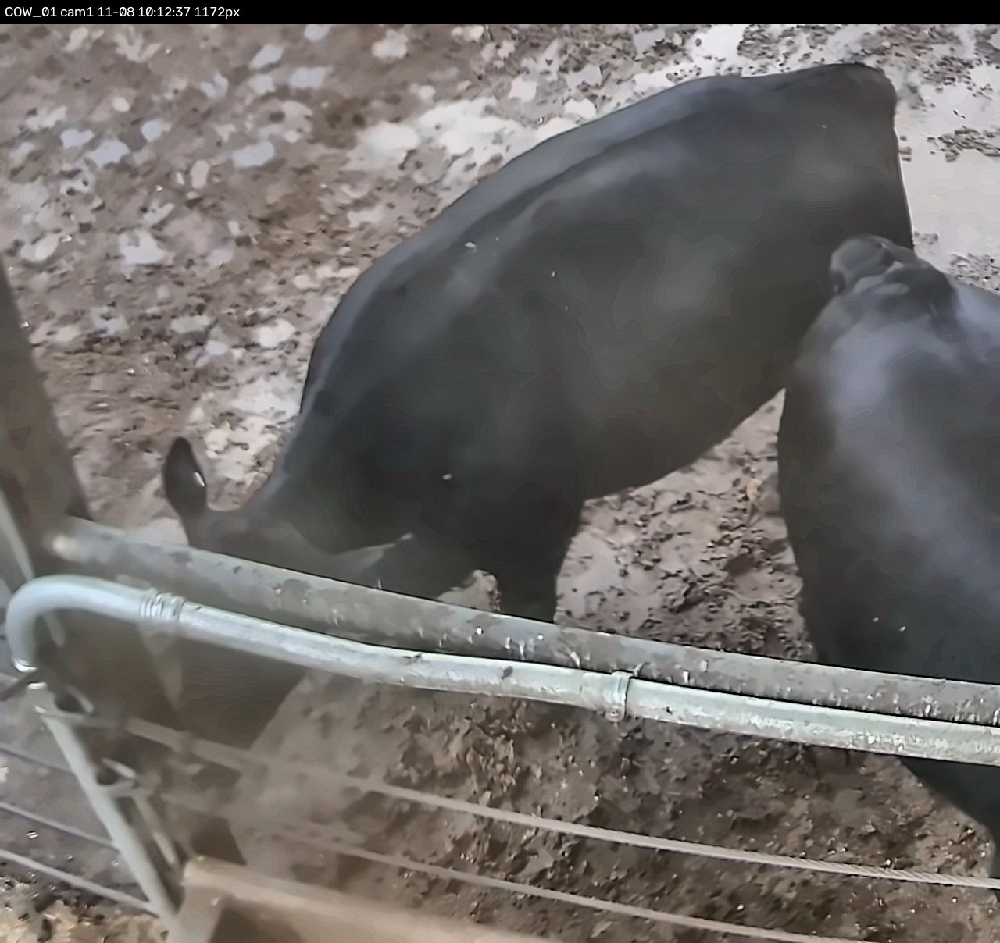</a>I0023 I0024 ✓ <a href="evidence/img/I0025.jpg">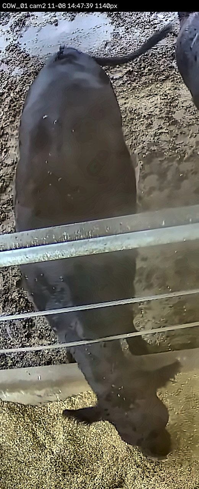</a>I0025 <a href="evidence/img/I0026.jpg">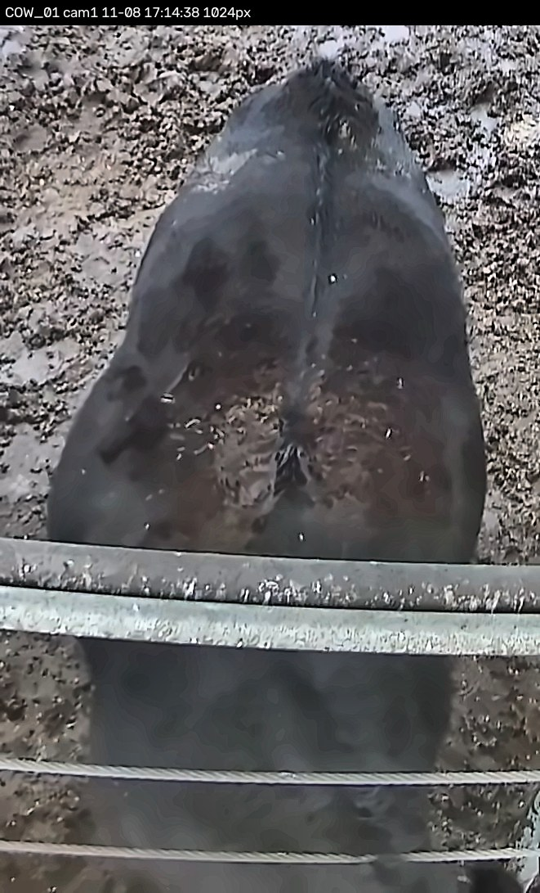</a>I0026 <a href="evidence/img/I0027.jpg">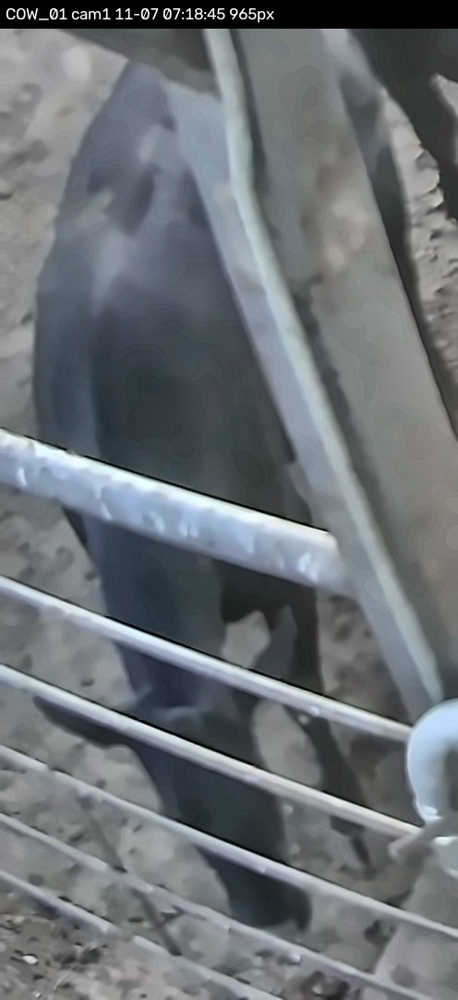</a>I0027 <a href="evidence/img/I0028.jpg">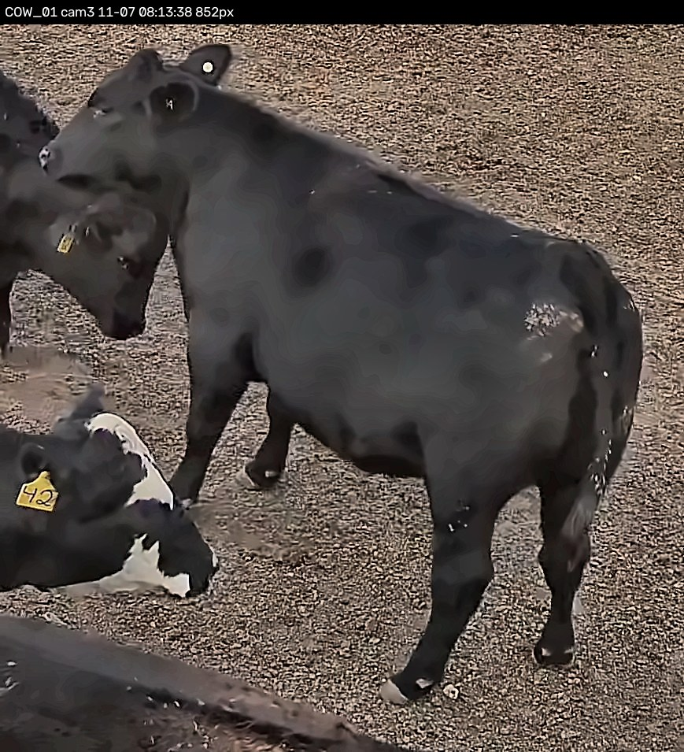</a>I0028 <a href="evidence/img/I0029.jpg">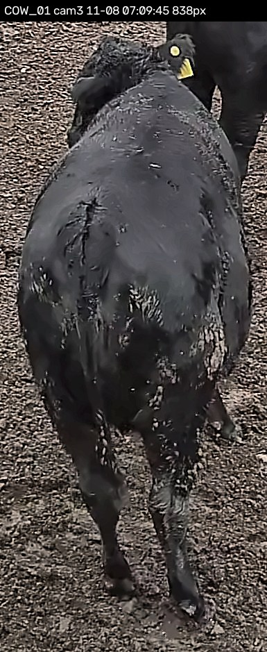</a>I0029 |
| 4 | `get_crop` time=11-07 07:18:45, camera=cam1, region=head, enhance=True | Several daylight crops. I0027 (11-07 07:18, cam1, 965px) shows a cow facing side-on/toward with head up — good candidate for a head crop. Let me get a head crop there to assess ears/eyes/nose. | I0030 ✓ |
| 5 | `get_crop` time=11-08 16:36:51, camera=cam2, region=head, enhance=True | That crop shows a body/leg through fence rails, not a clear head. Not usable for head signs. I0024 (11-08 16:36, cam2, 1170px) in gallery appeared to show heads down at the bunk. Let me try I0023 (11-08 10:12 cam1) — the second gallery image appeared to show a cow bent over the bunk. Actually I need a head facing toward/side-on. Let me try the crop at 11-08 16:36:51 cam2 head. | I0031 ✓ |
| 6 | `breathing`  | This shows a head down at the bunk feeding (facing toward/down into feed). Head is down because eating — normal, not head_low sign. I can see the muzzle/nose area reasonably: no obvious nasal discharge, but she is eating with head buried so not a clean standing assessment. Ears not clearly resolvable. Eyes not clearly visible. This is a feeding posture so I shouldn't call head_low. Let me check breathing since effort was 120% (though bpm normal) — look at the breathing window. | I0032 ✓ |
| 7 | `get_crop` time=11-08 14:47:39, camera=cam2, region=head, enhance=True | Breathing is 21/min, right at herd median, below the typical resting range — no tachypnea. The breathing_effort 120% at z+0.7 with bpm normal is not clinically significant. Now let me verify the head crop for discharge/ears — I0031 showed head buried eating. Let me get a head crop from a standing moment. Let me check compare_herdmates at a daylight moment to assess posture, and get a cleaner head view. Let me try get_crop at 11-08 14:47 cam2 (I0025, 1140px). | I0033 ✓ |
| 8 | `record_fact` sign=nasal_discharge, status=absent, confidence=0.5 | This is facing unknown — mostly a rump/back on the left and a head-down eating cow on right. Not a valid toward/side-on head view for signs. I've used my clean head crops. The only toward-facing head crop (I0031) showed her eating head-down with no obvious discharge but I can't properly assess ears/eyes/nose standing. Given constraints: head signs are mostly not_assessable. No nasal/ocular discharge seen (but need &gt;450px daylight clear muzzle — I0031 showed muzzle reasonably, no discharge visible). Let me record my findings. I have 1 call left — I'll record a key fact then finalize. Actually I'll just finalize now to be safe. |  |

✓ = cited in a decision.

---

## COW_10 · rank 3

Risk **0.26** · high confidence · 10 images looked at, 5 cited

> **The agent's summary.** COW_10 ranks #1 on the behavior score, but the score is inflated by two artifacts: a desync 'trend' spike from a near-empty final block, and an elevated breathing-effort amplitude that is contradicted by a normal breath rate (23/min) and no respiratory distress. Appetite, feeding, and posture at the bunk all look normal. No action needed beyond routine observation; if anything, pen-ride to get a clean standing head view to rule out nasal/ocular discharge, which the cameras could not assess.

**Sign verdicts and the images they rest on**

| Sign | Verdict | Images | The agent's note |
|---|---|---|---|
| ears drooping | absent | <a href="evidence/img/I0009.jpg">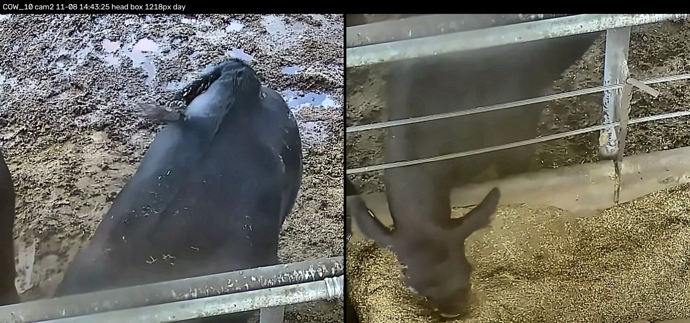</a> <b>I0009</b> cam2 · 8 Nov 14:43 · head, side-on · box 1218 px <a href="evidence/img/I0005.jpg">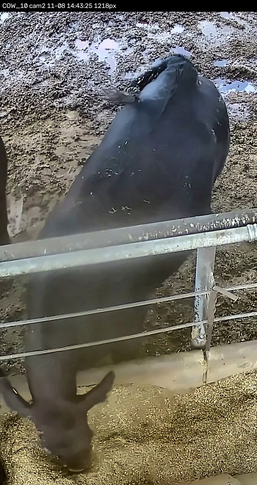</a> <b>I0005</b> cam2 · 8 Nov 14:43 · body · box 1218 px also cites `V0001` | Side-on daylight head crop shows ears carried upright/alert while eating. |
| laboured / open-mouth breathing, extended neck | absent | <a href="evidence/img/I0001.jpg">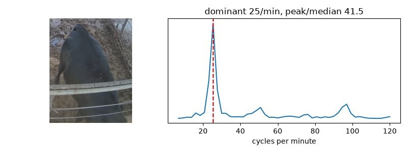</a> <b>I0001</b> cam1 · 8 Nov 17:15 · box 1034 px · 25.4 breaths/min also cites `V0002` | 23/min across 7 valid windows, below herd; no open-mouth/extended-neck/flank-heave posture observed. |
| coughing posture | not assessable | I0001 | jerk_rate normal (31 vs 30/h); no cough sequence reviewed. |
| hollow left flank / gaunt | not assessable | <a href="evidence/img/I0010.jpg">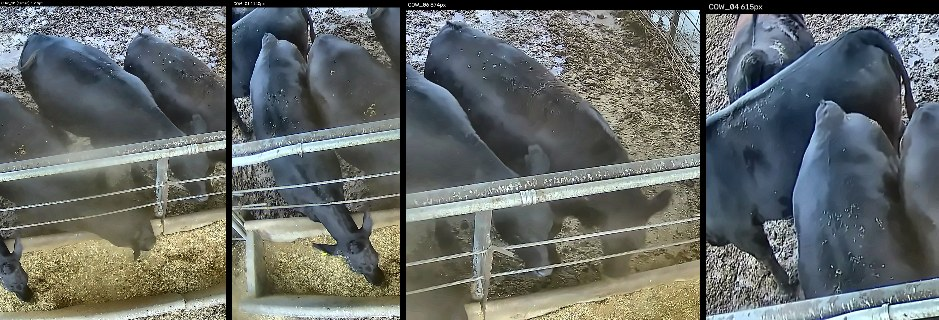</a> <b>I0010</b> cam2 · 8 Nov 16:25 · box 1319 px | No clear left-flank profile; body appears full in bunk frames but not confirmable. |
| head carried low / depressed | not assessable | I0009 I0010 | Only head-down-at-bunk (eating) frames available; no standing non-eating head-toward view to judge topline-relative carriage. |
| nasal discharge | not assessable | I0009 | Muzzle buried in feed in all close daylight frames; no clean &gt;=450px muzzle view. |
| ocular discharge / tearing | not assessable | I0009 | Eye visible but not a clean enough daylight view to confirm; no discharge seen but not confidently assessable. |

**Behavior check: are the deviations real?** I do NOT believe the two biggest drivers. The desync_share__trend spike is an end-of-coverage artifact (near-empty final block), and the elevated breathing_effort amplitude is not corroborated by rate or posture. Appetite is intact: feed_response shows COW_10 reaching the bunk promptly at major herd rushes (0-7 min, latency 14.9 vs 19.1 min) and staying as long or longer (18-27 min), with more but shorter visits (rate 1.5 vs 1.1/h explains the shorter 6.5-min visits). Longer lying bouts and slightly more isolation are mild and within noisy short-coverage range. Overall behavior looks largely normal for a top-ranked-by-score but clinically unremarkable cow.

**Indicators set aside as artifacts** (their contribution is removed from the score)

| Indicator | Why | Images |
|---|---|---|
| `desync_share` | The desync_share__trend +3.0 z is driven almost entirely by the final 11-09 00h block (value 1.0 vs herd 0, dev +20) which is a near-empty few-minute end-of-coverage block, plus a single 11-08 12h spike. Base desync_share is normal (16% vs 17%, z -0.1). The trend deviation is a coverage/edge artifact, not a sustained drift. | <a href="evidence/img/I0002.jpg">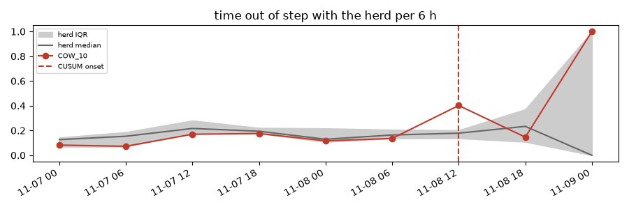</a> <b>I0002</b> trend chart: `desync_share` |
| `breathing_effort` | Flank-amplitude z of +2.7 (161%) is contradicted by a normal, low breath rate of 23/min from 7 valid windows and no distress posture; the amplitude is inflated by very close bunk windows (large box pixel scale), not true effort. | I0001 |

<b>Every step of the review, with the images each one returned (10 steps, 8 tool calls)</b>

| Step | Tool | The agent's reasoning before the call | Images returned |
|:-:|---|---|---|
| 1 | `breathing`  | Top deviations: desync_share__trend (+3.0), breathing_effort (+2.7), longest_lying_bout, bunk_visit_min. Breathing effort matters clinically. Let me start with breathing measurement. | I0001 ✓ |
| 2 | `trend` indicator=desync_share, block_h=6 | Breathing rate 23/min is normal and below herd. The breathing_effort z (+2.7, amplitude 161%) is odd but bpm is normal. Effort amplitude could be artifact of close-up. Let me check the desync_share__trend which is the biggest contributor - but that's a behavior. Let me look at trend for breathing_effort and the desync. Actually breathing effort amplitude may just be pixel scale. Let me check the trend of the main driver desync. | I0002 ✓ |
| 3 | `gallery` n=6 | The desync 'trend' spike is largely driven by the final 11-09 00h block which is only a few minutes (coverage ends 00:01) - value 1.0 vs herd 0 is a near-empty block, noise. The 11-08 12h block was a real brief spike. So the desync__trend +3.0 is heavily inflated by a tiny-coverage end block. Let me now look at the cow visually - gallery for head signs. | <a href="evidence/img/I0003.jpg">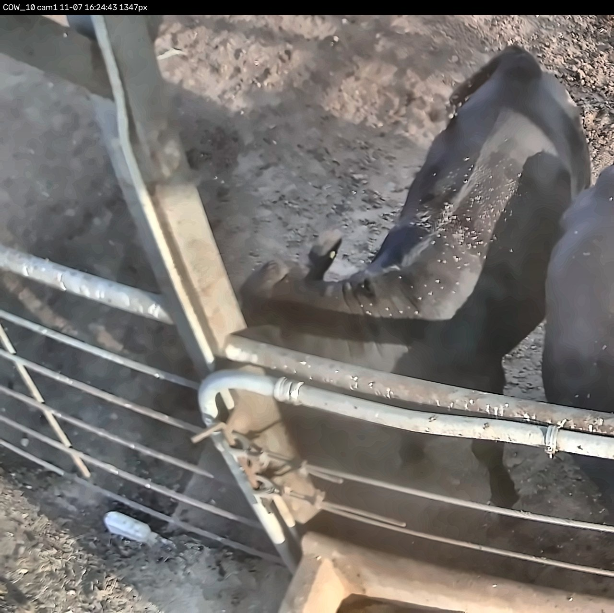</a>I0003 <a href="evidence/img/I0004.jpg">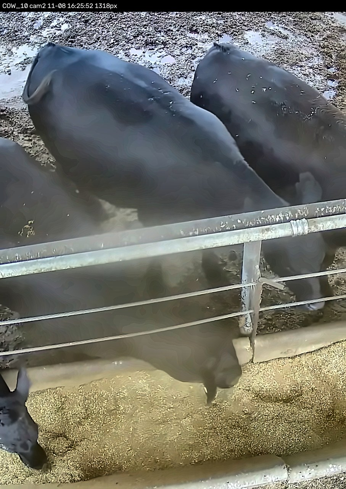</a>I0004 I0005 ✓ <a href="evidence/img/I0006.jpg">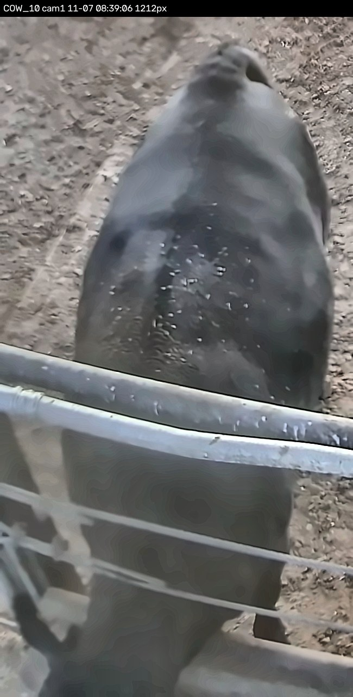</a>I0006 <a href="evidence/img/I0007.jpg">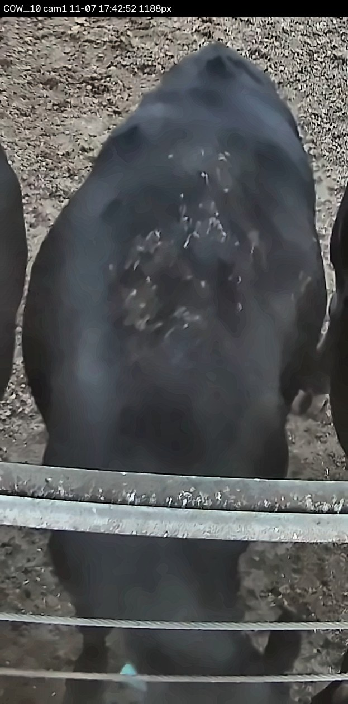</a>I0007 <a href="evidence/img/I0008.jpg">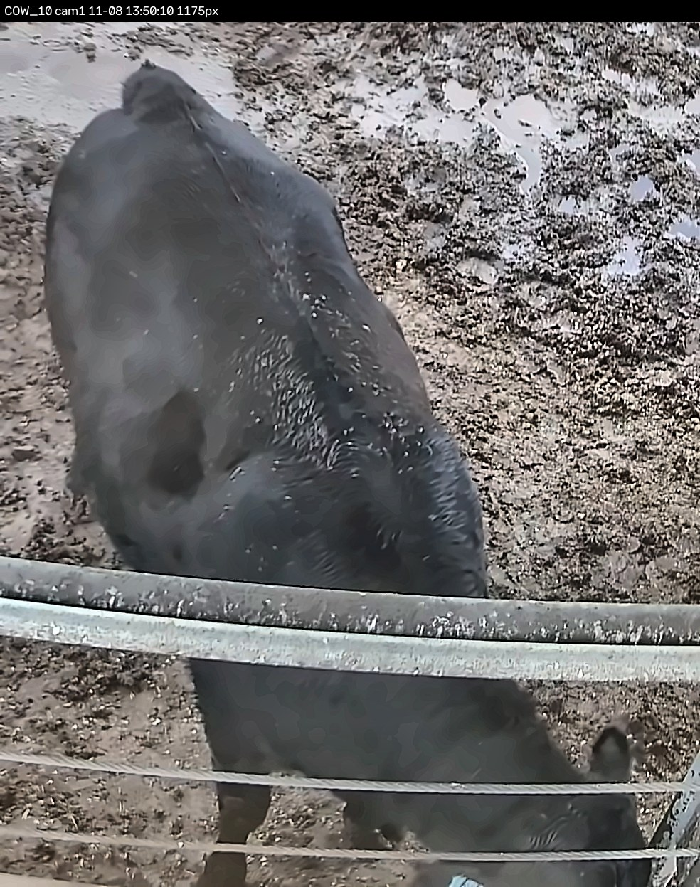</a>I0008 |
| 4 | `get_crop` time=11-08 14:43:25, camera=cam2, region=head, enhance=True | Gallery mostly shows backs/rumps and down-at-bunk eating. I0005 shows a head down at the bunk (eating - normal). Few clear head-toward frames. Let me get a head crop from a close view. Let me find close daylight head frames. I0005 at 11-08 14:43 cam2 looks head-on-ish at bunk. Let me get a head crop there. | I0009 ✓ |
| 5 | `record_fact` sign=ears_droop, status=absent, confidence=0.7 | Head crop side-on, head down at the bunk eating. Ears appear upright/alert, no obvious droop. Nose is down into feed - can't assess nasal discharge well. Eye visible, no obvious ocular discharge but it's eating, nose buried. Ears look normal/upright. Let me record what I can: ears look alert (absent droop), head down is eating (not head_low). Let me check compare_herdmates for posture context and also assess the breathing_effort artifact. The breathing_effort amplitude is high but bpm normal - likely a scale/posture artifact given it's a close bunk window. Let me verify with a breathing sequence check or just check feed_response for the bunk_visit deviation. Actually let me record facts first then decide. I'll record head/ear findings. |  |
| 6 | `feed_response`  | Now compare herdmates at a standing moment to assess head carriage/posture, and get a non-eating head view if possible. The gallery frames are mostly at bunk. Let me find an isolated or standing moment. Actually, most deviations are at-bunk/lying - behaviorally normal. Let me check feed_response to validate the bunk_visit_min / appetite indicators which are the real behavior drivers. |  |
| 7 | `compare_herdmates` time=11-08 16:25:52, camera=cam2 | Feed response: COW_10 generally reaches the bunk promptly at major herd rushes (0-7 min, matching or faster than herd: latency 14.9 vs 19.1) and stays comparable or longer (18-27 min at major rushes 11-07 11:58, 15:39; 11-08 09:39, 16:16). Appetite looks intact. The short bunk_visit_min (6.5 vs 9.5) is offset by higher visit rate (1.5 vs 1.1/h) - she makes more, shorter visits. No appetite suppression. So feeding/appetite is NOT a concern. The main drivers (desync_trend, breathing_effort) are weak: desync_trend inflated by near-empty end block; breathing bpm normal. Let me do one compare_herdmates to assess posture at a non-eating moment, and check if there's an isolated/standing moment. Actually I've used 6 calls; 3 left. Let me compare herdmates at a daylight close moment to finalize head_low/posture. | I0010 ✓ |
| 8 | `record_fact` sign=labored_breathing, status=absent, confidence=0.6 | At 11-08 16:25, COW_10 and herdmates all at the bunk with heads down eating - normal synchronized feeding behavior, no abnormal head carriage. Head down here is eating, not head_low. I have enough. Breathing effort amplitude elevated but bpm normal and clearly measurable 23/min (I0001) — likely a posture/scale artifact of close bunk windows rather than respiratory distress; no labored breathing posture seen. Let me record the breathing finding then finalize. |  |

✓ = cited in a decision.

---

## COW_09 · rank 4

Risk **0.18** · low confidence · 8 images looked at, 5 cited

> **The agent's summary.** COW_09 is eating well — fast to the bunk, feeding at or above herd level, good body condition, normal breathing (20.8/min) and low jerk rate. Visible head crop shows no ocular discharge, no ear droop and no head-low; nasal discharge and cough could not be fully assessed. No action needed beyond routine observation; the flagged feeding-decline trend is a noise artifact.

**Sign verdicts and the images they rest on**

| Sign | Verdict | Images | The agent's note |
|---|---|---|---|
| ears drooping | absent | <a href="evidence/img/I0050.jpg">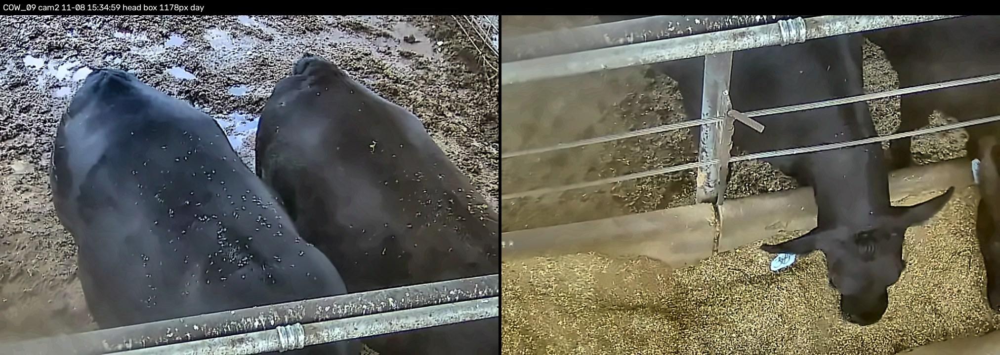</a> <b>I0050</b> cam2 · 8 Nov 15:34 · head, side-on · box 1178 px | Side-on daylight head crop (1178px); ear carriage normal, upright, no droop. |
| hollow left flank / gaunt | absent | <a href="evidence/img/I0044.jpg">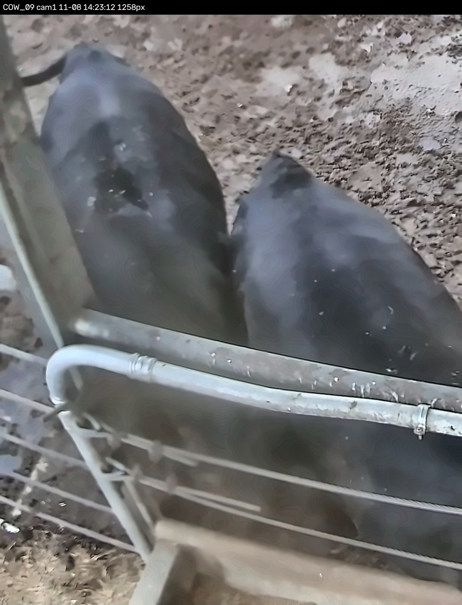</a> <b>I0044</b> cam1 · 8 Nov 14:23 · body · box 1258 px <a href="evidence/img/I0046.jpg">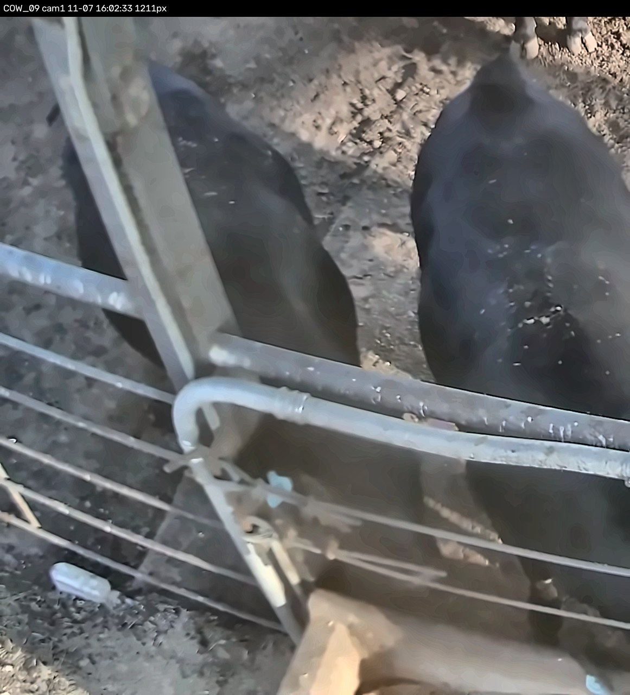</a> <b>I0046</b> cam1 · 7 Nov 16:02 · body · box 1211 px | Body crops show full, well-conditioned frame; no hollow flank. |
| head carried low / depressed | absent | I0050 <a href="evidence/img/I0048.jpg">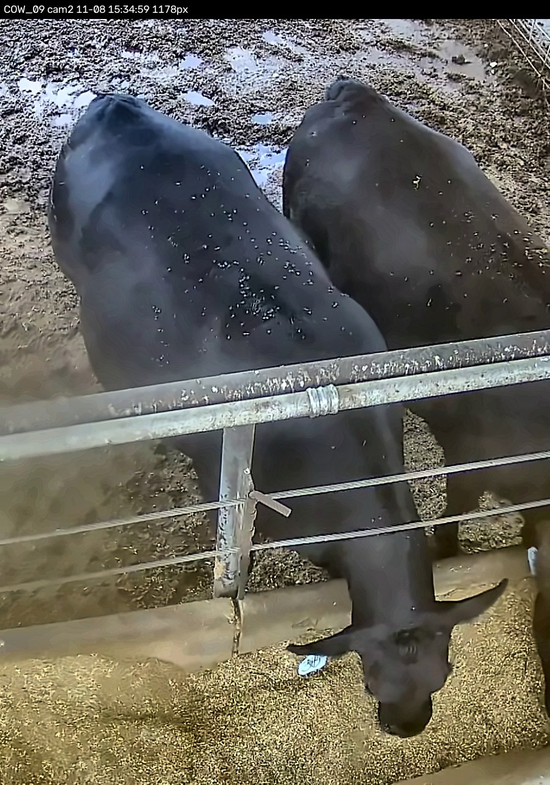</a> <b>I0048</b> cam2 · 8 Nov 15:34 · body · box 1178 px | Head carried normally; when low it is because she is actively eating with muzzle in the bunk, not head_low standing. |
| ocular discharge / tearing | absent | I0050 | Side-on daylight head crop &gt;=450px; eye region clean, no ocular discharge. |
| coughing posture | not assessable | no image qualified also cites `F-COW_09-jerk_rate` | Jerk rate 27.6/h is BELOW herd median; no cough posture sequence reviewed. |
| laboured / open-mouth breathing, extended neck | not assessable | no image qualified also cites `F-COW_09-breathing_bpm`, `F-COW_09-breathing_effort` | Resting bpm 20.8 equals herd, flank effort near herd; no still open-mouth/flank sequence reviewed to confirm or deny. |
| nasal discharge | not assessable | I0050 | Muzzle buried in feed while eating; no discharge visible but cannot reliably clear it at this angle. |

**Behavior check: are the deviations real?** I do not believe the headline feeding/meal trend deviations: the feeding CUSUM never crossed and COW_09 actually eats AT or ABOVE herd in every block, reaches the bunk fast (6.7 min) and takes long bunk visits. The remaining real signals (desync_share +1.5, slightly lower rumination and lying) are mild and this cow is a well-eating, well-conditioned animal ranked 5 of 10.

<b>Every step of the review, with the images each one returned (5 steps, 3 tool calls)</b>

| Step | Tool | The agent's reasoning before the call | Images returned |
|:-:|---|---|---|
| 1 | `trend` indicator=feeding_share, block_h=6 | The top sick-direction deviations are feeding_share_trend (-24% vs -12%, z+3.0), desync_share_trend (z+3.0), meals_per_h_trend (z+2.9). But note: feeding_share itself is -2.3 (eating MORE than herd), feed_call_latency fast (6.7 min), bunk_visit_min long. This cow is actually eating well. The trend deviations may be noise. Let me check the feeding trend first. | <a href="evidence/img/I0043.jpg">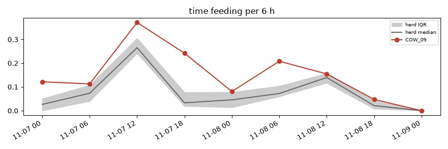</a>I0043 ✓ |
| 2 | `gallery` n=6 | Feeding trend shows no sustained deviation (CUSUM never crossed). COW_09 consistently eats at or ABOVE herd feeding — this is NOT a sick-direction signal despite the trend z. The 'feeding_share_trend +3.0' is noise from the day-to-day change metric; this cow eats well. The desync_share_trend is also high. But overall this is a well-eating cow (rank 5, low score). Let me look at the cow visually for clinical signs — check gallery for head/discharge/ears. | I0044 ✓ <a href="evidence/img/I0045.jpg">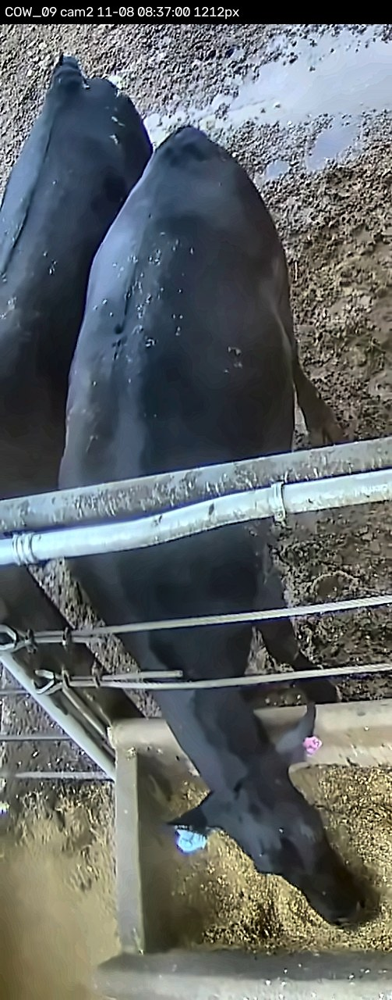</a>I0045 I0046 ✓ <a href="evidence/img/I0047.jpg">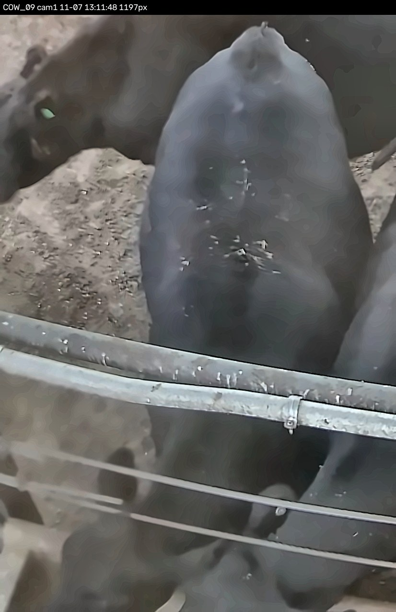</a>I0047 I0048 ✓ <a href="evidence/img/I0049.jpg">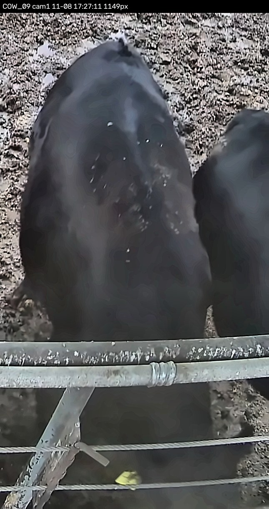</a>I0049 |
| 3 | `get_crop` time=11-08 15:34:59, camera=cam2, region=head, enhance=True | Gallery crops are all large (&gt;1000px) but show mostly backs/tops at the bunk, heads down eating. None give a clear toward/side-on head view for discharge/ear assessment. I0048 shows a head lowered into the bunk feeding (normal eating posture, not head_low). I need a proper head crop facing toward/side-on. Let me get a head crop from I0048 (cam2 close view) where the cow is at the bunk with head visible. | I0050 ✓ |

✓ = cited in a decision.

---

## COW_03 · rank 5

Risk **0.16** · low confidence · 8 images looked at, 4 cited

> **The agent's summary.** COW_03 is a low-concern animal (rank 6/10) that actually feeds more and longer than the herd, breathes normally (23/min), and shows no visible gaunt, head-low or labored breathing. The one 'sick-direction' number — a long overnight meal gap — is contradicted by its strong overall appetite, so no respiratory-disease action is warranted. Head signs (ears, nose, eyes) could not be judged because only overhead at-bunk views were available; recheck with a head-on crop if clinical suspicion rises.

**Sign verdicts and the images they rest on**

| Sign | Verdict | Images | The agent's note |
|---|---|---|---|
| hollow left flank / gaunt | absent | <a href="evidence/img/I0051.jpg">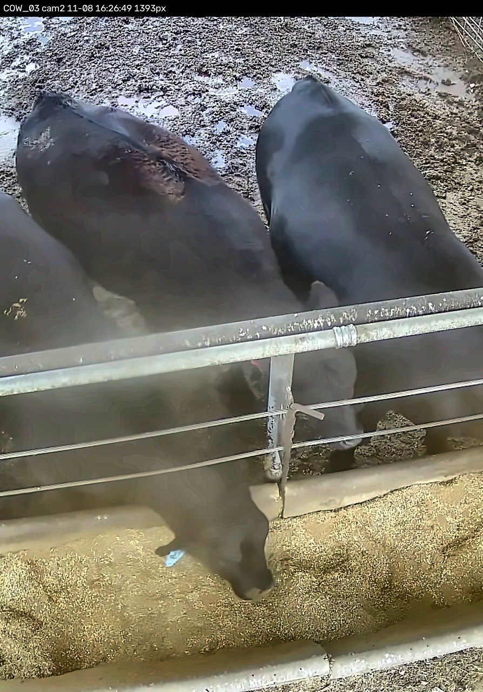</a> <b>I0051</b> cam2 · 8 Nov 16:26 · body · box 1393 px <a href="evidence/img/I0055.jpg">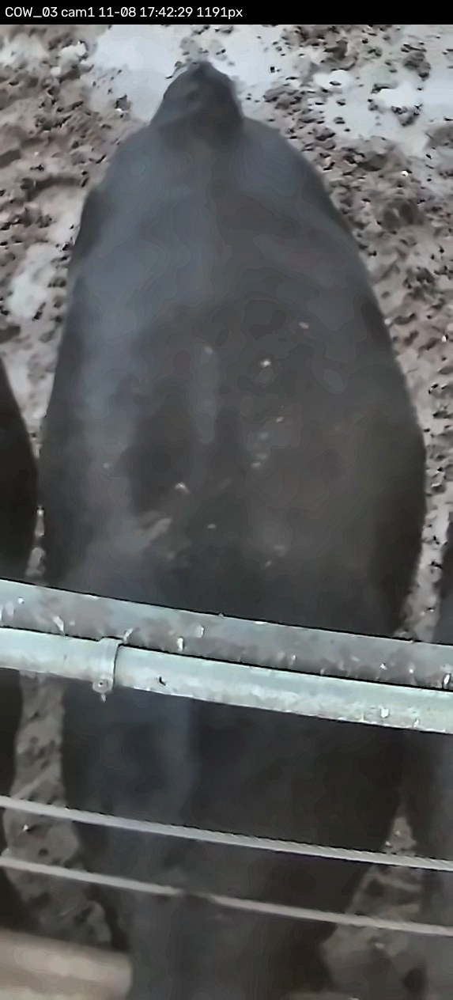</a> <b>I0055</b> cam1 · 8 Nov 17:42 · body · box 1191 px <a href="evidence/img/I0058.jpg">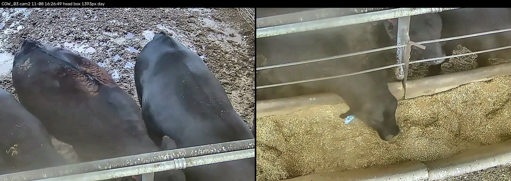</a> <b>I0058</b> cam2 · 8 Nov 16:26 · head, side-on · box 1393 px | Overhead body/rump crops show full, well-filled topline and flank; no hollow/empty look. |
| head carried low / depressed | absent | I0058 I0051 | Head carried down only while actively feeding at the bunk (muzzle in feed) — normal eating posture, not abnormal head carriage. |
| laboured / open-mouth breathing, extended neck | absent | <a href="evidence/img/I0057.jpg">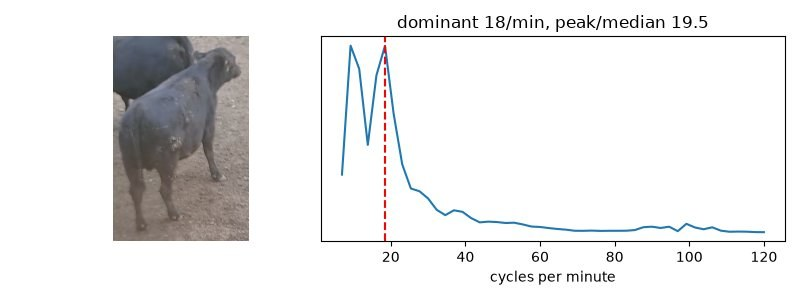</a> <b>I0057</b> cam1 · 7 Nov 14:53 · box 644 px · 18.5 breaths/min | Resting rate 23/min (herd median 21), below the typical 26-50 range; no open-mouth or extended-neck effort seen. |
| coughing posture | not assessable | no image qualified also cites `F-COW_03-jerk_rate` | Jerk rate 28.1/h is below herd median (30.2); no coughing posture captured in a sequence. |
| ears drooping | not assessable | I0058 | Overhead side-on views foreshorten the ears while the cow is at the bunk; no clear head-on crop to judge ear carriage. |
| nasal discharge | not assessable | I0058 | Muzzle buried in feed; no clean daylight head-on view &gt;=450px to assess nasal discharge. |
| ocular discharge / tearing | not assessable | I0058 | No clear eye-region view at &gt;=450px daylight; head-on crop not available. |

**Behavior check: are the deviations real?** The headline deviations point the wrong way for illness. feeding_share is HIGH (13% vs 9%*, F-COW_03-feeding_share), with long bunk visits (16.4 vs 9.5 min, F-COW_03-bunk_visit_min) and long meals (12.6 vs 8.7, F-COW_03-meal_min) — this cow eats longer, not less. feed_call_latency is normal (F-COW_03-feed_call_latency). The longest_meal_gap of 532 min (+2.4, F-COW_03-longest_meal_gap_min) is a single long overnight gap on 39 h of coverage and is contradicted by otherwise strong/above-median feeding; I believe it is real but benign (an overnight non-feeding interval), not an appetite-loss signal. Breathing (F-COW_03-breathing_bpm) is confirmed normal on images. Lying, rumination, isolation and social metrics are all near herd median.

<b>Every step of the review, with the images each one returned (4 steps, 3 tool calls)</b>

| Step | Tool | The agent's reasoning before the call | Images returned |
|:-:|---|---|---|
| 1 | `gallery` n=6 | COW_03 is rank 6, modest score. The top deviations in the sick direction are longest_meal_gap (+2.4) and feeding_share trend (+1.6), but interestingly feeding_share itself is high (13% vs 9%, negative contribution) and bunk_visit_min is long (16.4 vs 9.5). This cow actually feeds MORE per visit but fewer visits — contradictory. Let me check the breathing deviation (slightly elevated bpm/effort) and look for clinical signs via gallery first for head signs. | I0051 ✓ <a href="evidence/img/I0052.jpg">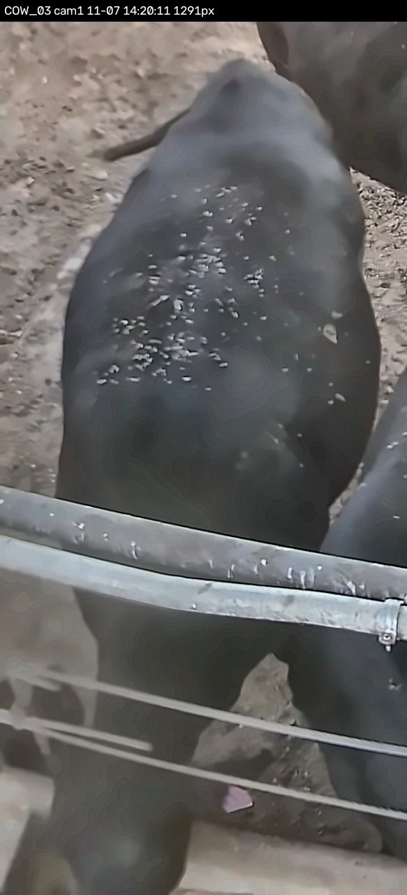</a>I0052 <a href="evidence/img/I0053.jpg">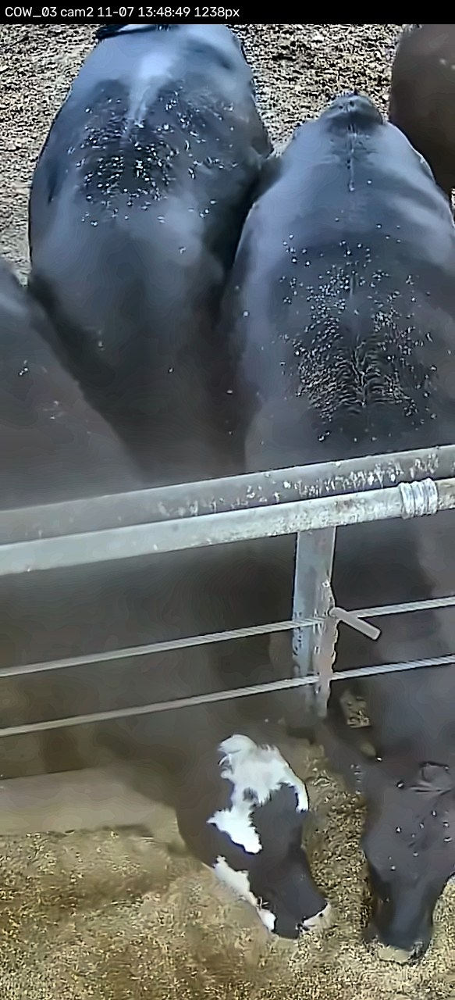</a>I0053 <a href="evidence/img/I0054.jpg">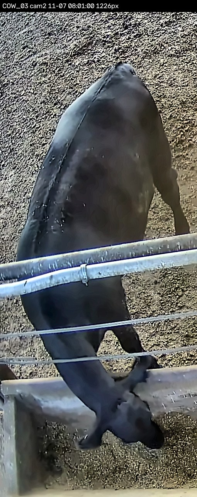</a>I0054 I0055 ✓ <a href="evidence/img/I0056.jpg">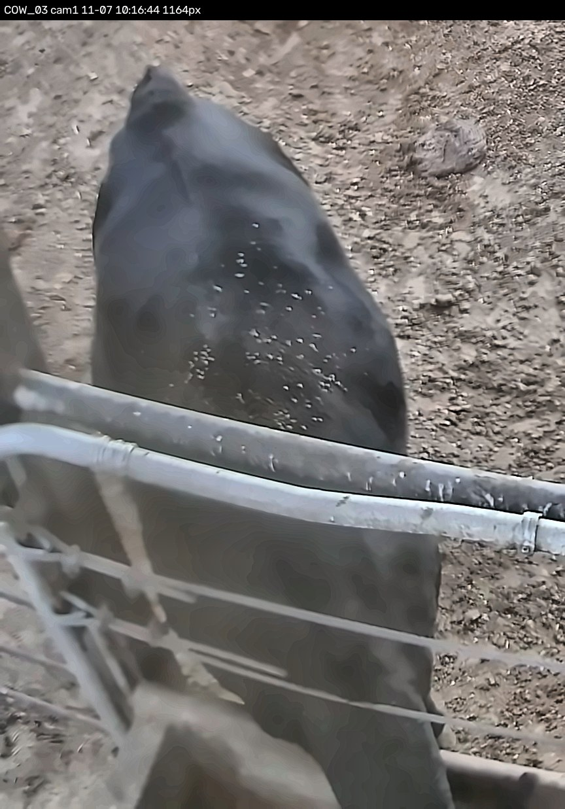</a>I0056 |
| 2 | `breathing`  | The gallery crops are mostly backs/rumps from the overhead cameras — heads down at the bunk eating. None give a clear head-on view for ears/eyes/nose. Most show cows at the bunk feeding (head down = normal eating posture, not head_low abnormal). I need a head crop facing toward/side-on. Let me try get_crop on the one that might show a head — I0051 or I0054 appear to have heads visible. Let me get a head crop around a close feeding moment and check breathing, since bpm is the only mildly elevated vital. Actually breathing matters more clinically. Let me check breathing to confirm the resting rate. | I0057 ✓ |
| 3 | `get_crop` time=11-08 16:26:49, camera=cam2, region=head, enhance=True | Breathing is 23/min, actually BELOW the typical resting range of 26-50, and near herd median (21). Not elevated clinically — the +0.6 z is noise on 2.5h. No respiratory concern. The feeding deviations: feeding_share is HIGH (13% vs 9%) and bunk visits long — this cow spends longer at the bunk per visit, which is the OPPOSITE of a sick signature. The longest_meal_gap (+2.4) is likely a single overnight gap on short coverage, not sustained appetite loss, and feed_call_latency is normal (18.2 vs 19.1). The gallery gave me no head-on view, so head signs are not_assessable. I'll use my last call to get a head crop to try to assess ears/eyes/nose. I0051 (cam2, 1393px) looked most head-visible. | I0058 ✓ |

✓ = cited in a decision.

---

## COW_04 · rank 6

Risk **0.15** · low confidence · 9 images looked at, 6 cited

> **The agent's summary.** COW_04 is a low-moderate concern (rank 4 of 10) whose score is inflated by a single 600-minute meal gap that is not sustained and is contradicted by prompt, normal feeding at the bunk. No clinical BRD signs were confirmed on video; breathing is normal and effort low. Head/eye/nose/ear detail could not be assessed cleanly, so a quick hands-on pen check of the face is reasonable if other flags appear, but no urgent intervention is indicated.

**Sign verdicts and the images they rest on**

| Sign | Verdict | Images | The agent's note |
|---|---|---|---|
| head carried low / depressed | absent | <a href="evidence/img/I0041.jpg">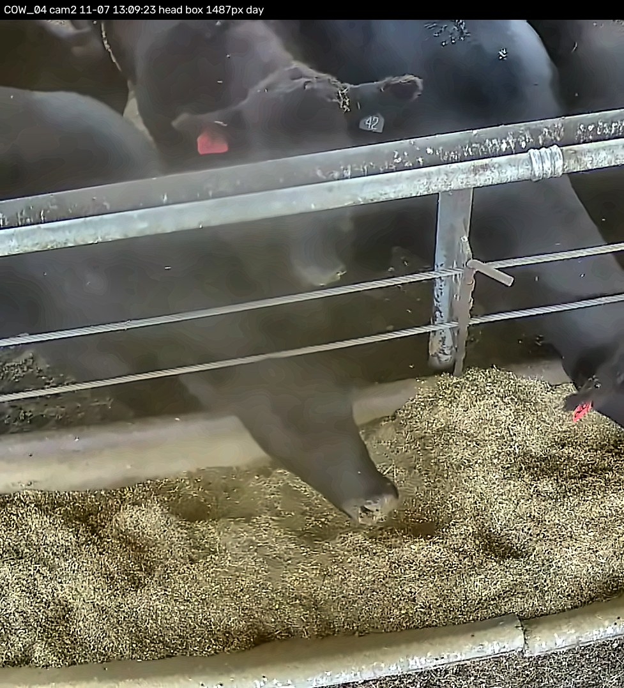</a> <b>I0041</b> cam2 · 7 Nov 13:09 · head, toward · box 1487 px  <b>I0042</b> cam1 · 8 Nov 16:27 · head, side-on · box 1396 px also cites `V0006` | Head crops show head carried down only while eating at the bunk (normal); no head-low-while-standing seen. |
| laboured / open-mouth breathing, extended neck | absent | I0041 I0042 also cites `F-COW_04-breathing_bpm`, `F-COW_04-breathing_effort` | In the daylight crops (I0041, I0042) the cow shows no open-mouth breathing or extended-neck posture; 22 bpm at rest (herd 20.8) and flank effort 57% (below herd 106%). |
| coughing posture | not assessable | no image qualified also cites `F-COW_04-jerk_rate` | Jerk rate 31/h equals herd (30.2); no cough sequence confirmed. |
| ears drooping | not assessable | I0041 I0042 | Ears not clearly resolved in the available top-down/feeding head crops. |
| hollow left flank / gaunt | not assessable |  <b>I0035</b> cam2 · 8 Nov 14:43 · body · box 1230 px  <b>I0036</b> cam2 · 7 Nov 14:20 · body · box 1229 px  <b>I0037</b> cam1 · 7 Nov 13:10 · body · box 1223 px | Top-down bunk views do not show the left flank for hollow/gaunt assessment. |
| nasal discharge | not assessable | I0041 | Muzzle buried in feed, no clean daylight nose view &gt;=450 px. |
| ocular discharge / tearing | not assessable | I0041 I0042 | Eyes not clearly visible in available crops. |

**Behavior check: are the deviations real?** I do not believe the dominant longest_meal_gap deviation: it is a single noisy overnight value, not sustained (I0034), and contradicted by good feed response (V0005). feed_call_latency is actually faster than herd (14.3 vs 19.1). The small isolation/edge/walking deviations (+0.8 z, modest contributions) are mild and within noise given short coverage. Feeding_share, meal length, bunk visits are all near herd median. Rumination is above median and breathing effort is low - both protective. Overall COW_04's score is driven mainly by an artifactual meal gap.

 <b>I0034</b> trend chart: `longest_meal_gap_min`

**Indicators set aside as artifacts** (their contribution is removed from the score)

| Indicator | Why | Images |
|---|---|---|
| `longest_meal_gap_min` | The 600-min single value drives the +3.0 z and +1.42 contribution, but the 6h trend CUSUM never crossed and the cow tracks the herd band. feed_response shows prompt bunk arrival (0-3 min) and normal 11-32 min stays at most herd rushes, so appetite is normal; the long 'gap' is an overnight/noise artifact, not a real appetite deficit. | I0034 |

<b>Every step of the review, with the images each one returned (10 steps, 8 tool calls)</b>

| Step | Tool | The agent's reasoning before the call | Images returned |
|:-:|---|---|---|
| 1 | `trend` indicator=longest_meal_gap_min, block_h=6 | The main deviation is longest_meal_gap_min (+3.0, 600 min vs 357). Let me check its trend and whether it's real. Other indicators are modest. Start with the meal gap trend. | I0034 ✓ |
| 2 | `feed_response`  | The 600 min single-value longest_meal_gap isn't reflected in the 6h trend - no sustained deviation, CUSUM never crossed. The gap likely came from an overnight period and the cow tracks the herd band well. This looks like a single noisy long gap, not a sustained appetite problem. Let me check feed_response to confirm appetite is fine. |  |
| 3 | `gallery` n=6 | COW_04 responds well to herd rushes - often 0-3 min latency and stays 11-32 min. Appetite looks normal/good. feed_call_latency is actually below herd (14.3 vs 19.1, negative z direction). The longest_meal_gap of 600 min is likely an overnight artifact and not sustained. Now let me look at the cow visually. The behavior score is modest (rank 4). Let me check breathing_effort which is notably LOW (57% vs 106%, z -2.4, protective). Actually that's negative direction. Let me get the gallery for visual signs. | I0035 ✓ I0036 ✓ I0037 ✓ I0038 I0039 I0040 |
| 4 | `find_moments` kind=close_view, n=6 | These gallery crops are mostly top-down views of backs/rumps with heads down at the bunk - not good for assessing head signs (need toward/side-on face). I0037 shows a head-down eating pose. These heads-down-at-bunk are normal eating. I need a head crop facing toward/side-on. Let me find close_view moments to get a head crop. |  |
| 5 | `get_crop` time=11-07 13:09:23, camera=cam2, region=head, enhance=True | 11-07 13:09:23 cam2 facing toward, 1487 px - good for a head crop. Let me get the head crop there. | I0041 ✓ |
| 6 | `get_crop` time=11-08 16:27:22, camera=cam1, region=head, enhance=True | The head is down at the bunk eating - muzzle in the feed. The muzzle/nose area is visible but the head is in a feeding posture (not head_low-while-standing). Ears not clearly visible, eyes not clear. Discharge not assessable at this angle/resolution for nose. Let me try the side-on close view 11-08 16:27:22 cam1 for a better head/ear/eye view. | I0042 ✓ |
| 7 | `record_fact` confidence=0.8 | This is a top-down view of the back/neck - the ear is partially visible but face/eyes/nose not clearly assessable. Head is down. I can see one ear that appears in normal position, not clearly drooped, but it's top-down and muddy. Not a clean toward/side-on face for discharge or eyes. Given I've used my calls, let me record findings. The head crops show feeding posture (head down at bunk = normal), ears not clearly assessable in these top-down muddy views, nose/eyes not assessable at this resolution. Let me check breathing since effort is unusually low - actually that's protective direction, not sick. The behavior is modest. Let me record a fact and finalize. I have 2 calls left - let me verify the longest_meal_gap isn't an artifact via the images I already have, and record. Actually I'll just record the key fact about appetite being normal and finalize. |  |
| 8 | `record_fact` confidence=0.7 | I have one head crop facing toward (I0041, feeding, head down at bunk) and one side-on top-down (I0042). Neither gives a clean eye/nose/ear view for discharge assessment. Head signs are largely not_assessable, except head posture which is feeding (normal). I'll record that and finalize. |  |

✓ = cited in a decision.

---

## COW_05 · rank 7

Risk **0.15** · low confidence · 7 images looked at, 2 cited

> **The agent's summary.** COW_05 looks like a normal, healthy cow with no visible BRD signs: breathing is normal, body condition is full, ears are not drooping, and no discharge was assessable. Her mildly elevated indicators are mostly day-to-day trend noise over short 48h coverage, while her actual feeding, rumination and resting values sit right at the herd average. No action needed; recheck the eyes/nose on a clean side-on daylight crop if she later shows droopy ears or a drop in appetite.

**Sign verdicts and the images they rest on**

| Sign | Verdict | Images | The agent's note |
|---|---|---|---|
| ears drooping | absent |  <b>I0065</b> cam2 · 8 Nov 15:40 · head, side-on · box 1220 px also cites `V0007` | Side-on head crop &gt;=250px shows ears relaxed/upright, not drooping. |
| hollow left flank / gaunt | absent |  <b>I0059</b> cam1 · 7 Nov 15:03 · body · box 1365 px I0065 | Body crops show full, well-filled flank/body condition, no hollow left flank. |
| laboured / open-mouth breathing, extended neck | absent | I0065 also cites `F-COW_05-breathing_bpm`, `F-COW_05-breathing_effort` | Side-on image I0065 (box 1220px) shows no open mouth, no extended neck, no exaggerated flank effort; measured 20.8 bpm at rest (herd median) with flank effort 83% (below herd 106%). |
| coughing posture | not assessable | no image qualified also cites `F-COW_05-jerk_rate` | Jerk rate 33.3/h is near herd median (30.2, z+0.9); no coughing-posture sequence confirmed. |
| head carried low / depressed | not assessable | I0065 | Only observed head carried low while actively eating at the bunk, which is normal; no image of standing/not-eating head carriage. |
| nasal discharge | not assessable | I0065 | Muzzle angled down into feed; nose not cleanly visible at &gt;=450px daylight colour. |
| ocular discharge / tearing | not assessable | I0065 | Eye region not clearly resolved; head angled into feed. |

**Behavior check: are the deviations real?** COW_05 is a low-ranking cow (0.19, 7/10). The largest positive contributors are day-to-day TREND terms (longest_lying_bout_min__trend z+1.9, rumination_share__trend z+1.3, bunk_visit_rate__trend z+0.9) that carry NO hours value and over short 48h coverage are noisy. Her ABSOLUTE values are at or better than herd: feeding_share 10% vs 11%, rumination_share 74% vs 75%, lying_share 43% vs 43%, longest_lying_bout actually LOW (z-2.5), breathing normal, drinking rate normal/high. Feed-call latency (+0.5) and short bunk visits (+0.7) are mild and based on modest hours. I do not see a credible sick-direction behavioral signal beyond normal short-window noise; no artifact was proven since images matched a real feeding cow.

<b>Every step of the review, with the images each one returned (5 steps, 3 tool calls)</b>

| Step | Tool | The agent's reasoning before the call | Images returned |
|:-:|---|---|---|
| 1 | `gallery` n=6 | COW_05 ranks 7/10, low score. The notable deviations are trends: rumination down 71%, longest lying bout down, bunk visits down. But most absolute values match herd. The rumination trend (z+1.3) is worth checking. Let me look for visible clinical signs via gallery first — the closest daylight head crops. | I0059 ✓ I0060 I0061 I0062 I0063 I0064 |
| 2 | `get_crop` time=11-08 15:40:00, camera=cam2, region=head, enhance=True | The gallery crops are mostly backs/rumps or heads-down at the bunk, facing away. None give a clean toward/side-on head view for assessing ears/eyes/nose. I0064 shows a head down at the bunk. I need a proper head crop facing toward/side-on. Let me get a head crop from I0062 (cam2, 11-08 15:40, 1220px) which appears to show a head near the bunk. | I0065 ✓ |
| 3 | `record_fact` sign=ears_droop, status=absent, confidence=0.7 | I0065 shows COW_05 side-on, head down at the bunk feeding. Head is low because it's eating (normal). Ears appear in a relaxed/forward position, no obvious droop. No visible nasal/ocular discharge, though the head is angled down into feed — eyes/nose not clearly visible from this angle. Ears are assessable: they look normal (upright/relaxed, not drooping). Head_low cannot be called abnormal because she is eating. Nasal/ocular discharge not clearly visible at this angle. Breathing is normal (20.8 bpm, z+0.0). The behavior signals are mostly weak/noisy trends with low hours. Rumination trend down 71% but absolute rumination 74% is normal. I'll record findings. I'm out of calls after this, so finalize. |  |

✓ = cited in a decision.

---

## COW_07 · rank 8

Risk **0.13** · low confidence · 7 images looked at, 7 cited

> **The agent's summary.** COW_07 looks like a normal, healthy animal: it eats promptly after feed delivery, ruminates and lies normally, keeps up with the herd, and breathes at a normal rate with a full body condition. The only mild flags (slightly more sudden movements, a bit more lying) are small and unconfirmed, with the top cough candidates occurring at night in low-resolution IR. No priority for pulling; continue routine monitoring and recheck if daytime coughing or appetite drop appears.

**Sign verdicts and the images they rest on**

| Sign | Verdict | Images | The agent's note |
|---|---|---|---|
| hollow left flank / gaunt | absent |  <b>I0067</b> cam1 · 8 Nov 16:21 · body · box 1350 px  <b>I0070</b> cam1 · 8 Nov 14:33 · body · box 1207 px  <b>I0072</b> cam1 · 7 Nov 16:41 · body · box 1195 px | Daylight body crops show a full, well-conditioned frame; no hollow flank or empty look. |
| laboured / open-mouth breathing, extended neck | absent | I0067 I0070 | Resting breathing measured normal (F-COW_07-breathing_bpm 20.8/min, effort 105% = herd); daylight body views show no open-mouth or heaving flank. |
| coughing posture | not assessable |  <b>I0066</b> cam3 · 8 Nov 18:22 · head · box 187 px · IR night | Top jerk events at night in cam3 IR, box 187px; sequence shows no clear neck-extension/head-drop cough posture, but resolution too poor to confirm or rule out. |
| ears drooping | not assessable | I0066  <b>I0069</b> cam1 · 8 Nov 15:03 · body · box 1231 px | No daylight facing head crop; IR night crops lack ear detail. |
| head carried low / depressed | not assessable | I0066 I0067  <b>I0068</b> cam1 · 7 Nov 16:13 · body · box 1254 px I0069 I0070  <b>I0071</b> cam1 · 7 Nov 14:59 · body · box 1197 px I0072 | Daylight crops show the cow at the bunk (head down eating, normal) or facing away/rump; the only head-on view is while feeding. Night sequence is IR and &lt;250px. No qualifying standing-not-eating facing head crop. |
| nasal discharge | not assessable | I0067 I0068 I0069 | No daylight head-on crop &gt;=450px showing muzzle; cow faces away or feeds head-down. |
| ocular discharge / tearing | not assessable | I0069 | No clear daylight eye view; IR night unusable for discharge. |

**Behavior check: are the deviations real?** COW_07 is a low-concern animal (rank 8/10, score 0.15). The few 'sick-direction' deviations are weak and not clinically convincing: jerk_rate +1.0 (F-COW_07-jerk_rate, 33.9 vs 30.2/h) is only marginally above the herd and its biggest events are IR night cam3 with no confirmable cough posture (I0066); longest_lying_bout and lying/walking trends (F-COW_07-longest_lying_bout_min, F-COW_07-lying_share__trend) are mild and offset by normal feeding, rumination (77%), normal appetite (feed_call_latency actually FASTER than herd, F-COW_07-feed_call_latency), normal social spacing and normal breathing. I found no image evidence that any indicator's identity, visibility or label is wrong, so I call no artifacts.

I0066

<b>Every step of the review, with the images each one returned (4 steps, 3 tool calls)</b>

| Step | Tool | The agent's reasoning before the call | Images returned |
|:-:|---|---|---|
| 1 | `jerks`  | COW_07 ranks low (8/10, score 0.15). Few real deviations. The top contributors are jerk_rate (+1.0, cough/head-shake), longest lying bout, and lying/walking trends. Breathing is normal (20.8/min). Let me check jerks first as it's the main signal and could indicate cough. |  |
| 2 | `get_sequence` time=11-08 18:22:25, span_s=6, n=8, camera=cam3, region=head | jerk_rate is only slightly above herd (33.9 vs 30.2, z+1.0). The top events cluster at 11-08 18:22-18:43 cam3. Let me check a sequence around the strongest event (18:22:25) to see if it's a cough posture. Daylight hopefully. This also may give a head crop. | I0066 ✓ |
| 3 | `gallery` n=6 | This is IR night footage (grey, soft), median box 187 px — below 250 px threshold and IR. Can't assess discharge or ear detail in IR. The jerk events are at night (18:22 is evening but these are clearly IR/grey). No clear cough posture visible; just low-res grey crops. I have no daylight head crop. jerk_rate z+1.0 is modest and not an artifact per se, but I lack image evidence of cough. All head signs are not_assessable (no qualifying daylight facing crop). Breathing is normal. I'll save my finding and finalize — I have 1 call left but a gallery might not help given the overall low score; let me use it for one daylight head crop attempt. | I0067 ✓ I0068 ✓ I0069 ✓ I0070 ✓ I0071 ✓ I0072 ✓ |

✓ = cited in a decision.

---

## COW_06 · rank 9

Risk **0.12** · low confidence · 7 images looked at, 2 cited

> **The agent's summary.** COW_06 looks like a healthy, normally-behaving cow with good appetite and normal company. The only mild flags are slightly fewer water visits and a marginally higher resting breath rate, but breathing effort is actually below the herd and nothing clinical was visible. No action needed beyond routine watching; a clear daytime head view would help confirm ears/eyes/nose if you want certainty.

**Sign verdicts and the images they rest on**

| Sign | Verdict | Images | The agent's note |
|---|---|---|---|
| laboured / open-mouth breathing, extended neck | absent |  <b>I0073</b> cam2 · 7 Nov 13:17 · body · box 1337 px  <b>I0079</b> cam2 · 7 Nov 13:17 · head, side-on · box 1338 px also cites `F-COW_06-breathing_bpm`, `F-COW_06-breathing_effort` | In the daylight crops COW_06 stands and feeds calmly with no open-mouth breathing or extended-neck posture; resting breathing 24.4/min is within normal range and flank effort is LOW (55% vs herd 106%). |
| coughing posture | not assessable | no image qualified also cites `F-COW_06-jerk_rate` | Jerk rate 29.3/h is below herd median (30.2/h); no cough posture confirmed in any image. |
| ears drooping | not assessable | I0079 I0073 | No clear head-facing crop; ears not visible in any usable image. |
| hollow left flank / gaunt | not assessable | I0073 I0079 | Only backs/rumps visible at the bunk; left flank not assessed in a clear side view. |
| head carried low / depressed | not assessable | I0079 I0073 | Best daylight crops show COW_06 with head down in the bunk eating; no face-toward/side-on head view available. Low head while eating is normal and cannot be scored. |
| nasal discharge | not assessable | I0079 | Muzzle only partly visible and head down; no daylight muzzle view &gt;=450 px facing toward. |
| ocular discharge / tearing | not assessable | I0079 | Eyes not visible in any crop; no facing head view. |

**Behavior check: are the deviations real?** COW_06 is a low-concern cow (rank 9 of 10, score 0.13). The only notable positive-direction indicators are lower drinking visits (F-COW_06-drinking_visit_rate z+2.0) and a modestly elevated resting breathing rate (F-COW_06-breathing_bpm z+0.9, only 5.5 h observed). These are offset by healthy appetite and social signals: more meals per hour (F-COW_06-meals_per_h z-1.4), normal bunk visit rate, LOW breathing effort (F-COW_06-breathing_effort z-2.5), and good herd proximity (F-COW_06-cows_within_3m). I did not find image evidence to call any indicator an artifact. The low drinking rate is real in the data but on short, noisy coverage and is not corroborated by any clinical sign.

<b>Every step of the review, with the images each one returned (4 steps, 2 tool calls)</b>

| Step | Tool | The agent's reasoning before the call | Images returned |
|:-:|---|---|---|
| 1 | `gallery` n=6 | COW_06 is rank 9 of 10, a low-concern cow. Top deviations: drinking_visit_rate (z+2.0), breathing_bpm (z+0.9), desync and meal gaps are mild. Breathing 24.4/min is within normal resting range and effort is actually LOW (55%). The elevated breathing z is modest. The main thing is to check for clinical signs with a head crop. Let me get the gallery first for the best daylight crops. | I0073 ✓ I0074 I0075 I0076 I0077 I0078 |
| 2 | `get_crop` time=11-07 13:17:57, camera=cam2, region=head, enhance=True | The gallery crops are mostly backs/rumps and cows facing away or down into the bunk - none give a clear head view facing toward/side-on. I0073 (cam2) shows heads down at bunk. I need a head crop facing toward/side-on. Let me find close_view moments to get a head crop. | I0079 ✓ |

✓ = cited in a decision.

---

## COW_08 · rank 10

Risk **0.10** · low confidence · 7 images looked at, 5 cited

> **The agent's summary.** COW_08 looks like a healthy, actively feeding, well-socialised animal — the lowest BRD-risk cow in the pen. Body condition is good with no gaunt flank, breathing rate is normal, and it eats more than its penmates. No clinical action needed; head-level signs (ears/eyes/nose/head carriage) could not be assessed because no clean standing head-up daylight view was available, so a quick pen-side look at the head would close that gap.

**Sign verdicts and the images they rest on**

| Sign | Verdict | Images | The agent's note |
|---|---|---|---|
| hollow left flank / gaunt | absent |  <b>I0080</b> cam1 · 7 Nov 13:05 · body · box 1262 px  <b>I0081</b> cam1 · 7 Nov 13:32 · body · box 1260 px  <b>I0084</b> cam1 · 7 Nov 16:31 · body · box 1187 px | Full, well-filled flank and good body fill in multiple daylight crops &gt;250px; no hollow left flank. |
| coughing posture | not assessable |  <b>I0086</b> cam1 · 7 Nov 13:05 · head, side-on · box 1262 px | Jerk rate low (21.9/h vs 30.2 herd, F-COW_08-jerk_rate); no coughing posture captured. |
| ears drooping | not assessable | I0086 | Heads bunched at bunk, no clear ear detail on this cow. |
| head carried low / depressed | not assessable | I0086 I0080  <b>I0082</b> cam2 · 7 Nov 12:42 · body · box 1252 px | No standing head-up view facing toward/side-on; all crops are rumps or heads-down feeding at bunk. |
| laboured / open-mouth breathing, extended neck | not assessable | I0086 | Measured breathing 20.8 bpm (F-COW_08-breathing_bpm) and effort 92% are normal/low, but no visual open-mouth/flank-effort sign was assessed in image. |
| nasal discharge | not assessable | I0086 | No daylight head crop &gt;=450px facing toward with nose visible. |
| ocular discharge / tearing | not assessable | I0086 | No clear eye view in any crop. |

**Behavior check: are the deviations real?** Behavior is reassuring and I believe it. COW_08 is the lowest-scoring cow (0.11, rank 10/10) and never top-3 in resamples. It feeds MORE than the herd (feeding_share 14% vs 11%, F-COW_08-feeding_share; meal_min 13.5 vs 8.7, F-COW_08-meal_min), is LESS isolated (edge_or_alone 8% vs 13%, F-COW_08-edge_or_alone_share; isolation 5% vs 9%, F-COW_08-isolation_share), and has FEWER jerks (F-COW_08-jerk_rate). The only mild sick-direction signals are a longer meal gap (+1.2, F-COW_08-longest_meal_gap_min) and slightly lower rumination/lying share, all small and well within noise given 23.6 h coverage. No indicator is an artifact.

<b>Every step of the review, with the images each one returned (3 steps, 2 tool calls)</b>

| Step | Tool | The agent's reasoning before the call | Images returned |
|:-:|---|---|---|
| 1 | `gallery` n=6 | Behavior looks benign. Need to check clinical signs with daylight head crops. Start with gallery for closest crops. | I0080 ✓ I0081 ✓ I0082 ✓ I0083 I0084 ✓ I0085 |
| 2 | `get_crop` time=11-07 13:05:12, camera=cam1, region=head, enhance=True | Gallery crops show feeding/rumps, no clean standing head-up view. Try a head crop at the largest daylight moment facing toward/side-on. | I0086 ✓ |

✓ = cited in a decision.

