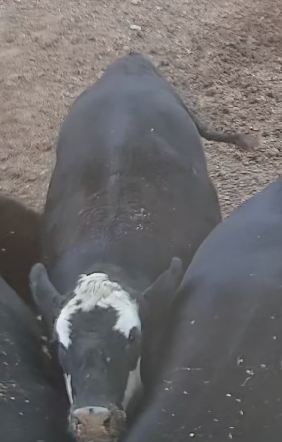
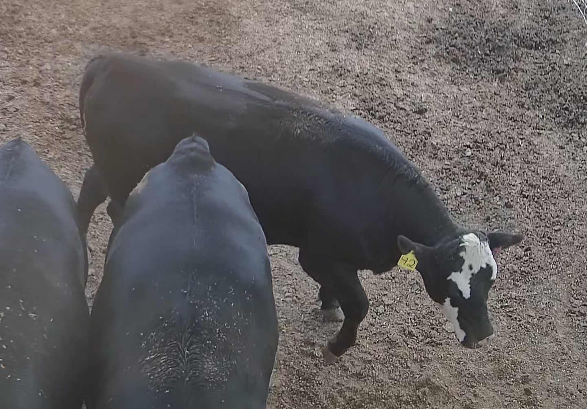

# Trace COW_01_d1_m0813
**Cow** COW_01 · **day** 1 · **minute** 813 · night=False
**Tier-1:** [['standing', 0.2309]]  · id_conf=0.95 · visibility={'back': 0.173, 'front': 0.2, 'top': 0.0}

1. **Gate** → agent (low_confidence)
2. **night_check** {"camera": "front", "brightness": 119.3, "saturation": 0.099, "ir_like": false, "is_night": false}
3. _vlm call_ `plan` tokens=2857+685 4.74s cached=True repaired=False
4. **Plan** (llm): The tier-1 standing claim is weak and the cow is partly near the feed bunk, so I will verify location, movement, posture, intake, and rumination while checking camera visibility and identity.  steps=['best_camera', 'zone_query', 'track_history', 'temporal_window', 'zoom', 'zoom', 'rumination_probe', 'compare_to_exemplar']
5. **Tool** `best_camera` {} _(why: Determine which camera provides the most reliable view because visibility is low and the detector marked the identity unresolved.; by planner)_ → ok=True facts={"visible_frac": {"back": 0.173, "front": 0.2, "top": 0.0}, "best_camera": "front"}
6. **Tool** `zone_query` {} _(why: Check whether the cow is actually at the feed bunk or waterer, which could disprove standing.; by planner)_ → ok=True facts={"available": true, "zone_fractions": {"feed_bunk": 0.26666666666666666, "waterer": 0.0, "resting": 0.0, "open": 0.7333333333333333}, "head_in_bunk_frac": 0.26666666666666666, "source": "fused_state", "note": "zones come from the tracking state (body position, no separate waterer zone); head positio
7. **Tool** `track_history` {'window_s': 90.0} _(why: Measure displacement and posture around the minute to distinguish standing from walking or lying.; by planner)_ → ok=True facts={"speed_mean": 0.308, "speed_max": 0.59, "displacement_m": 0.23, "unit": "m/s", "posture_mode": "unknown", "posture_changes": 0, "n_records": 14, "camera": "front", "prev_label": "feeding", "next_label_tier1": "other_not_visible"}
8. **Tool** `temporal_window` {'camera': 'auto', 'before_s': 30, 'after_s': 30, 'n_frames': 6} _(why: Inspect sustained body position and head location across the minute rather than relying on one frame.; by planner)_ → ok=True facts={"camera": "front", "n_frames": 2, "span_s": [-30, 30]}
   
   
9. **Tool** `zoom` {'camera': 'auto', 'region': 'head', 't_offset_s': 0.0, 'scale': 3.0} _(why: Examine whether the muzzle is at feed or water and whether any visible head posture supports another behavior.; by planner)_ → ok=True facts={"camera": "front", "region": "head", "available": false}
10. **Tool** `zoom` {'camera': 'auto', 'region': 'legs', 't_offset_s': 0.0, 'scale': 3.0} _(why: Verify whether the cow is upright on all four legs or recumbent.; by planner)_ → ok=True facts={"camera": "front", "region": "legs", "available": false}
11. **Tool** `rumination_probe` {'camera': 'auto', 'seconds': 8.0} _(why: Use high-frequency jaw measurements to test rumination, which cannot be established from a still image.; by planner)_ → ok=True facts={"camera": "front", "jaw_motion_score": 0.0, "periodicity_hz": 0.0, "rumination_likely": false, "note": "heuristic; thresholds are assumptions"}
12. **Tool** `compare_to_exemplar` {'camera': 'auto'} _(why: Verify that the visible crop is COW_01 because the upstream detector flagged the identity as unresolved.; by planner)_ → ok=True facts={"camera": "front", "similarity": null, "match": null}
13. _vlm call_ `hypothesis` tokens=2200+582 4.91s cached=False repaired=False
14. **Hypothesis** (first): `standing` conf=0.68 cues=['Cow is visibly upright on all four legs in both front-camera frames', 'Track displacement was only 0.23 m over the interval, below roughly one body length', 'Rumination probe found no jaw-motion signal (score 0.0; rumination_likely false)', 'No waterer zone occupancy was measured'] alts=[['other_not_visible', 0.18], ['walking', 0.09], ['feeding', 0.05]]
15. **Verifier** (first) → hard=1 soft=0 · failures: ['cue_chewing_hallucinated[hard]: claims chewing but jaw_motion_score=0.0']
16. **decision** {"behavior": "standing", "confidence": 0.2309, "reason": "unresolved_fallback_tier1", "correction": "unresolved", "rationale": "The proposed 'standing' was contradicted by measurements (cue_chewing_hallucinated) and could not be repaired; YOLO's 'standing' kept at low confidence."}

## Every action and the reason for it

| # | actor | action | reason | outcome |
|---|---|---|---|---|
| 1 | gate | gate:agent | escalation rules: low_confidence | agent |
| 2 | agent | night_check | measure brightness and colour saturation of the actual frame, so night/infrared handling does not depend on the clock or an upstream flag | brightness=119.3, saturation=0.099, ir_like=False -> night=False |
| 3 | vlm | plan | The tier-1 standing claim is weak and the cow is partly near the feed bunk, so I will verify location, movement, posture, intake, and rumination while checking camera visibility and identity. | 8 steps: ['best_camera', 'zone_query', 'track_history', 'temporal_window', 'zoom', 'zoom', 'rumination_probe', 'compare_to_exemplar'] |
| 4 | tool | tool:best_camera | Determine which camera provides the most reliable view because visibility is low and the detector marked the identity unresolved. | ok {"visible_frac":{"back":0.173,"front":0.2,"top":0.0},"best_camera":"front"} |
| 5 | tool | tool:zone_query | Check whether the cow is actually at the feed bunk or waterer, which could disprove standing. | ok {"available":true,"zone_fractions":{"feed_bunk":0.26666666666666666,"waterer":0.0,"resting":0.0,"open":0.7333333333333333},"head_in_bunk_frac":0.266666666666 |
| 6 | tool | tool:track_history | Measure displacement and posture around the minute to distinguish standing from walking or lying. | ok {"speed_mean":0.308,"speed_max":0.59,"displacement_m":0.23,"unit":"m/s","posture_mode":"unknown","posture_changes":0,"n_records":14,"camera":"front","prev_la |
| 7 | tool | tool:temporal_window | Inspect sustained body position and head location across the minute rather than relying on one frame. | ok {"camera":"front","n_frames":2,"span_s":[-30,30]} |
| 8 | tool | tool:zoom | Examine whether the muzzle is at feed or water and whether any visible head posture supports another behavior. | ok {"camera":"front","region":"head","available":false} |
| 9 | tool | tool:zoom | Verify whether the cow is upright on all four legs or recumbent. | ok {"camera":"front","region":"legs","available":false} |
| 10 | tool | tool:rumination_probe | Use high-frequency jaw measurements to test rumination, which cannot be established from a still image. | ok {"camera":"front","jaw_motion_score":0.0,"periodicity_hz":0.0,"rumination_likely":false,"note":"heuristic; thresholds are assumptions"} |
| 11 | tool | tool:compare_to_exemplar | Verify that the visible crop is COW_01 because the upstream detector flagged the identity as unresolved. | ok {"camera":"front","similarity":null,"match":null} |
| 12 | vlm | hypothesis:first | independent look at the evidence without YOLO's guess | standing conf=0.68; Standing is best supported by the upright posture visible in both frames and the small measured displacement. Feeding is weaker because head |
| 13 | verifier | verify:first | deterministic rule check of the label against measurements, independent of the VLM | failed hard:cue_chewing_hallucinated |
| 14 | resolver | final_decision | The proposed 'standing' was contradicted by measurements (cue_chewing_hallucinated) and could not be repaired; YOLO's 'standing' kept at low confidence. | unresolved: standing -> standing |

## Decision: `standing` conf=0.2309 · reason=unresolved_fallback_tier1 · source=model_estimate · flags=['hard:cue_chewing_hallucinated']
**Correction:** unresolved · **Why:** The proposed 'standing' was contradicted by measurements (cue_chewing_hallucinated) and could not be repaired; YOLO's 'standing' kept at low confidence.