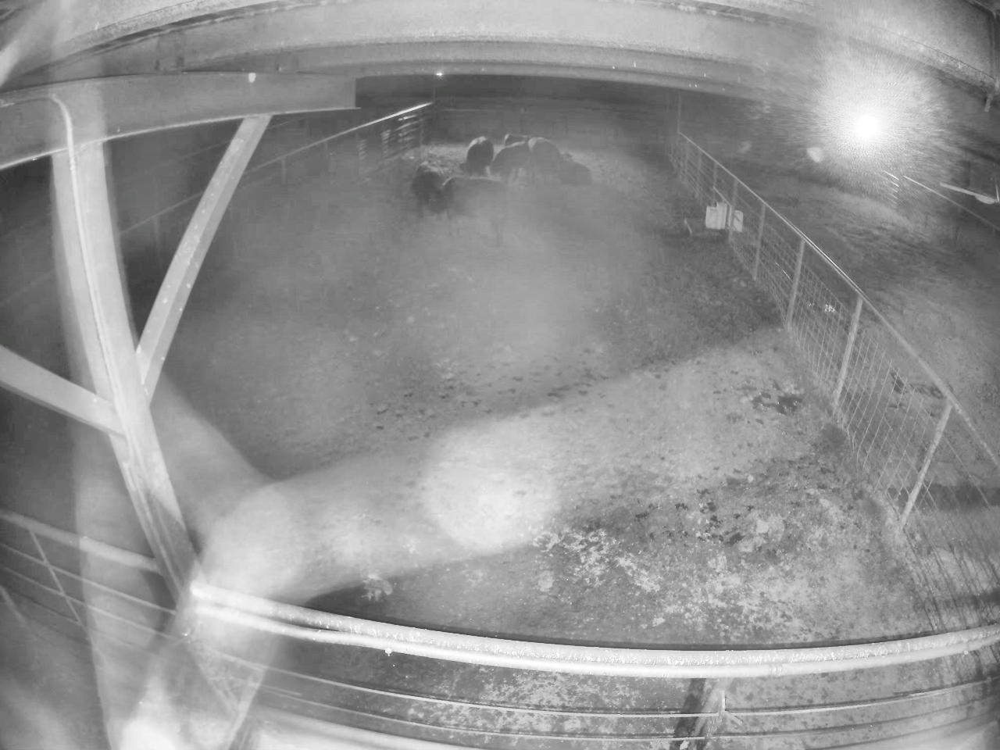
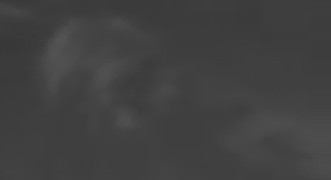
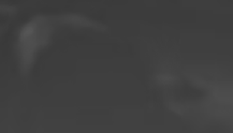
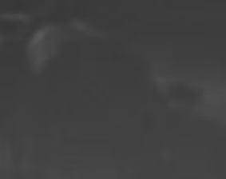
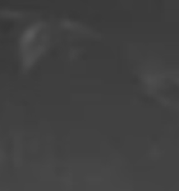
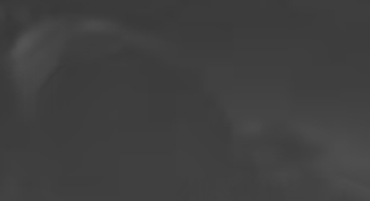

# Trace COW_05_d1_m1085
**Cow** COW_05 · **day** 1 · **minute** 1085 · night=True
**Tier-1:** [['ruminating_lying', 0.7128], ['ruminating_standing', 0.2574], ['social_interaction', 0.0082]]  · id_conf=0.95 · visibility={'back': 0.0, 'front': 0.42, 'top': 0.0}

1. **Gate** → agent (night_low_confidence, rare_class_modest_conf)
2. **night_check** {"camera": "front", "brightness": 101.6, "saturation": 0.0, "ir_like": true, "is_night": true}
3. _vlm call_ `plan` tokens=2965+718 5.44s cached=False repaired=False
4. **Plan** (llm): The main uncertainty is whether the cow is lying or standing, while rumination must be measured rather than inferred from stills. Because this is nighttime and visibility is limited, I will identify the best view, use posture/history measurements, and confirm jaw periodicity with a high-frame-rate probe.  steps=['best_camera', 'enhance_night', 'cow_history', 'track_history', 'rumination_probe', 'temporal_window']
5. **Tool** `best_camera` {} _(why: This identifies which camera provides the most reliable view of COW_05 before selecting image-based checks.; by planner)_ → ok=True facts={"visible_frac": {"back": 0.0, "front": 0.42, "top": 0.0}, "best_camera": "front"}
6. **Tool** `enhance_night` {'camera': 'auto', 't_offset_s': 0.0} _(why: Night enhancement is needed before relying on any visual posture or identity cues in the dark frame.; by planner)_ → ok=True facts={"camera": "front", "brightness_before": 101.6, "brightness_after": 146.9, "ir_like": true, "looks_like_night": true}
   
7. **Tool** `cow_history` {'lookback_min': 30} _(why: This checks whether COW_05 is already in a continuous lying or rumination bout, using history only as supporting context.; by planner)_ → ok=True facts={"available": true, "recent_runs": "social_interaction x3 > ruminating_standing x3 > social_interaction x1 > standing x1 > social_interaction x6 > standing x1 > other_not_visible x2 > ruminating_standing x10 > other_not_visible x3", "current_bout": {"label": "other_not_visible", "minutes": 3, "ends_
8. **Tool** `track_history` {'window_s': 90.0} _(why: This directly tests posture and movement around the minute to separate recumbent from upright rumination.; by planner)_ → ok=True facts={"speed_mean": 0.502, "speed_max": 1.27, "displacement_m": 0.45, "unit": "m/s", "posture_mode": "unknown", "posture_changes": 0, "n_records": 28, "camera": "front", "prev_label": "other_not_visible", "next_label_tier1": "ruminating_standing"}
9. **Tool** `rumination_probe` {'camera': 'auto', 'seconds': 8.0} _(why: This measures jaw-motion periodicity because rumination cannot be established from a still image.; by planner)_ → ok=True facts={"camera": "front", "jaw_motion_score": 0.002, "periodicity_hz": 0.62, "rumination_likely": false, "note": "heuristic; thresholds are assumptions"}
10. **Tool** `temporal_window` {'camera': 'auto', 'before_s': 15.0, 'after_s': 15.0, 'n_frames': 6} _(why: This checks whether the cow remains identifiable and whether posture is sustained or changes during the minute.; by planner)_ → ok=True facts={"camera": "front", "n_frames": 4, "span_s": [-15.0, 15.0]}
   
   
   
   
11. _vlm call_ `hypothesis` tokens=2511+320 3.44s cached=False repaired=False
12. **Hypothesis** (first): `other_not_visible` conf=0.88 cues=['Front enhanced IR images are very dark and heavily occluded, with no identifiable view of COW_05', 'Posture is unknown in track measurements', 'Rumination probe reports rumination_likely=false with jaw_motion_score 0.002', 'Night enhancement indicates an infrared night scene'] alts=[['standing', 0.06], ['ruminating_standing', 0.04]]
13. **Verifier** (first) → hard=0 soft=0 · all passed
14. **second_look** {"camera": "front", "steps": [{"tool": "get_frames", "args": {"camera": "front"}, "reason": "a second, independent look from the front (best remaining view), so one blind spot cannot decide the label", "source": "second_look"}, {"tool": "zoom", "args": {"camera": "front", "region": "head"}, "reason"
15. **Tool** `get_frames` {'camera': 'front', 't_offset_s': 0.0} _(why: a second, independent look from the front (best remaining view), so one blind spot cannot decide the label; by second_look)_ → ok=True facts={"camera": "front", "t_offset_s": 0.0, "available": true}
   
16. **Tool** `zoom` {'camera': 'front', 'region': 'head', 't_offset_s': 0.0, 'scale': 2.0} _(why: inspect the head from the front (best remaining view) to test the cues behind 'other_not_visible'; by second_look)_ → ok=True facts={"camera": "front", "region": "head", "available": true}
   
17. **Verifier** (after_second_look) → hard=0 soft=0 · all passed
18. _vlm call_ `critique` tokens=1940+190 2.15s cached=False repaired=False
19. **Critique** → accept (alt=standing) The strongest alternative is standing, but the new front body and head images remain too dark and occluded to establish identity or posture, and the measurements report unknown posture with rumination_likely=false. Thus no visible or measured evidence supports standing or ruminating_lying over other_not_visible.
20. **decision** {"behavior": "other_not_visible", "confidence": 0.85, "reason": "agent_accept", "correction": "abstained", "rationale": "Not visible enough to judge (YOLO said 'ruminating_lying'): COW_05 cannot be reliably identified or classified in the dark, obstructed front-camera images, and the measurements do

## Every action and the reason for it

| # | actor | action | reason | outcome |
|---|---|---|---|---|
| 1 | gate | gate:agent | escalation rules: night_low_confidence, rare_class_modest_conf | agent |
| 2 | agent | night_check | measure brightness and colour saturation of the actual frame, so night/infrared handling does not depend on the clock or an upstream flag | brightness=101.6, saturation=0.0, ir_like=True -> night=True |
| 3 | vlm | plan | The main uncertainty is whether the cow is lying or standing, while rumination must be measured rather than inferred from stills. Because this is nighttime and visibility is limited, I will identify the best view, use posture/history measurements, and confirm jaw periodicity with a high-frame-rate probe. | 6 steps: ['best_camera', 'enhance_night', 'cow_history', 'track_history', 'rumination_probe', 'temporal_window'] |
| 4 | tool | tool:best_camera | This identifies which camera provides the most reliable view of COW_05 before selecting image-based checks. | ok {"visible_frac":{"back":0.0,"front":0.42,"top":0.0},"best_camera":"front"} |
| 5 | tool | tool:enhance_night | Night enhancement is needed before relying on any visual posture or identity cues in the dark frame. | ok {"camera":"front","brightness_before":101.6,"brightness_after":146.9,"ir_like":true,"looks_like_night":true} |
| 6 | tool | tool:cow_history | This checks whether COW_05 is already in a continuous lying or rumination bout, using history only as supporting context. | ok {"available":true,"recent_runs":"social_interaction x3 > ruminating_standing x3 > social_interaction x1 > standing x1 > social_interaction x6 > standing x1 > |
| 7 | tool | tool:track_history | This directly tests posture and movement around the minute to separate recumbent from upright rumination. | ok {"speed_mean":0.502,"speed_max":1.27,"displacement_m":0.45,"unit":"m/s","posture_mode":"unknown","posture_changes":0,"n_records":28,"camera":"front","prev_la |
| 8 | tool | tool:rumination_probe | This measures jaw-motion periodicity because rumination cannot be established from a still image. | ok {"camera":"front","jaw_motion_score":0.002,"periodicity_hz":0.62,"rumination_likely":false,"note":"heuristic; thresholds are assumptions"} |
| 9 | tool | tool:temporal_window | This checks whether the cow remains identifiable and whether posture is sustained or changes during the minute. | ok {"camera":"front","n_frames":4,"span_s":[-15.0,15.0]} |
| 10 | vlm | hypothesis:first | independent look at the evidence without YOLO's guess | other_not_visible conf=0.88; COW_05 cannot be reliably identified or classified in the dark, obstructed front-camera images, and the measurements do not establi |
| 11 | verifier | verify:first | deterministic rule check of the label against measurements, independent of the VLM | all checks passed |
| 12 | agent | escalate_second_look | independent look says 'other_not_visible' but YOLO said 'ruminating_lying' | second look + critique |
| 13 | tool | tool:get_frames | a second, independent look from the front (best remaining view), so one blind spot cannot decide the label | ok {"camera":"front","t_offset_s":0.0,"available":true} |
| 14 | tool | tool:zoom | inspect the head from the front (best remaining view) to test the cues behind 'other_not_visible' | ok {"camera":"front","region":"head","available":true} |
| 15 | verifier | verify:after_second_look | deterministic rule check of the label against measurements, independent of the VLM | all checks passed |
| 16 | vlm | critique | argue against the proposed label using the new evidence before it is accepted | accept (alt=standing): The strongest alternative is standing, but the new front body and head images remain too dark and occluded to establish identity or postu |
| 17 | resolver | final_decision | Not visible enough to judge (YOLO said 'ruminating_lying'): COW_05 cannot be reliably identified or classified in the dark, obstructed front-camera images, and the measurements do not establish posture or rumination. Standing or ruminating_standing are weaker because posture is unknown and the rumination probe is negative.. Night/infrared frame: confidence capped and fine cues need a measurement. | abstained: ruminating_lying -> other_not_visible |

## Decision: `other_not_visible` conf=0.85 · reason=agent_accept · source=not_visible · flags=['disagrees_with_tier1', 'night']
**Correction:** abstained · **Why:** Not visible enough to judge (YOLO said 'ruminating_lying'): COW_05 cannot be reliably identified or classified in the dark, obstructed front-camera images, and the measurements do not establish posture or rumination. Standing or ruminating_standing are weaker because posture is unknown and the rumination probe is negative.. Night/infrared frame: confidence capped and fine cues need a measurement.