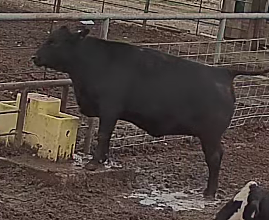
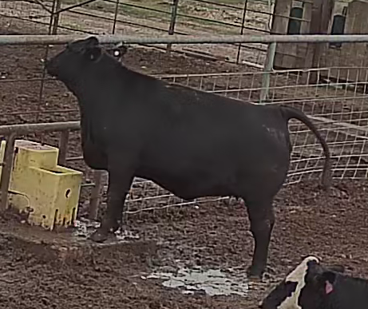
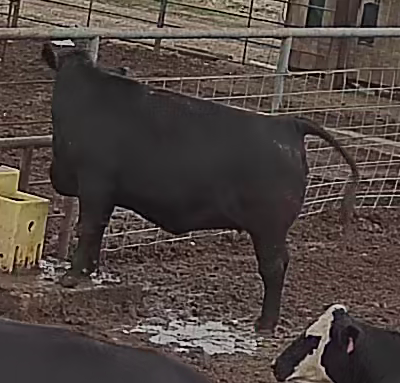
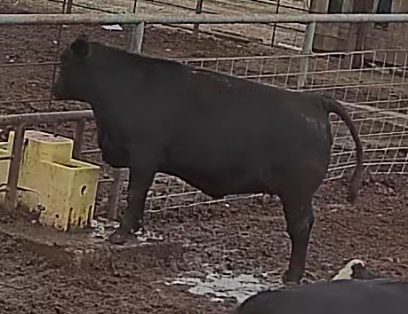
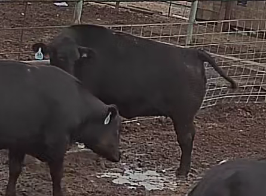
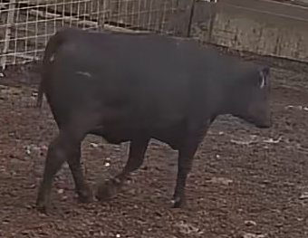
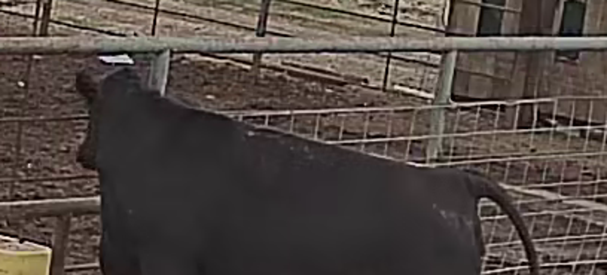

# Trace COW_02_d1_m0862
**Cow** COW_02 · **day** 1 · **minute** 862 · night=False
**Tier-1:** [['drinking', 0.6933], ['walking', 0.3054]]  · id_conf=0.925 · visibility={'back': 0.96, 'front': 0.307, 'top': 0.0}

1. **Gate** → agent (camera_disagreement, rare_class_modest_conf)
2. **night_check** {"camera": "back", "brightness": 116.8, "saturation": 0.189, "ir_like": false, "is_night": false}
3. _vlm call_ `plan` tokens=2925+508 3.63s cached=False repaired=False
4. **Plan** (llm): The main uncertainty is drinking versus walking, while camera disagreement and a contradictory drinking-zone flag require independent checks. I will first verify visibility and spatial location, then assess displacement, bout context, and visual head position over time.  steps=['best_camera', 'zone_query', 'track_history', 'cow_history', 'temporal_window', 'zoom', 'get_frames', 'get_frames']
5. **Tool** `best_camera` {} _(why: This identifies which camera provides the most reliable view because the cameras currently disagree.; by planner)_ → ok=True facts={"visible_frac": {"back": 0.96, "front": 0.307, "top": 0.0}, "best_camera": "back"}
6. **Tool** `zone_query` {} _(why: This tests whether the cow's head and body were actually at the waterer rather than merely near another zone.; by planner)_ → ok=True facts={"available": true, "zone_fractions": {"feed_bunk": 0.016666666666666666, "waterer": 0.0, "resting": 0.7333333333333333, "open": 0.13333333333333333}, "head_in_bunk_frac": 0.016666666666666666, "source": "fused_state", "note": "zones come from the tracking state (body position, no separate waterer z
7. **Tool** `track_history` {'window_s': 90.0} _(why: This measures sustained displacement and speed needed to distinguish walking from a stationary drinking event.; by planner)_ → ok=True facts={"speed_mean": 0.262, "speed_max": 1.09, "displacement_m": 9.81, "unit": "m/s", "posture_mode": "unknown", "posture_changes": 0, "n_records": 60, "camera": "back", "prev_label": "drinking", "next_label_tier1": "feeding"}
8. **Tool** `cow_history` {'lookback_min': 30} _(why: This provides context about the cow's current drinking or walking bout without treating prior labels as proof.; by planner)_ → ok=True facts={"available": true, "recent_runs": "ruminating_lying x6 > lying x1 > ruminating_lying x6 > lying x1 > ruminating_lying x5 > drinking x4 > standing x1 > drinking x1 > standing x1 > drinking x1 > other_not_visible x2 > drinking x1", "current_bout": {"label": "drinking", "minutes": 1, "ends_minutes_ago
9. **Tool** `temporal_window` {'camera': 'auto', 'before_s': 20.0, 'after_s': 20.0, 'n_frames': 6} _(why: This shows whether the cow remains at the waterer or travels across the pen during the minute.; by planner)_ → ok=True facts={"camera": "back", "n_frames": 6, "span_s": [-20.0, 20.0]}
   
   
   
   
   
   
10. **Tool** `zoom` {'camera': 'auto', 'region': 'head', 't_offset_s': 0.0, 'scale': 3.0} _(why: This checks the muzzle's relation to the waterer and whether the head is lowered for drinking.; by planner)_ → ok=True facts={"camera": "back", "region": "head", "available": true}
   
11. **Tool** `get_frames` {'camera': 'auto', 't_offset_s': -20.0} _(why: This supplies an earlier whole-body view to verify identity, position, and whether movement toward or away from the waterer occurred.; by planner)_ → ok=True facts={"camera": "back", "t_offset_s": -20.0, "available": true}
   
12. **Tool** `get_frames` {'camera': 'auto', 't_offset_s': 20.0} _(why: This supplies a later whole-body view to compare displacement and persistence of the candidate behavior.; by planner)_ → ok=True facts={"camera": "back", "t_offset_s": 20.0, "available": true}
   
13. _vlm call_ `hypothesis` tokens=2968+433 5.31s cached=False repaired=False
14. **Hypothesis** (first): `walking` conf=0.96 cues=['Cow is visibly upright on four legs in the supplied frames and changes position across frames', 'Measured displacement is 9.81 m over the minute with mean speed 0.262 and maximum speed 1.09', 'Waterer zone fraction is 0.0 and head-in-bunk fraction is only 0.0167'] alts=[['standing', 0.03], ['drinking', 0.01]]
15. **Verifier** (first) → hard=0 soft=0 · all passed
16. **decision** {"behavior": "walking", "confidence": 0.96, "reason": "agent_accept", "correction": "behavior_corrected", "rationale": "YOLO said 'drinking' but the evidence supports 'walking': Walking is dominant because the cow is upright and visibly changes location, while tracking measured 9.81 m of displacemen

## Every action and the reason for it

| # | actor | action | reason | outcome |
|---|---|---|---|---|
| 1 | gate | gate:agent | escalation rules: camera_disagreement, rare_class_modest_conf | agent |
| 2 | agent | night_check | measure brightness and colour saturation of the actual frame, so night/infrared handling does not depend on the clock or an upstream flag | brightness=116.8, saturation=0.189, ir_like=False -> night=False |
| 3 | vlm | plan | The main uncertainty is drinking versus walking, while camera disagreement and a contradictory drinking-zone flag require independent checks. I will first verify visibility and spatial location, then assess displacement, bout context, and visual head position over time. | 8 steps: ['best_camera', 'zone_query', 'track_history', 'cow_history', 'temporal_window', 'zoom', 'get_frames', 'get_frames'] |
| 4 | tool | tool:best_camera | This identifies which camera provides the most reliable view because the cameras currently disagree. | ok {"visible_frac":{"back":0.96,"front":0.307,"top":0.0},"best_camera":"back"} |
| 5 | tool | tool:zone_query | This tests whether the cow's head and body were actually at the waterer rather than merely near another zone. | ok {"available":true,"zone_fractions":{"feed_bunk":0.016666666666666666,"waterer":0.0,"resting":0.7333333333333333,"open":0.13333333333333333},"head_in_bunk_fra |
| 6 | tool | tool:track_history | This measures sustained displacement and speed needed to distinguish walking from a stationary drinking event. | ok {"speed_mean":0.262,"speed_max":1.09,"displacement_m":9.81,"unit":"m/s","posture_mode":"unknown","posture_changes":0,"n_records":60,"camera":"back","prev_lab |
| 7 | tool | tool:cow_history | This provides context about the cow's current drinking or walking bout without treating prior labels as proof. | ok {"available":true,"recent_runs":"ruminating_lying x6 > lying x1 > ruminating_lying x6 > lying x1 > ruminating_lying x5 > drinking x4 > standing x1 > drinking |
| 8 | tool | tool:temporal_window | This shows whether the cow remains at the waterer or travels across the pen during the minute. | ok {"camera":"back","n_frames":6,"span_s":[-20.0,20.0]} |
| 9 | tool | tool:zoom | This checks the muzzle's relation to the waterer and whether the head is lowered for drinking. | ok {"camera":"back","region":"head","available":true} |
| 10 | tool | tool:get_frames | This supplies an earlier whole-body view to verify identity, position, and whether movement toward or away from the waterer occurred. | ok {"camera":"back","t_offset_s":-20.0,"available":true} |
| 11 | tool | tool:get_frames | This supplies a later whole-body view to compare displacement and persistence of the candidate behavior. | ok {"camera":"back","t_offset_s":20.0,"available":true} |
| 12 | vlm | hypothesis:first | independent look at the evidence without YOLO's guess | walking conf=0.96; Walking is dominant because the cow is upright and visibly changes location, while tracking measured 9.81 m of displacement during the minute |
| 13 | verifier | verify:first | deterministic rule check of the label against measurements, independent of the VLM | all checks passed |
| 14 | resolver | final_decision | YOLO said 'drinking' but the evidence supports 'walking': Walking is dominant because the cow is upright and visibly changes location, while tracking measured 9.81 m of displacement during the minute. Standing is weaker because the measured displacement is substantial, and drinking is unsupported by the zero waterer-zone fraction.; all automatic checks passed. | behavior_corrected: drinking -> walking |

## Decision: `walking` conf=0.96 · reason=agent_accept · source=model_estimate · flags=['disagrees_with_tier1']
**Correction:** behavior_corrected · **Why:** YOLO said 'drinking' but the evidence supports 'walking': Walking is dominant because the cow is upright and visibly changes location, while tracking measured 9.81 m of displacement during the minute. Standing is weaker because the measured displacement is substantial, and drinking is unsupported by the zero waterer-zone fraction.; all automatic checks passed.